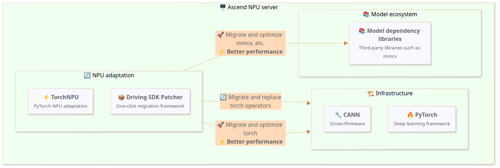
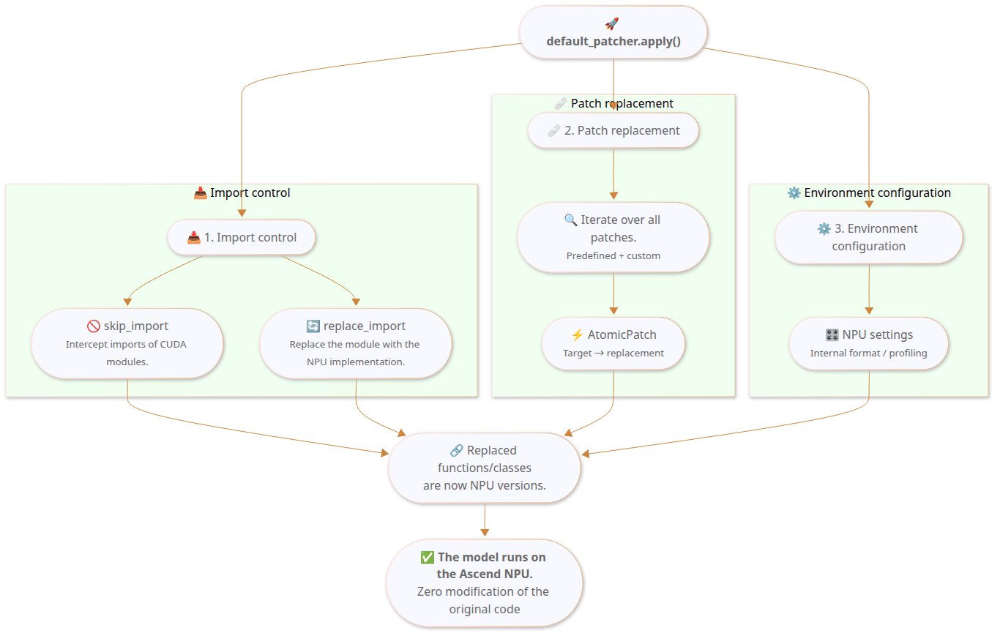
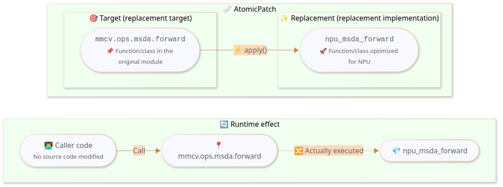

# One-Click Patcher

## Why One-Click Patcher

Open-source autonomous driving models are usually built on the **CUDA ecosystem**. The chip architecture of the Ascend NPU differs fundamentally from that of GPUs: the operator implementations, memory management, and software stack invocation methods are all different. This means that when you migrate an open-source model to the Ascend platform, you need to:

- Replace CUDA-specific operators with NPU implementations
- Handle incompatible third-party libraries, such as `flash_attn` and `torch_scatter`
- Adjust the data formats and precision policies
- Modify the distributed training logic

These adaptation tasks are scattered across many files. The traditional approach is to modify the model source code directly. This causes several problems: **messy code management** (the original code is mixed with the adaptation code), **difficult upgrades** (you need to re-adapt after upstream updates), and **recompilation after third-party library changes** (for example, the custom operators of `mmcv`).

**One-Click Patcher** is a runtime replacement framework provided by Driving SDK and based on **Monkey Patch**. Monkey Patch is a technique that dynamically replaces the attributes of modules, classes, functions, or methods at runtime, changing the behavior of the program without modifying the original source code. One-Click Patcher uses this mechanism to achieve **zero-intrusion migration from CUDA to NPU**: without changing a single character of the original code, the adaptation is completed through dynamic replacement at runtime.

Specifically, One-Click Patcher solves the following problems:

| Problem | Solution |
|------|----------|
| Large migration workload and high barrier to entry | Encapsulate common adaptations as predefined patches that can be applied with one line of code. |
| Modifying third-party library source code requires recompilation | Replace at runtime, without modifying or recompiling the source code of libraries such as `mmcv`. |
| Adaptation code is coupled with the original code | Patches are independent of the model code, and the **source code** is fully decoupled from the **migration code** |
| Migration experience is hard to reuse | Consolidate verified adaptation solutions into predefined patches that new models can reuse directly. |
| Lack of practical features for the Ascend environment | Built-in tools such as performance collection (Profiling) and early stop of training (Brake) |

### About `default_patcher`

`default_patcher` is a Patcher instance preconfigured by the framework. It already contains common NPU optimization patches, that is, patches for libraries such as `mmcv`, `torch`, and `numpy`. For details, see the [predefined patch list](#predefined-patch-list).

**Note**: `default_patcher` does not guarantee complete migration for all models. Some models may require additional custom patches to handle specific CUDA dependencies or operator replacements.

### `default_patcher` + Custom Patches

When a model has proprietary CUDA operators that need additional handling:

```python
from mx_driving.patcher import default_patcher, Patch, AtomicPatch
from mx_driving.patcher.patch import with_imports

class MyCustomPatch(Patch):
    """Custom patch description"""

    @classmethod
    def patches(cls, options=None):
        return [
            AtomicPatch(
                "target_module.target_function",
                cls._replacement,
                precheck=cls._precheck,          # Optional: pre-application check
                runtime_check=cls._runtime_check, # Optional: runtime check
            ),
        ]

    @staticmethod
    def _precheck():
        """Pre-application check; returns False to skip this patch"""
        ...

    @staticmethod
    def _runtime_check(*args, **kwargs):
        """Runtime check; returns False to fall back to the original function"""
        ...

    @staticmethod
    @with_imports("module")  # Declares the external modules that the function depends on
    def _replacement(...):
        """Replacement function implementation"""
        ...

default_patcher.add(MyCustomPatch)
default_patcher.apply()
```

Notes:

- `Patch.name` is now optional. If it is not defined explicitly, the class name is used automatically as the default identifier.
- `disable()` accepts both a string name and a `Patch` class or patch instance directly, for example, `default_patcher.disable(MyCustomPatch)`.
- If you want to replace a conflicting patch that is already enabled in `default_patcher`, you are advised to call `disable()` on the default patch first, and then `add()` the patch you want to enable.

If your model requires additional import control or project patches besides the default patches, the recommended entry-point pattern is:

```python
from mx_driving.patcher import default_patcher
from migrate_to_ascend.patch import configure_patcher

configure_patcher(default_patcher)
default_patcher.apply()

from tools.train import main
main()
```

### Quick Overview of Common Features

```python
from mx_driving.patcher import default_patcher, AtomicPatch

default_patcher.skip_import("<cuda_module>")                     # Skip the CUDA module
default_patcher.replace_import("<old_module>", "<new_module>")   # Replace the entire module
default_patcher.inject_import("<src>", "<name>", "<target>")     # Inject an import
default_patcher.add(AtomicPatch("<target>", replacement))        # Add a patch
default_patcher.with_profiling("<output_dir>")                   # Collect profiling data
default_patcher.brake_at(<step>)                                 # Stop training early
default_patcher.allow_internal_format()                          # Allow the NPU internal format
default_patcher.apply()                                          # Apply all patches
```

### How to Choose Import Control

The three types of import control solve three different problems:

| Scenario | Recommended API | Typical Example |
|------|---------|----------|
| The module does not exist in the Ascend environment at all, but the subsequent execution path never really runs it | `skip_import()` | `flash_attn` and `torch_scatter` are only imported at the top of the file, and the real execution path is taken over by NPU patches |
| The problem occurs at the module import boundary, and you need to replace the entire module entry | `replace_import()` | DiffusionDrive switches the exports of `projects.mmdet3d_plugin.ops.deformable_aggregation` to the NPU implementation |
| A class or function is defined in a submodule, but the parent module does not export it correctly, causing `from pkg import Name` to fail | `inject_import()` | DiffusionDrive adds classes such as `V1SparseDrive` and `V1SparseDriveHead` back to `projects.mmdet3d_plugin.models` |

A real `configure_patcher()` snippet usually uses all three at the same time:

```python
patcher.skip_import("flash_attn", "torch_scatter")
patcher.replace_import(
    "projects.mmdet3d_plugin.ops.deformable_aggregation",
    DeformableAggregationFunction=_DeformableAggregationFunction,
)
patcher.inject_import(
    "projects.mmdet3d_plugin.models.sparsedrive_v1",
    "V1SparseDrive",
    "projects.mmdet3d_plugin.models",
)
```

## Custom Patch Example: Gaussian Kernel Weight NPU Optimization

The following complete example shows how to replace a CUDA implementation with an NPU-optimized implementation.

1. Original CUDA implementation

    Assume the target module `my_model.ops.gaussian` contains the following function:

    ```python
    # File: my_model/ops/gaussian.py (original CUDA implementation)
    import math
    import torch

    def compute_gaussian_weights(distances, sigma):
        """Computes Gaussian kernel weights (CUDA version)"""
        variance = 2.0 * sigma * sigma
        weights = torch.exp(-distances * distances / variance)
        norm_factor = 1.0 / (sigma * math.sqrt(2 * math.pi))
        return weights * norm_factor
    ```

2. NPU-optimized implementation

    On the NPU, you want to use the fused operators provided by `torch_npu` to improve performance:

    ```python
    # NPU-optimized version
    import math
    import torch_npu

    def compute_gaussian_weights(distances, sigma):
        """Computes Gaussian kernel weights (NPU-optimized version)"""
        variance = 2.0 * sigma * sigma
        weights = torch_npu.npu_exp(-distances * distances / variance)  # Uses the fused NPU operator
        norm_factor = 1.0 / (sigma * math.sqrt(2 * math.pi))
        return weights * norm_factor
    ```

3. Write a Patch to replace the implementation

    ```python
    from mx_driving.patcher import default_patcher, Patch, AtomicPatch
    from mx_driving.patcher.patch import with_imports
    import torch

    class GaussianWeightsPatch(Patch):
        """NPU optimization for Gaussian kernel weight computation"""
        name = "gaussian_weights"

        @classmethod
        def patches(cls, options=None):
            return [
                AtomicPatch(
                    "my_model.ops.gaussian.compute_gaussian_weights",
                    cls._compute_gaussian_weights_npu,
                    runtime_check=cls._check_fp32,  # Uses the NPU optimization only for FP32 inputs
                ),
            ]

        @staticmethod
        def _check_fp32(distances, sigma):
            """Runtime check: uses the NPU optimization only for FP32 inputs and falls back to the original implementation for other dtypes"""
            return distances.dtype == torch.float32

        @staticmethod
        @with_imports("math", "torch_npu")  # Declares the external modules that the function depends on
        def _compute_gaussian_weights_npu(distances, sigma):
            """NPU-optimized implementation"""
            variance = 2.0 * sigma * sigma
            weights = torch_npu.npu_exp(-distances * distances / variance)  # noqa: F821
            norm_factor = 1.0 / (sigma * math.sqrt(2 * math.pi))  # noqa: F821
            return weights * norm_factor

    default_patcher.add(GaussianWeightsPatch)
    default_patcher.apply()
    ```

**Key Points:**

| Feature | Purpose |
|------|------|
| `with_imports` | Declares the external modules that the function depends on. |
| `runtime_check` | Checks the input dtype at runtime. The NPU optimization is used only for FP32 inputs, and FP16 or BF16 inputs automatically fall back to the original implementation. |
| `AtomicPatch` | Specifies the target path to replace and the replacement function. |

## Execution Process

### Overall Environment

One-Click Patcher works in the following environment chain:



### What Happens Behind `apply()`?



**Key point**: `apply()` must be called before all other `import` statements. Patcher implements patches by replacing module attributes. If the target module has already been imported and its attributes have been referenced by other modules, the patch will not take effect.

---

## Core Concept: Atomic Patch

The smallest unit of work in One-Click Patcher is `AtomicPatch` (atomic patch), which performs one precise runtime replacement:



- `target`: The path of the original attribute to replace, for example, `"mmcv.ops.msda.forward"`.
- `replacement`: The new implementation after replacement, that is, the NPU-optimized version.

In the places where the original model code calls `mmcv.ops.msda.forward()`, the NPU version is actually executed after `apply()`, while the code text does not change at all.

### Patch and Patcher

| Concept | Description |
|------|------|
| **AtomicPatch** | The smallest patch unit. It performs a single `target` → `replacement` replacement |
| **Patch** | A composite patch that organizes multiple related AtomicPatch units, for example, the `forward` and `backward` of one operator |
| **Patcher** | The patch manager. It collects, organizes, and applies all patches, and provides auxiliary features such as import control |
| **default_patcher** | A preconfigured Patcher instance that already contains common predefined patches and works out of the box |

## Predefined Patch List

The framework includes verified NPU adaptation patches that new models can reuse directly.
> [!NOTE]
>
> ✅ means the patch is already included in `default_patcher` and takes effect when `apply()` is called.
> ❌ means you need to add the patch manually through `patcher.add()`.
>
>`NumpyCompat` is an early compatibility patch among the default patches. It restores removed aliases such as `np.bool`, `np.float`, and `np.int`, preventing third-party libraries from failing early at import time due to NumPy compatibility issues.

| Module | Patch Name | Description | `default_patcher` |
|------|----------|------|:---------------:|
| **mmcv** | MultiScaleDeformableAttention | Multi-scale deformable attention | ✅ |
| | DeformConv | Deformable convolution | ✅ |
| | ModulatedDeformConv | Modulated deformable convolution | ✅ |
| | SparseConv3D | 3D sparse convolution | ✅ |
| | Stream | CUDA stream management | ✅ |
| | DDP | Distributed data parallel | ✅ |
| | Voxelization | Voxelization | ❌ |
| | OptimizerHooks | Optimizer hooks (`mmcv` 1.x) | ❌ |
| **mmengine** | OptimizerWrapper | Optimizer wrapper | ❌ |
| **mmdet** | PseudoSampler | Pseudo sampler | ❌ |
| | ResNetAddRelu | ResNet with fused ReLU | ✅ |
| | ResNetMaxPool | ResNet max pooling | ✅ |
| | ResNetFP16 | ResNet FP16 support | ❌ |
| **mmdet3d** | NuScenesDataset | NuScenes dataset | ✅ |
| | NuScenesMetric | NuScenes evaluation metrics | ✅ |
| **numpy** | NumpyCompat | NumPy compatibility fix | ✅ |
| **torch** | TensorIndex | Tensor indexing optimization | ✅ |
| | BatchMatmul | Batch matrix multiplication | ✅ |
| **torch_scatter** | TorchScatter | NPU implementation of scatter operations | ❌ |
| **transformers** | TransformersNPU | `transformers` NPU composite patch (>=4.51.0) | ❌ |
| **diffusers** | DiffusersNPU | `diffusers` NPU composite patch (==0.35.1) | ❌ |

## File Organization of Migration Code

You are advised to place all migration-related code in a separate `migrate_to_ascend/` folder to physically decouple the **source code** (the original model code) from the **migration code** (the NPU adaptation code):

```shell
my_model/                          ← Source Code
├── configs/                         Not modified at all
├── projects/
│   ├── models/
│   └── ops/
├── tools/
│   ├── train.py                     Original training script
│   └── test.py
│
├── migrate_to_ascend/             ← Migration Code
│   ├── patch.py                     Patch definitions and patcher configuration
│   ├── train.py                     Ascend training entry (based on the original train.py, with patcher code added at the top)
│   ├── test.py                      Ascend test entry (based on the original test.py, with patcher code added at the top)
│   ├── train_8p.sh                  8-device distributed training script
│   └── requirements.txt             Ascend environment dependencies
│
├── README.md
└── setup.py
```

**Advantages of This Organization**:

- **Zero intrusion**: No file in the `my_model/` directory is modified.
- **One-click migration**: Copy the `migrate_to_ascend/` folder into the open-source model repository and it runs directly.
- **Dual-stack coexistence**: The same repository and the same branch can support both CUDA and Ascend environments at the same time.
- **Independent management**: Version control of the migration code does not interfere with the original model code.

**Training Entry Example** (`migrate_to_ascend/train.py`):

```python
from mx_driving.patcher import default_patcher
from migrate_to_ascend.patch import configure_patcher

configure_patcher(default_patcher)
default_patcher.apply()

from tools.train import main
main()
```

For real project references, see the `migrate_to_ascend/` directories of [DiffusionDrive](../../../model_examples/DiffusionDrive/README.md) and [PanoOcc](../../../model_examples/PanoOcc/README.md).

## Utility Features

### Collecting Performance Profiling Data

```python
default_patcher.with_profiling("path/to/profiling/", level=1)

# Precisely control the step parameters for profiling collection
default_patcher.with_profiling("path/to/profiling/", level=1,
                                skip_first=100,
                                wait=1,
                                warmup=5,
                                active=10,
                                repeat=2)
default_patcher.apply()
```

Default step control parameters: `skip_first=20`, `wait=1`, `warmup=1`, `active=1`, `repeat=1`.

- `level`: 0 means recording only NPU activity, 1 means NPU and CPU activity, and 2 means NPU and CPU activity plus the call stack.
- `skip_first`: Skips the first `N` iterations to exclude initialization overhead.
- `wait`: Waits for the system to stabilize before recording starts.
- `warmup`: Warm-up phase, during which operations execute but nothing is recorded.
- `active`: Number of iterations during which data is actually recorded.
- `repeat`: Number of times the whole process repeats. A value of 0 means no repetition.
- Total iterations = `skip_first + (wait + warmup + active) × (repeat + 1)`.

### Early Brake for Training

```python
default_patcher.brake_at(1000)  # Stops automatically at step 1000
default_patcher.apply()
```

### Combining Profiling and Brake

Using Profiling and Brake together stops training automatically after profiling collection completes:

```python
default_patcher.with_profiling("/path/to/prof", level=1).brake_at(500).apply()
```
