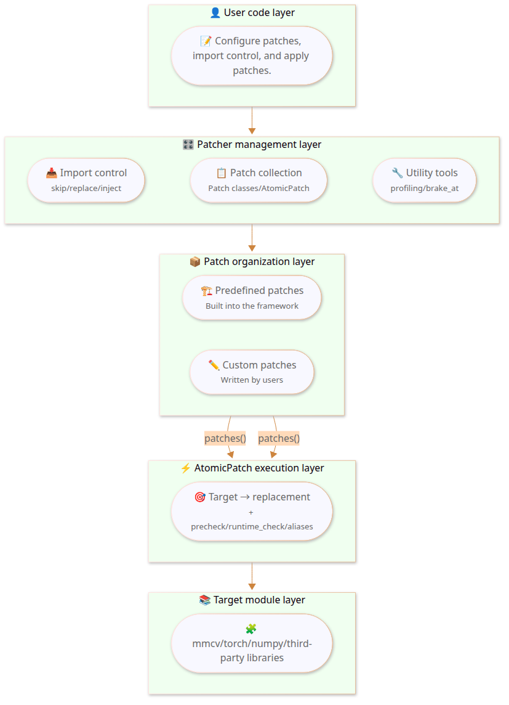
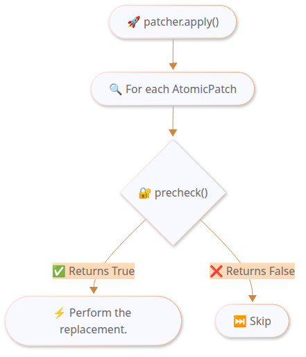
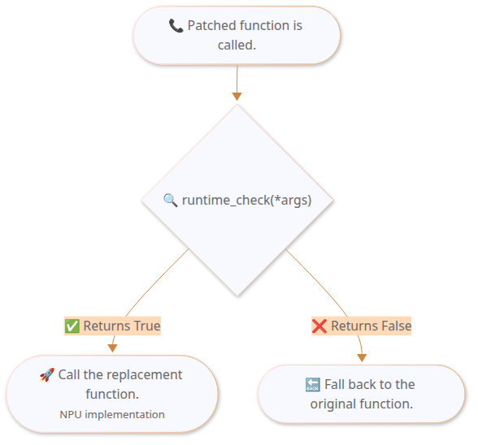

# Feature Guide

<!-- This file uses <a id> anchors for TOC link validity. markdownlint MD033 is disabled for the entire file. -->
<!-- markdownlint-disable MD033 -->

This document explains the features of One-Click Patcher in detail, including use cases, parameter descriptions, and code examples.

> For the basic concepts and quick start, see [One-Click Patcher](./patcher.md).

***

## Table of Contents

<!-- markdownlint-disable MD051 -->

- [Architecture Overview](#architecture-overview)
- [Import Control](#import-control)
    - [`skip_import` - Skipping Unavailable Modules](#skip_import---skipping-unavailable-modules)
    - [`replace_import` - Replacing Module Imports](#replace_import---replacing-module-imports)
    - [`inject_import` - Injecting Missing Imports](#inject_import---injecting-missing-imports)
- [Patch Mechanism](#patch-mechanism)
    - [`AtomicPatch` - Atomic Patch](#atomicpatch---atomic-patch)
    - [`Patch` - Composite Patch](#patch---composite-patch)
    - [`RegistryPatch` - Registry Patch](#registrypatch---registry-patch)
    - [`aliases` - Module Re-export Handling](#aliases---module-re-export-handling)
    - [`precheck` - Pre-Application Checks](#precheck---pre-application-checks)
    - [`runtime_check` - Runtime Condition Dispatch](#runtime_check---runtime-condition-dispatch)
    - [`with_imports` - Lazy Import Decorator](#with_imports---lazy-import-decorator)
    - [`target_wrapper` - Original Function Wrapper](#target_wrapper---original-function-wrapper)
    - [`replacement_wrapper` - Replacement Function Wrapper](#replacement_wrapper---replacement-function-wrapper)
- [Utility Tools](#utility-tools)
    - [`with_profiling` - Performance Profiling](#with_profiling---performance-profiling)
    - [`brake_at` - Early Training Stop](#brake_at---early-training-stop)
    - [`allow_internal_format` - NPU Internal Format Control](#allow_internal_format---npu-internal-format-control)
    - [Logging Configuration](#logging-configuration)
    - [Patch Status View](#patch-status-view)
- [Best Practices](#best-practices)
- [Advanced Usage](#advanced-usage)
    - [Custom Patcher (Without `default_patcher`)](#custom-patcher-without-default_patcher)
    - [Legacy Compatibility (1.0 API)](#legacy-compatibility-10-api)

<!-- markdownlint-enable MD051 -->
- [Why Choose the 2.0 Style?](#why-choose-the-20-style)
- [Notes](#notes)

***

## Architecture Overview

### Layered Architecture



***

## Import Control

### Selection Guide

The three import-control APIs solve three different problems. First decide which layer the problem occurs in:

| Problem | API to Use | Must It Run Before the Target Import? |
| ------------------------------------------ | ------------------ | ------------------------------ |
| A CUDA-specific dependency does not exist in the current environment, but later logic never actually executes it. | `skip_import()` | Yes |
| The original module itself should be taken over by another module or by an export table as a whole. | `replace_import()` | Yes |
| The parent module omits a class or function, which makes `from pkg import Name` fail. | `inject_import()` | Preferably yes. It runs immediately, but if the consumer has already failed during import, it is still too late. |

Real-life cases in the repository:

- `skip_import()`: DiffusionDrive and PanoOcc skip `flash_attn` and `torch_scatter` at the entry point.
- `replace_import()`: DiffusionDrive replaces the exports of `projects.mmdet3d_plugin.ops.deformable_aggregation` with the NPU implementation.
- `inject_import()`: DiffusionDrive adds back classes such as `V1SparseDrive` and `V1SparseDriveHead` into `projects.mmdet3d_plugin.models`.

<a id="skip_import"></a>

### `skip_import` - Skipping Unavailable Modules

**Use Case**: When you run an open-source model, you may hit a `ModuleNotFoundError` because the missing module belongs to the CUDA ecosystem, such as `flash_attn` or `torch_scatter`. These modules do not exist in the Ascend environment and do not need to be installed. This kind of import may appear in multiple files throughout the model code. Finding and deleting them one by one is tedious and also changes the original code. `skip_import` intercepts those import requests without changing any source code and returns a harmless stub object.

**Behavior**: Imports of the skipped module and all its submodules succeed, but the returned value is a stub object. Attribute access returns another stub, and function calls return `None`.

```python
patcher.skip_import("flash_attn", "torch_scatter")

# The following imports now succeed without errors:
from flash_attn.flash_attn_interface import flash_attn_func  # -> Stub
from flash_attn.any.deep.path import anything                # -> Stub
import torch_scatter                                          # -> Stub
```

Real-life case:

```python
# Common pattern in DiffusionDrive / PanoOcc entry points
patcher.skip_import("flash_attn")
patcher.skip_import("torch_scatter")
```

Prerequisites:

- These modules are only imported. The original implementation is never reached at runtime.
- If downstream logic really depends on the computation the module provides, `skip_import()` only gets the import through. It does not replace the functionality. In that case, you should usually use `replace_import()` instead.

***

<a id="replace_import"></a>

### `replace_import` - Replacing Module Imports

**Use Case**: Replace a CUDA operator module with an NPU implementation. Unlike `skip_import`, the replacement module provides a real, usable implementation.

It helps to think of the second argument as a module stand-in. The latter replaces the former.

The default recommendation order is:

1. **Replace the entire module**. Use the simplest form: `replace_import("old.module", "new.module")`.
2. **Provide only an export table**. Use `replace_with.module(...)`, but this is an advanced usage.
3. **Use one module as a template and override its exports**. Use `replace_with.module(...)`, which is also an advanced usage.

```python
# Option 1: Replace with another module entirely. This is the most direct and the default recommendation
patcher.replace_import("cuda_ops.special_op", "mx_driving.npu_ops")

# Option 2: Replace specific exports in a module
# When code runs `from projects.ops.cuda_op import MyFunction`, it gets `NPUImpl`
from mx_driving.patcher import replace_with

patcher.replace_import(
    "projects.ops.cuda_op",
    replace_with.module(
        MyFunction=NPUImpl,
        AnotherFunc=NPUAnotherImpl,
    ),
)

# Option 3: Use another module as a template and override specific exports
patcher.replace_import(
    "old.module",
    replace_with.module("new.module", SpecialFunc=custom_impl),
)
```

Compatible syntax:

```python
patcher.replace_import("projects.ops.cuda_op", MyFunction=NPUImpl)
patcher.replace_import("old.module", base_module="new.module", exports={"SpecialFunc": custom_impl})
```

Current behavior and limitations:

- `replace_import()` now prefers to preserve the real parent package and namespace package. It no longer pollutes the parent package with an empty stub. Standard import forms such as `import pkg.mod` and `from pkg import mod` are both supported.
- If the target module already exists in `sys.modules`, `replace_import()` skips it and emits a warning. This is the most important current limitation and also the most common reason it appears ineffective.
- When you use `base_module` or `replace_with.module("new.module")`, the stand-in module is a snapshot copy of the exports from the source module with `exports` overrides layered on top. It is not a live proxy to the original module.

Real-life case in the repository:

```python
# DiffusionDrive: keep the project code importing the original path,
# but actually receive the NPU version of DeformableAggregationFunction that we provide
patcher.replace_import(
    "projects.mmdet3d_plugin.ops.deformable_aggregation",
    DeformableAggregationFunction=_DeformableAggregationFunction,  # Existing compatible syntax in the repository
)
```

Explanation:

- The existing model-migration code in the repository still uses this compatible `**kwargs` form.
- If you are writing new code, you are advised to switch to `replace_with.module(DeformableAggregationFunction=...)`, because it makes it easier to see at a glance that the latter is the module stand-in.

This case is suitable for `replace_import()` but not for `AtomicPatch()` because:

- The risk occurs at the module import boundary, not after a function has already been imported successfully.
- Downstream code uses `from ... import DeformableAggregationFunction`.
- We need to take over the module export table at import time.

Timing example:

```python
# ✅ Correct: call replace_import before importing the target module
patcher.replace_import("pkg.cuda_op", "pkg.npu_op")
from pkg.cuda_op import run

# ❌ Too late: the target module is already in sys.modules
from pkg.cuda_op import run
patcher.replace_import("pkg.cuda_op", "pkg.npu_op")
```

#### Advanced Usage: Replacing Only Part of a Module Export

This kind of syntax means:

```python
from mx_driving.patcher import replace_with

patcher.replace_import(
    "pkg.cuda_op",
    replace_with.module(MyKernel=MyNpuKernel),
)
```

It does not mean "patch the `pkg.cuda_op.MyKernel` attribute". Instead:

1. First create a new stand-in module, `pkg.cuda_op`.
2. Then attach exports such as `MyKernel=MyNpuKernel` to that stand-in module.
3. Later, when code imports `pkg.cuda_op` or `from pkg.cuda_op import MyKernel`, it receives the exports from that stand-in module.

Therefore, the applicable scenario is narrow, and the syntax is also easy to misuse. Ask yourself two questions first:

- Does the problem occur at the module import boundary rather than after a function has already been imported successfully?
- Does the downstream code consume the module exports through `from pkg.cuda_op import MyKernel`?

Only when both answers are closer to "yes" is this form usually appropriate.

One more concrete mental model:

```python
# User code
from pkg.cuda_op import MyKernel

# replace_import does not do this:
# pkg.cuda_op.MyKernel = MyNpuKernel
#
# Instead, it is more like this:
# fake_module = ModuleType("pkg.cuda_op")
# fake_module.MyKernel = MyNpuKernel
# sys.modules["pkg.cuda_op"] = fake_module
```

Real-life case, continued from the DiffusionDrive example:

```python
patcher.replace_import(
    "projects.mmdet3d_plugin.ops.deformable_aggregation",
    replace_with.module(
        DeformableAggregationFunction=_DeformableAggregationFunction,
    ),
)
```

Why `AtomicPatch()` is not used here:

- The risk occurs at the import and export boundary of the `projects.mmdet3d_plugin.ops.deformable_aggregation` module.
- Downstream code consumes the `DeformableAggregationFunction` export.
- We need to take over the entire module entry at import time, rather than modifying attributes after the module has already been imported successfully.

The limitations of this approach deserve even stronger emphasis than for full-module replacement:

- It depends even more on your accurate understanding of precisely what the target module exports.
- If downstream code actually imports a different symbol from the module instead of the export you replaced, this approach will have no effect.
- If what you actually need is "the module can import fine, and only certain functions or classes need different implementations," then `AtomicPatch()` is usually more direct and less likely to confuse readers.

In summary:

- Treat `replace_import("old.module", "new.module")` as the standard capability.
- Treat `replace_with.module(MyKernel=...)` as a specialized capability — use it only when you explicitly need to construct a stand-in module export table.

***

<a id="inject_import"></a>

### `inject_import` - Injecting Missing Imports

**Use Case**: An open-source model omits some imports itself, for example a class is not exported in `__init__.py`, which causes an `ImportError` at runtime. This is rare, but when it happens, `inject_import` can fix the problem without modifying the model code.

```python
# Scenario: MyClass is defined in a.b.c, but a.b's `__init__.py` forgets to export it
# This makes `from a.b import MyClass` fail
patcher.inject_import("a.b.c", "MyClass", "a.b")
# After the fix: `from a.b import MyClass` works

# Scenario: NPU migration needs to add extra classes to the target module
patcher.inject_import(
    "mx_driving.npu_ops",        # Source module where the class is defined
    "NPUSpecialOp",              # Name to inject
    "projects.ops",              # Target module to inject into
)
```

Real-life case:

```python
patcher.inject_import(
    "projects.mmdet3d_plugin.models.sparsedrive_v1",
    "V1SparseDrive",
    "projects.mmdet3d_plugin.models",
)
```

Current behavior details:

- `inject_import()` runs immediately when called. It does not wait for `apply()`.
- If the target module already has an attribute with the same name, it does not overwrite the original value.
- If the target module defines `__all__`, the injected name is added to `__all__` whenever possible.

***

## Patch Mechanism

<a id="atomicpatch"></a>

### `AtomicPatch` - Atomic Patch

AtomicPatch is the most basic patch unit. It performs a single `target` → `replacement` substitution.

```python
# Minimal form: specify the target path and the replacement function
AtomicPatch("mmcv.ops.func", npu_func)

# Replacement in string form (lazy resolution to avoid circular imports)
AtomicPatch("module.func", "mx_driving.ops.npu_func")
```

**Full Parameters**:

```python
AtomicPatch(
    target="mmcv.ops.msda.forward",      # Original attribute path to replace
    replacement=npu_forward,             # Replacement implementation (must provide at least one of replacement and target_wrapper)
    aliases=["mmcv.ops.MSDA.forward"],   # List of alias paths
    precheck=lambda: mmcv_version.is_v2x, # Check before applying
    runtime_check=check_dtype,           # Runtime condition dispatch
    target_wrapper=wrap_fn,              # Wrap the original function
    replacement_wrapper=add_logging,     # Wrap the replacement
)
```

***

<a id="patch"></a>

### `Patch` - Composite Patch

Patch groups multiple related AtomicPatches together. Deep-learning operators often need both a forward and a backward method replaced. Therefore, a composite patch is the most common organizational form.

```python
from mx_driving.patcher import Patch, AtomicPatch
from mx_driving.patcher.patch import with_imports

class MyOpPatch(Patch):
    @classmethod
    def patches(cls, options=None):
        return [
            AtomicPatch("module.Op.forward", cls._forward),
            AtomicPatch("module.Op.backward", cls._backward),
        ]

    @staticmethod
    @with_imports(("torch_npu", "npu_op"))
    def _forward(ctx, x):
        return npu_op(x)  # noqa: F821

    @staticmethod
    def _backward(ctx, grad):
        return grad
```

Additional notes:

- `Patch.name` is now optional. If you do not define it explicitly, the class name is used by default. For example, the default name for the patch above is `MyOpPatch`.
- If you need a stable external identifier, you are still advised to define `name` explicitly, for example when a patch can be disabled by user configuration, must migrate across versions, or must align with `legacy_name`.
- `patcher.disable()` accepts three kinds of arguments: a string name, a `Patch` class, or a patch instance. The 2.0 style recommends calling `patcher.disable(MyOpPatch)` directly.

***

<a id="registrypatch"></a>

### `RegistryPatch` - Registry Patch

Use this to register a class with the `mmcv`/`mmengine` Registry:

```python
from mx_driving.patcher import RegistryPatch

RegistryPatch(
    "mmcv.runner.HOOKS",      # Registry path
    MyOptimizerHook,          # Class to register
    name="OptimizerHook",     # Registration name
    force=True,               # Force overwrite of an existing registration
)
```

***

<a id="aliases"></a>

### `aliases` - Module Re-export Handling

**Use Case**: You wrote an AtomicPatch for a specific `target`. You filled in the path of that attribute in the source file as the target, but the patch did not take effect.

This is usually because the open-source model imports the target in one of the following ways, which means the target actually exists under multiple paths:

1. **`from ... import ...`**: the target is imported directly into the namespace of another module.
2. **`import ... as ...`**: the target is imported under a renamed alias.
3. **`__init__.py` re-export**: the target is lifted to a higher-level path through the `__init__.py` of the package.

If the model code uses these **alias paths** rather than the original definition path of the target, replacing only the original path is not enough. The `aliases` parameter specifies **all alias paths for the target** so that every access path is replaced.

```python
# Example: mmcv.ops.__init__.py contains
# from .multi_scale_deform_attn import MultiScaleDeformableAttnFunction
# This gives the same class two access paths

AtomicPatch(
    # Original definition path of the target
    "mmcv.ops.multi_scale_deform_attn.MultiScaleDeformableAttnFunction.forward",
    npu_forward,
    aliases=[
        # Alias path after the target is re-exported through `__init__.py`
        "mmcv.ops.MultiScaleDeformableAttnFunction.forward",
    ],
)
```

***

<a id="precheck"></a>

### `precheck` - Pre-Application Checks

`precheck` runs when `patcher.apply()` is called. If it returns `False`, the patch is skipped and no replacement occurs. It is commonly used for version constraints.



```python
from mx_driving.patcher import mmcv_version

AtomicPatch(
    "mmcv.ops.msda.forward",
    npu_forward,
    precheck=lambda: mmcv_version.is_v2x,  # Apply only for mmcv 2.x
)
```

***

<a id="runtime_check"></a>

### `runtime_check` - Runtime Condition Dispatch

`runtime_check` runs every time a patched function is called. It dynamically chooses whether to call the **replacement function** (the NPU implementation) or the **original function**. The parameters must match the target function.



```python
def check_fp32(input_tensor, weight, bias=None):
    """Use the NPU optimization only for FP32 tensors."""
    return input_tensor.dtype == torch.float32

AtomicPatch(
    "module.conv",
    npu_conv,
    runtime_check=check_fp32,
)
```

***

<a id="with_imports"></a>

### `with_imports` - Lazy Import Decorator

**Use Case**: When you write a replacement function, you often need to import some NPU-related modules, such as `torch_npu`. Writing `import` statements directly inside the function body creates the following problems:

- **Circular Import**: Module A imports module B, and module B imports module A, which causes an `ImportError`. If the module that defines the replacement function imports the target module during import time, it may trigger a circular import.
- **Lazy Import**: Some modules can only be imported at a specific time, for example after `apply()` runs. Importing them at the top of the module fails.
- **Inconsistent Code Style**: If you put `import` statements inside the function body, the replacement function looks noticeably different from the original function, which hurts readability.

`with_imports` declares dependencies through a decorator and performs the imports only when the function is called for the first time. The imports are injected into the global namespace of the function. This lets the replacement function keep the same style as the original function. The imports stay out of the function body, and the API call site looks the same.

**Syntax**:

```python
from mx_driving.patcher.patch import with_imports

@with_imports(
    "module_name",                    # Import the entire module: import module_name
    ("module", "attr"),               # Import from a module: from module import attr
    ("module", "attr", "alias"),      # Import with an alias: from module import attr as alias
)
def my_function():
    pass
```

Two enhanced forms are also supported:

```python
# Form 4: Lazy decorator form using an @ expression
@with_imports(
    ("mmcv.runner", "auto_fp16"),
    "@auto_fp16(apply_to=('q', 'k', 'v'), out_fp32=True)",
)
def forward(self, q, k, v):
    ...

# Form 5: Legacy apply_decorators form
@with_imports(
    ("module.constants", "VALUE"),
    apply_decorators=[
        ("wi_decorator_mod.my_decorator", {"multiplier": 3}),
    ],
)
def func():
    return VALUE  # noqa: F821
```

**Examples**:

```python
# String form: import the entire module
@with_imports("torch_npu", "math")
def forward(x, sigma):
    return torch_npu.npu_exp(x) * math.sqrt(sigma)  # noqa: F821

# Tuple form: import a specific name from a module
@with_imports(("torch_npu", "npu_fusion_attention"))
def attention(q, k, v):
    return npu_fusion_attention(q, k, v, head_num=8)  # noqa: F821

# Import with an alias
@with_imports(("torch_npu.npu_ops", "npu_matmul", "matmul"))
def compute(a, b):
    return matmul(a, b)  # noqa: F821

# Mixed form
@with_imports(
    "math",
    ("torch_npu", "npu_fusion_attention"),
    ("module.constants", "SCALE_FACTOR"),
)
def _forward(self, q, k, v):
    return npu_fusion_attention(q, k, v) * SCALE_FACTOR  # noqa: F821

# Use an @ expression to add a lazy decorator to the replacement
@with_imports(
    ("torch", "no_grad"),
    "@no_grad()",
)
def inference(x):
    return x
```

> The `# noqa: F821` comment suppresses IDE and lint warnings about undefined variables, because these variables are injected at runtime.

Notes:

- `@with_imports` must be placed below `@staticmethod` or `@classmethod`, that is, closer to the function definition.
- Do not stack multiple layers of `@with_imports` on the same function. The current implementation emits a warning, and the recommended approach is to merge them into a single decorator call.
- `apply_decorators` is still supported, but new code is better off using the `@decorator_expr` form, because it is more direct and closer to ordinary Python decorators.

***

<a id="target_wrapper"></a>

### `target_wrapper` - Original Function Wrapper

Use this to add logic, such as synchronization or logging, on top of the original function rather than replacing it completely. When you use it, **do not provide `replacement`**.

```python
def add_stream_sync(original):
    def wrapper(self, *args, **kwargs):
        import torch_npu
        torch_npu.npu.synchronize()
        result = original(self, *args, **kwargs)
        torch_npu.npu.synchronize()
        return result
    return wrapper

AtomicPatch("model.Module.forward", target_wrapper=add_stream_sync)
```

> If you provide both `replacement` and `target_wrapper`, `replacement` takes precedence and `target_wrapper` does not take effect.

***

<a id="replacement_wrapper"></a>

### `replacement_wrapper` - Replacement Function Wrapper

Use this to add extra wrapping to the replacement function, such as logging or timing.

| Comparison | target_wrapper | replacement_wrapper |
| ------- | --------------- | -------------------- |
| Wrapped object | Original function | Replacement function |
| Can access the original function | Yes, passed as an argument | No |

```python
def add_logging(func):
    def wrapper(*args, **kwargs):
        print("calling npu_func")
        return func(*args, **kwargs)
    return wrapper

AtomicPatch("module.func", npu_func, replacement_wrapper=add_logging)
```

***

## Utility Tools

### Version Detection

When you write `precheck`, you often need to inspect the version of a dependency library. The framework provides convenient version-detection utilities:

```python
from mx_driving.patcher import mmcv_version
from mx_driving.patcher.version import get_version, check_version

# mmcv version detection
if mmcv_version.is_v1x:
    print("mmcv 1.x detected")
if mmcv_version.is_v2x:
    print("mmcv 2.x detected")
if mmcv_version.has_mmcv:
    print(f"mmcv version: {mmcv_version.version}")

# General version detection
torch_version = get_version("torch")  # Returns the version string, such as "2.1.0"
is_torch_2x = check_version("torch", major=2)  # Check the major version number
is_torch_2_1 = check_version("torch", major=2, minor=1)  # Check the major and minor version numbers
```

**Common Usage**:

```python
# Apply different patches according to the mmcv version
AtomicPatch(
    "mmcv.ops.msda.forward",
    npu_forward_v2,
    precheck=lambda: mmcv_version.is_v2x,
)

AtomicPatch(
    "mmcv.ops.msda.forward",
    npu_forward_v1,
    precheck=lambda: mmcv_version.is_v1x,
)
```

***

<a id="with_profiling"></a>

### `with_profiling` - Performance Profiling

Collect NPU performance data during the training loop and generate a profiling report.

```python
patcher.with_profiling(
    "/output/prof",    # Output directory
    level=1,           # 0 = minimum, 1 = NPU + CPU, 2 = include call stacks
    skip_first=100,    # Skip the first N iterations
    wait=1,            # Number of iterations to wait before recording
    warmup=5,          # Number of warmup iterations
    active=10,         # Number of iterations during which data is recorded
    repeat=2,          # Number of times to repeat the whole process
)
```

**Total Iterations** = `skip_first + (wait + warmup + active) × (repeat + 1)`.

***

<a id="brake_at"></a>

### `brake_at` - Early Training Stop

Stop training at a specified step for debugging or performance testing:

```python
patcher.brake_at(1000)  # Stop at step 1000
```

***

### <a id="allow_internal_format"></a>`allow_internal_format` - NPU Internal Format Control

NPU internal format is a data-layout optimization for Ascend NPU. It may improve the performance of some operators, but it may also introduce accuracy issues in some scenarios.

**Default Behavior**: Disable the internal format to ensure maximum compatibility.

```python
patcher.allow_internal_format()       # Enable it. It may improve performance, but you need to verify accuracy
patcher.disallow_internal_format()    # Disable it. This is the default
```

**Recommendation**: Keep the default during the first migration. Try enabling it only after functionality verification passes.

***

### Logging Configuration

Logging currently has four layers of control. It is best to understand them separately:

1. `set_patcher_log_level()`/`patcher_logger.set_level()`: the Python logger threshold. It determines the lowest level that is emitted.
2. `configure_patcher_logging(on_apply=..., ...)`: event actions. It determines whether each event is logged, muted, raised as an exception, or exits the process.
3. `patcher_logger.configure_summary(...)`: controls whether the summary at the end of `apply()` is printed, what level it uses, and which sections it shows.
4. Distributed rank filtering: by default, only rank 0 prints logs and the summary. `exception` and `exit` still run on every rank.

Example:

```python
from mx_driving.patcher import configure_patcher_logging, set_patcher_log_level, patcher_logger
import logging

# Strict mode: fail by raising an exception
configure_patcher_logging(
    on_apply="info",        # Patch applied successfully
    on_skip="warning",      # Patch skipped
    on_fail="exception",    # Patch application failed -> raise PatchError
    on_error="exception",   # Unexpected error -> raise PatchError
)

# Quiet mode
configure_patcher_logging(
    on_apply="debug",
    on_skip="silent",       # Do not log
    on_fail="warning",
    on_error="error",
)

# Summary configuration is independent
patcher_logger.configure_summary(
    level=logging.INFO,
    show_applied=True,
    show_skipped=False,
    show_failed=True,
)

# The logger level affects both immediate logs and the summary
set_patcher_log_level(logging.INFO)
```

The optional values in `configure_patcher_logging()` are not all "log levels". More precisely, they are event actions:

- `"debug"`/`"info"`/`"warning"`/`"error"`: log at the corresponding level.
- `"exception"`: raise `PatchError`.
- `"exit"`: log the error and terminate the program.
- `"silent"`: stay completely silent, and by default also hide the corresponding section in the summary.

In distributed training, logs are automatically limited to rank 0 only:

```python
from mx_driving.patcher import patcher_logger
patcher_logger.set_rank_from_env()  # Detect automatically from environment variables
```

Notes:

- `apply()` does not directly `print()` each item by default. Instead, it buffers the results and then emits a layered summary through the logger.
- Because the summary now also goes through the logger, `set_patcher_log_level(logging.WARNING)` affects whether the summary is visible as well.

***

### Patch Status View

```python
patcher.print_info()            # View the patch application status
patcher.print_info(diff=True)   # Include code diffs. This can produce a large amount of output and is useful for debugging
```

Example output:

```text
======================================================================
  MX-DRIVING PATCHER SUMMARY
======================================================================
  Applied Patches:
    [mmcv] (2.1.0)
      multi_scale_deformable_attention:
        + mmcv.ops.msda.forward
        + mmcv.ops.msda.backward
  Skipped Patches:
    [mmcv] (2.1.0)
      deform_conv:
        ~ mmcv.ops.dc.forward (precheck failed)
======================================================================
```

***

## Best Practices

### Complete Model Migration Configuration

```python
# migrate_to_ascend/patch.py
"""DiffusionDrive model NPU migration configuration."""
from mx_driving.patcher import Patcher, Patch, AtomicPatch, replace_with
from mx_driving.patcher.patch import with_imports

# CUDA-specific modules to skip
SKIP_MODULES = ["flash_attn", "torch_scatter"]

# Missing imports to inject
INJECT_IMPORTS = [
    ("projects.mmdet3d_plugin.models.sparsedrive_v1", "V1SparseDrive", "projects.mmdet3d_plugin.models"),
]

class FlashAttentionPatch(Patch):
    """Flash Attention NPU implementation."""
    name = "flash_attention_npu"

    @classmethod
    def patches(cls, options=None):
        return [
            AtomicPatch(
                "projects.mmdet3d_plugin.models.attention.FlashAttention.forward",
                cls._forward,
            ),
        ]

    @staticmethod
    @with_imports(("torch_npu", "npu_fusion_attention"))
    def _forward(self, q, k, v, causal=False, key_padding_mask=None):
        scale = self.softmax_scale or (q.shape[-1]) ** (-0.5)
        output = npu_fusion_attention(  # noqa: F821
            q, k, v, q.shape[-2],
            input_layout="BSND",
            scale=scale,
        )[0]
        return output, None


class DeformableAggregationWrapper:
    """Redirect the CUDA implementation to the NPU implementation in mx_driving."""
    @staticmethod
    def apply(*args, **kwargs):
        import mx_driving
        return mx_driving.deformable_aggregation(*args, **kwargs)


def configure_patcher(patcher: Patcher, performance: bool = False) -> Patcher:
    """Configure the Patcher for the DiffusionDrive model."""
    patcher.skip_import(*SKIP_MODULES)

    patcher.replace_import(
        "projects.mmdet3d_plugin.ops.deformable_aggregation",
        replace_with.module(DeformableAggregationFunction=DeformableAggregationWrapper),
    )

    for source, name, target in INJECT_IMPORTS:
        patcher.inject_import(source, name, target)

    patcher.add(FlashAttentionPatch)

    if performance:
        patcher.brake_at(1000)

    return patcher
```

### Chained Calls

```python
(default_patcher
    .skip_import("flash_attn", "torch_scatter")
    .add(MyPatch)
    .with_profiling("/prof", level=1)
    .brake_at(500)
    .apply())
```

### Simple Model Migration

```python
# At the very top of train.py
from mx_driving.patcher import default_patcher, Patch, AtomicPatch, replace_with
from mx_driving.patcher.patch import with_imports

# Skip a non-existent module
default_patcher.skip_import("cuda_extension")

# Replace the entire CUDA module entry
default_patcher.replace_import("my_model.ops.cuda_impl", "my_model.ops.npu_impl")

# Or replace only specific exports in the original module
default_patcher.replace_import(
    "my_model.ops.special",
    replace_with.module(SpecialKernel=my_npu_kernel),
)

# Use with_imports to delay dependency imports
class CustomOpPatch(Patch):
    name = "custom_op"

    @classmethod
    def patches(cls, options=None):
        return [
            AtomicPatch("my_model.ops.custom_op", cls._npu_op),
        ]

    @staticmethod
    @with_imports(("torch_npu", "npu_add"))  # Delay the import to avoid circular dependencies
    def _npu_op(x, y):
        return npu_add(x, y)  # noqa: F821

default_patcher.add(CustomOpPatch)
default_patcher.apply()

# Normal imports and training afterward
import torch
from my_model import Model

model = Model()
```

***

## Advanced Usage

### Custom Patcher (Without `default_patcher`)

When you need full control over the patch list, you can create a standalone `Patcher`:

```python
from mx_driving.patcher import Patcher, MultiScaleDeformableAttention

patcher = Patcher()
patcher.add(MultiScaleDeformableAttention)  # Add only the patches you need
patcher.add(MyCustomPatch)
patcher.apply()
```

### Legacy Compatibility (1.0 API)

Version 2.0 is fully compatible with the 1.0 API:

```python
from mx_driving.patcher import PatcherBuilder, Patch, msda

patcher_builder = PatcherBuilder()
patcher_builder.add_module_patch("mmcv", Patch(msda))

with patcher_builder.build() as patcher:
    train()
```

***

## Why Choose the 2.0 Style?

Compared with the function-based style in 1.0, the declarative style in 2.0 has the following advantages:

| Dimension | 1.0 | 2.0 |
| ---- | -------- | -------- |
| Design paradigm | Imperative | Declarative |
| Patch granularity | Coarse-grained (function level) | Fine-grained (attribute level) |
| Traceability | Poor | Excellent |
| Testability | Difficult | Easy |
| Code reuse | Difficult | Easy |
| Error localization | Vague | Precise |
| Backward compatibility | - | Fully compatible |

**Better Readability**: The black-box functions in 1.0 make it hard to understand what gets replaced at a glance. The declarative list in 2.0 makes this clear immediately.

**Fine-grained Control**: 1.0 can only disable an entire patch function. 2.0 can disable a single replacement.

**Code Reuse**: 2.0 patches can be composed and reused through `*OtherPatch.patches()`.

**Better Error Handling**: 2.0 error messages point to the specific target path.

***

## Notes

### Call Order

```python
# Correct order
patcher.skip_import("flash_attn")      # 1. Configure import control first
patcher.replace_import(...)            # 2. Replace modules
patcher.inject_import(...)             # 3. Inject imports
patcher.add(MyPatch)                   # 4. Add patches
patcher.apply()                        # 5. Apply at the end

# ❌ Incorrect: the target module has already been imported before skip_import
import flash_attn                       # Already imported!
patcher.skip_import("flash_attn")       # Ineffective
```

The same applies to `replace_import()` and `inject_import()` that depend on parent-module exports. If you place them after the target import, they also fail or arrive too late to affect the consumer.

### `apply()` Must Be at the Top

```python
# ✅ Correct
from mx_driving.patcher import default_patcher
default_patcher.apply()
import torch   # After apply()

# ❌ Incorrect
import torch   # Too early
from mx_driving.patcher import default_patcher
default_patcher.apply()  # `torch` has already been imported, so the related patches may not take effect
```

### `replacement` and `target_wrapper`

Provide at least one of them. If you provide both, `replacement` takes precedence and `target_wrapper` does not take effect.

### `runtime_check` Parameter Signature

The parameters of `runtime_check` must match those of the target function:

```python
# Target function: torch.matmul(a, b)
# The parameters of runtime_check must also be (a, b)
def check(a, b):
    return a.dim() >= 4

AtomicPatch("torch.matmul", npu_matmul, runtime_check=check)
```
