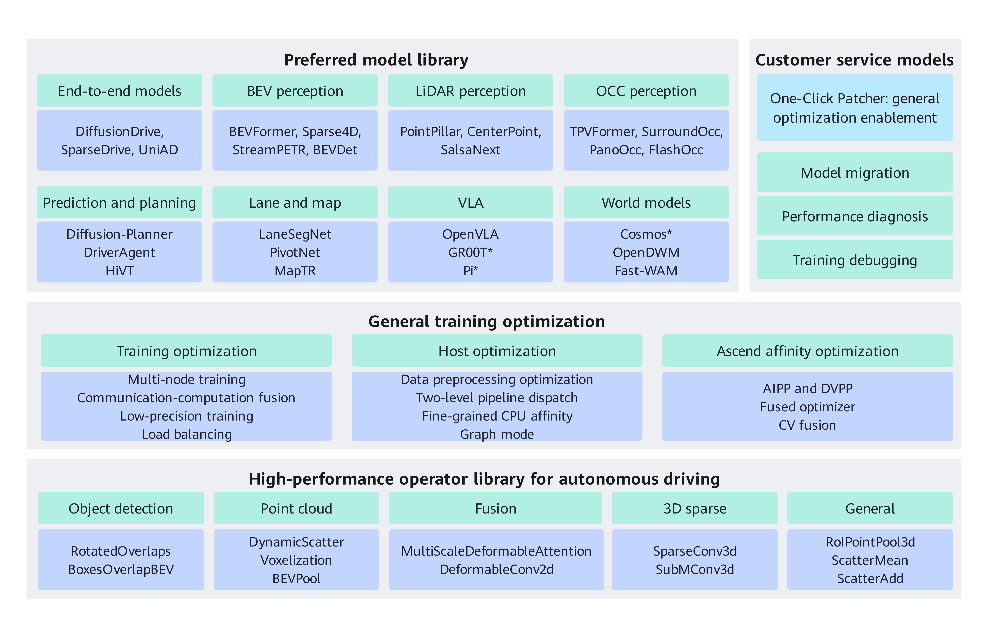

# Driving SDK Introduction

## Overview

Driving SDK is an Ascend training acceleration suite for autonomous driving, developed for Ascend AI cluster systems. It provides a high-performance operator library for autonomous driving, an optimized model library, and a one-click Patcher for rapid migration. Driving SDK is intended to provide customers and developers in the autonomous driving industry with the foundational capabilities needed to develop autonomous driving systems on Ascend compute resources.

## Driving SDK Architecture

The architecture of Driving SDK is shown in [Figure 1](#architecture). It consists of three core components and general training optimization capabilities:

- **Optimized Model Library**

    It adapts mainstream autonomous driving models from the industry to the Ascend NPU platform, covering core autonomous driving domains such as end-to-end models, BEV perception, prediction and planning, OCC perception, LiDAR perception, Lane & Map, VLA, and world models. It provides mainstream industry models such as UniAD, SparseDrive, BEVFormer, MapTR, OpenVLA, and Cosmos. Some models have been deeply optimized to achieve industry-leading performance and can be quickly reproduced and trained on the Ascend platform. For the detailed model list and performance data, see the [model list](../models/support_list.md).

- **One-Click Patcher**

    For customers' proprietary models, it provides a one-click migration framework based on the Monkey Patch mechanism to achieve zero-intrusion migration from CUDA to NPU. You do not need to modify the original source code. The adaptation is completed through dynamic replacement at runtime. Throughout the model migration and tuning process, it provides the following capabilities:
    - **Model migration**: With import control (`skip_import`/`replace_import`/`inject_import`) and predefined patches, you can quickly complete CUDA operator replacement and third-party library adaptation. NPU adaptation patches for commonly used libraries such as `mmcv`, `torch`, and `numpy` are built in, and custom patch extension is supported.
    - **Performance diagnosis**: A built-in Profiling performance collection tool supports multi-level collection (NPU/NPU+CPU/NPU+CPU+call stack) and allows precise control of the iteration interval for collection.
    - **Training debugging**: Provides debugging aids such as early stopping (Brake) and can be combined with Profiling to stop automatically once collection is complete.
    - **General optimization enablement**: Applies general training optimization methods such as communication-computation fusion and low-precision training to customer models to fully unleash Ascend hardware performance.

    For detailed usage and examples, see [One-Click Patcher](../features/patcher.md).

- **High-Performance Operator Library for Autonomous Driving**

    It provides high-performance operators covering general, sampling, voxelization, detection, sparse, and fusion directions, including typical intelligent-driving operators such as BEVPool, SparseConv3d, DynamicScatter, MultiScaleDeformableAttention, and ScatterMean, to support high-performance execution of models on Ascend hardware. The operators support <term>Atlas A2 training products</term>, <term>Atlas A3 training products</term>, and <term>Ascend 950 products</term>. For the detailed operator list, see the [API list](../api/README.md).

- **General Training Optimizations**

    This is a collection of optimization strategies commonly used in model migration and tuning. From the three dimensions of training strategies, host-side execution, and Ascend affinity optimization, it provides optimization capabilities such as multi-machine training, communication-computation fusion, low-precision training, load balancing, two-level pipeline dispatch, fine-grained core binding, graph mode, data preprocessing optimization, fused optimizers, CV fusion, and AIPP and DVPP. These optimization methods have been widely applied to model adaptation in the optimized model library and can be applied to customers' proprietary models through One-Click Patcher.

**Figure 1** Driving SDK architecture

