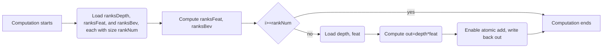

# Custom Operator

This article walks you through implementing a custom operator from scratch. We will implement a simple operator, `bev_pool_v3`. It is similar to `bev_pool_v2`, but it no longer uses a sorting algorithm, and the channel size is divisible by 8. The operator inputs and outputs are as follows:

| Name | Type | Shape | Description |
| --- | --- | --- | --- |
| depth | Tensor | `[B, N, D, H, W]` | Input, depth map. |
| feat | Tensor | `[B, N, H, W, C]` | Input, feature map. |
| ranks_depth | Tensor | `[N_RANKS]` | Input, depth map indices. |
| ranks_feat | Tensor | `[N_RANKS]` | Input, feature map indices. |
| ranks_bev | Tensor | `[N_RANKS]` | Input, BEV indices. |
| bev_feat_shape | List[int] | 5 | Input, BEV feature map shape. `B, D, H, W, C`. |
| out | Tensor | `[B, C, D, H, W]` | Output, BEV feature map. |

## Clarifying the Operator Computation Logic

The computation logic of the `bev_pool_v3` operator is as follows. Each iteration takes one depth value from the depth map, finds the corresponding feature in the feature map, multiplies them, and then accumulates the result into the corresponding position in the BEV feature map. This process repeats `N_RANKS` times.
First, we implement this operator with PyTorch, and then we convert it to AscendC. This approach helps us understand the computation logic of the operator more clearly and makes debugging easier.

```python
import torch
B, N, D, H, W = 2, 3, 4, 5, 6
N_RANKS = 7
C = 8
depth = torch.rand([B, N, D, H, W])
feat = torch.rand([B, N, H, W, C])
ranks_depth = torch.randint(0, B*N*D*H*W, [N_RANKS])
ranks_feat = torch.randint(0, B*N*H*W, [N_RANKS])
ranks_bev = torch.randint(0, B, [N_RANKS])
bev_feat_shape = [B, D, H, W, C]

def bev_pool_v3(depth, feat, ranks_depth, ranks_feat, ranks_bev, bev_feat_shape):
    B, D, H, W, C = bev_feat_shape
    depth = depth.view([B*N*D*H*W])
    feat = feat.view([B*N*H*W, C])
    out = torch.zeros([B, D, H, W, C])
    for i in range(N_RANKS):
        d = depth[ranks_depth[i]]
        f = feat[ranks_feat[i]]
        b = ranks_bev[i]
        out[b] += d * f
```

In fact, we have already implemented a simple `bev_pool_v3` operator. Next, we will convert it step by step into AscendC code for the Driving SDK.

## Adding the Operator Python API

Create a new file `bev_pool_v3.py` in the `mx_driving/point/ops` directory and add the following code:

```python
class BEVPoolV3(torch.autograd.Function):
    @staticmethod
    def forward(ctx, depth, feat, ranks_depth, ranks_feat, ranks_bev, bev_feat_shape):
        (B, D, H, W, C) = bev_feat_shape
        out = mx_driving._C.npu_bev_pool_v3(depth, feat, ranks_depth, ranks_feat, ranks_bev, B, D, H, W)
        return out

def bev_pool_v3(depth, feat, ranks_depth, ranks_feat, ranks_bev, bev_feat_shape):
    x = BEVPoolV3.apply(
        depth,
        feat,
        ranks_depth,
        ranks_feat,
        ranks_bev,
        bev_feat_shape,
    )
    x = x.permute(0, 4, 1, 2, 3).contiguous()
    return x
```

> [!NOTICE]
> We place the transpose logic in the `bev_pool_v3` function rather than in `forward`. That way, when we implement `backward`, we do not need to transpose the gradient manually again, which reduces the amount of reasoning we need to do.
>
## Adding the Operator C++ ABI

First, add the declaration of `npu_bev_pool_v3` to `_C.__init__.pyi`:

```python
def npu_bev_pool_v3(
    depth: torch.Tensor,
    feat: torch.Tensor,
    ranks_depth: torch.Tensor,
    ranks_feat: torch.Tensor,
    ranks_bev: torch.Tensor,
    B: int,
    D: int,
    H: int,
    W: int,
) -> torch.Tensor:...
```

Of course, you do not have to do this step, but it helps you get better code completion and type-checking support when you write Python code.
Then add the declaration of `npu_bev_pool_v3` to `function.h` in the `mx_driving/point/csrc` directory:

```cpp
at::Tensor npu_bev_pool_v3(const at::Tensor& depth, const at::Tensor& feat, const at::Tensor& ranks_depth,
    const at::Tensor& ranks_feat, const at::Tensor& ranks_bev, int64_t b, int64_t d, int64_t h, int64_t w);
```

Then add the binding for `npu_bev_pool_v3` in `pybind.cpp`:

```cpp
m.def("npu_bev_pool_v3", &npu_bev_pool_v3);
```

## Implementing the Operator C++ ABI

Add another new file, `BEVPoolV3.cpp`, and implement an `npu_bev_pool_v3` function that returns all zeros:

```cpp
#include "csrc/OpApiCommon.h"
#include "functions.h"
at::Tensor npu_bev_pool_v3(const at::Tensor& depth, const at::Tensor& feat, const at::Tensor& ranks_depth,
    const at::Tensor& ranks_feat, const at::Tensor& ranks_bev, int64_t b, int64_t d, int64_t h, int64_t w)
{
    auto c = feat.size(C_IDX);
    auto out = at::zeros({b, d, h, w, c}, feat.options());
    return out;
}
```

Then run `python setup.py develop`, and you can use the `bev_pool_v3` operator in Python. Of course, this operator still does not implement any real functionality. Next, we will improve it step by step.

## Adding the AscendC Operator Interface

When we run an NPU operator, the task goes from Python to our C++ ABI, then to the NPU C++ ABI, which is the CANN runtime. The runtime finds the operator binary, loads it onto the hardware for execution, and configures the inputs and outputs. Therefore, we also need to add an operator definition interface that the runtime can use to locate the binary and dispatch the compute task.
Add the following code to a new file `bev_pool_v3.cpp` in `mx_driving/point/kernels/op_host`:

```cpp
namespace ops {
class BEVPoolV3 : public OpDef {
public:
    explicit BEVPoolV3(const char* name) : OpDef(name)
    {
        this->Input("depth")
            .ParamType(REQUIRED)
            .DataType({ge::DT_FLOAT})
            .Format({ge::FORMAT_ND})
            .AutoContiguous()
            .UnknownShapeFormat({ge::FORMAT_ND});
        this->Input("feat")
            .ParamType(REQUIRED)
            .DataType({ge::DT_FLOAT})
            .Format({ge::FORMAT_ND})
            .AutoContiguous()
            .UnknownShapeFormat({ge::FORMAT_ND});
        this->Input("ranks_depth")
            .ParamType(REQUIRED)
            .DataType({ge::DT_INT32})
            .Format({ge::FORMAT_ND})
            .AutoContiguous()
            .UnknownShapeFormat({ge::FORMAT_ND});
        this->Input("ranks_feat")
            .ParamType(REQUIRED)
            .DataType({ge::DT_INT32})
            .Format({ge::FORMAT_ND})
            .AutoContiguous()
            .UnknownShapeFormat({ge::FORMAT_ND});
        this->Input("ranks_bev")
            .ParamType(REQUIRED)
            .DataType({ge::DT_INT32})
            .Format({ge::FORMAT_ND})
            .AutoContiguous()
            .UnknownShapeFormat({ge::FORMAT_ND});

        this->Output("out")
            .ParamType(REQUIRED)
            .DataType({ge::DT_FLOAT})
            .Format({ge::FORMAT_ND})
            .UnknownShapeFormat({ge::FORMAT_ND});

        this->AICore().AddConfig("ascendxxxx");
    }
};
OP_ADD(BEVPoolV3);
}  // namespace ops
```

This definition specifies the input and output data types, formats, shapes, and the supported hardware platform. With this, we have defined a `BEVPoolV3` operator. Next, we will implement its computation logic.

## Partitioning the Computation Task

Do you remember the Python operator we implemented at the beginning? The core of the computation sits inside a `for` loop. We need to split this `for` loop into multiple compute tasks, place those tasks into a compute stream, and then let multiple NPU cores execute them in parallel. There are two ways to partition tasks: A. top-down, and B. bottom-up.
A. Top-down: We first split the entire computation into multiple tasks, with each core handling only one task in parallel. Then we split each task into multiple subtasks for sequential execution inside the core. We split tasks into smaller ones because when the data volume is large enough, the cache of a single core cannot hold all the data.

```shell
                         |                |                |
        +------+------+--|------+------+--|------+------+--+---+
        | ta   |      |tb|      |      |  |      |      |  | tc|
        +------+------+--|------+------+--|------+------+--+---+
               core0     |      core1     |      ...       |core39
```

With this approach, you may encounter three task sizes: `ta`, `tb`, and `tc`. `ta` is the average-size task assigned to each core, `tb` is the tail task assigned to each core, and `tc` is the tail task on the tail core.
B. Bottom-up: We first split the entire computation into multiple subtasks, and then place those subtasks on multiple cores for parallel execution.

```shell
                             |                    |                    |
        +------+------+------|------+------+------|------+------+------|--+
        |  ta  |      |      |      |      |      |      |      |      |tb|
        +------+------+------|------+------+------|------+------+------|--+
                 core0       |         core1      |         ...        |core39
```

With this approach, you may encounter two task sizes: `ta` and `tb`. `ta` is the average-size task assigned to each core, and `tb` is the tail task on the tail core.
This way of thinking is more suitable for our `bev_pool_v3` operator because our computation process is a `for` loop. Each loop iteration is a subtask. We only need to place these subtasks on multiple cores for parallel execution and handle the last subtask specially.
How does the hardware know how we have partitioned these tasks? We need to pass the partition information to the hardware through an additional data structure called `tiling`. Add a new file `bev_pool_v3_tiling.h` in `mx_driving/point/kernels/op_host` and define the `tiling` data structure:

```cpp
namespace optiling {
BEGIN_TILING_DATA_DEF(BEVPoolV3TilingData)
TILING_DATA_FIELD_DEF(int32_t, usedCoreNum)
TILING_DATA_FIELD_DEF(int32_t, avgTaskNum)
TILING_DATA_FIELD_DEF(int32_t, tailTaskNum)
TILING_DATA_FIELD_DEF(int32_t, totalTaskNum)
TILING_DATA_FIELD_DEF(int32_t, avgRankNum)
TILING_DATA_FIELD_DEF(int32_t, tailRankNum)
TILING_DATA_FIELD_DEF(int32_t, channel)
END_TILING_DATA_DEF

REGISTER_TILING_DATA_CLASS(BEVPoolV3, BEVPoolV3TilingData) // Bind the tiling data structure to the BEVPoolV3 operator
}  // namespace optiling
```

Here, `usedCoreNum` is the number of cores involved in the computation, `totalTaskNum` is the number of task blocks, `avgTaskNum` is the average number of task blocks per core, which is the number of `ta` blocks, `tailTaskNum` is the number of task blocks on the tail core, `avgRankNum` is the average number of ranks per task block, which is the size of `ta`, `tailRankNum` is the number of ranks in the tail task block, which is the size of `tb`, and `channel` is the number of feature channels.

## Implementing the Tiling Function

In fact, the tiling function has three responsibilities. First, it passes the tensor shape information, attribute values, or other necessary runtime information for the kernel to the execution device. Second, it decides how many cores to start on the execution device. Third, it allocates the temporary memory required when the kernel runs.
Add the following code to `mx_driving/point/ops/op_host/bev_pool_v3.cpp`:

```cpp
static ge::graphStatus TilingForBEVPoolV3(gert::TilingContext* context){
    BEVPoolV3TilingData tiling;
    return ge::GRAPH_SUCCESS;
}
```

This function receives the runtime context, then determines the number of cores, the number of task blocks, the number of ranks per task block, and other information according to the input shape information and platform configuration, and fills those values into the tiling data structure.

### Calculating the Number of Cores

First, we calculate the number of cores. Here we assume that the maximum amount of work each core can process at a time is `RANK_NUM_PER_TASK`. Then the average amount of work per task is `min(RANK_NUM_PER_TASK, ranks)`, the total number of tasks is `tasks = ceil(ranks / RANK_NUM_PER_TASK)`, and the actual number of cores we need to start is `min(tasks, MAX_CORE_NUM)`.

```cpp
auto platform = platform_ascendc::PlatformAscendC(context->GetPlatformInfo());
auto coreNum = platform.GetCoreNum(); // Get the number of cores
auto ranksDepthShape = context->GetInputShape(0); // The second input is ranks_depth
int32_t ranks = ranksDepthShape->GetOriginShape().GetDim(0); // Get the size of ranks_depth

int32_t avgRankNum = std::min(RANK_NUM_PER_TASK, ranks); // Average rank count per task
auto totalTaskNum = (ranks + avgRankNum - 1) / avgRankNum; // Total number of tasks
int32_t usedCoreNum = std::min(static_cast<int32_t>(coreNum), totalTaskNum); // Actual number of cores to start
if (usedCoreNum == 0) {
    return ge::GRAPH_FAILED;
}
context->SetBlockDim(usedCoreNum); // Set the number of cores to start
```

### Calculating the Number of Task Blocks

Based on the preceding discussion, we can calculate `avgTaskNum`, which is the average number of task blocks per core, and `tailTaskNum`, which is the number of task blocks on the tail core.

```cpp
auto avgTaskNum = totalTaskNum / usedCoreNum;
auto tailTaskNum = totalTaskNum % usedCoreNum;
auto tailRankNum = ranks - (totalTaskNum - 1) * avgRankNum;
tiling.set_usedCoreNum(usedCoreNum);
tiling.set_totalTaskNum(totalTaskNum);
tiling.set_avgTaskNum(avgTaskNum);
tiling.set_tailTaskNum(tailTaskNum);
tiling.set_avgRankNum(avgRankNum);
tiling.set_tailRankNum(tailRankNum);
tiling.set_channel(channel);
MX_DRIVING_LOGI("BEVPoolV3 tiling: usedCoreNum=%d, totalTaskNum=%d, avgTaskNum=%d, tailTaskNum=%d, avgRankNum=%d, "
                "tailRankNum=%d, channel=%d",
    usedCoreNum, totalTaskNum, avgTaskNum, tailTaskNum, avgRankNum, tailRankNum, channel);

tiling.SaveToBuffer(context->GetRawTilingData()->GetData(), context->GetRawTilingData()->GetCapacity()); // Save the tiling data to the buffer
context->GetRawTilingData()->SetDataSize(tiling.GetDataSize()); // Set the buffer size
```

> [!NOTE]
> You can use the `MX_DRIVING_LOGI` macro to print logs. Therefore, you can see this information at runtime.
>
### Allocating Temporary Memory

Although our operator is simple enough to avoid temporary memory allocation, we still allocate some temporary memory that AscendC system library calls may need for future extensibility.

```cpp
uint32_t sysWorkspaceSize = platform.GetLibApiWorkSpaceSize();
size_t* currentWorkspace = tilingContext->GetWorkspaceSizes(1);
if (currentWorkspace == nullptr) {
    return ge::GRAPH_FAILED;
}
currentWorkspace[0] = sysWorkspaceSize;
```

## Implementing the Operator

Once we have the computation task, we need to clarify the computation logic again. A good way to do this is to draw the computation graph. We can draw the main computation process of the `bev_pool_v3` operator as follows:



From the computation graph, we can see the memory involved in the whole computation and its lifetime:

1. `ranksDepth`, `ranksFeat`, and `ranksBev`: Inputs. Each core loads `ranksDepth`, `ranksFeat`, and `ranksBev` with size `rankNum`. Their lifetime covers the whole computation process.
2. `depth`, `feat`: Inputs. Each core loads `depth` and `feat`. Their lifetime is within the `for` loop, from the start of the data transfer to the end of the computation.
3. `out`: Output. Each core computes `out`. Its lifetime is within the `for` loop, from the start of the computation to the end of the data transfer.
In AscendC, `TQue` is used to synchronize the instruction pipeline and allocate memory. We place memory with the same lifetime into the same `TQue`, which reduces the number of allocations and releases, as well as event resource consumption. However, before we begin allocating memory, we need to obtain the tiling information first.

### Getting the Tiling Information

Add a `bev_pool_v3.cpp` file in `mx_driving/point/kernels/op_kernel` and add the function entry:

```cpp
extern "C" __global__ __aicore__ void bev_pool_v3(GM_ADDR depth, GM_ADDR feat, GM_ADDR ranksDepth, GM_ADDR ranksFeat,
    GM_ADDR ranksBev, GM_ADDR out, GM_ADDR workspace, GM_ADDR tiling)
{
    GET_TILING_DATA(bevPoolTiling, tiling);
}
```

During compilation, the compiler generates a `GET_TILING_DATA` macro for the tiling structure defined in step 7, which is used to obtain the tiling information. Here, `bevPoolTiling` is the tiling structure we defined in step 7.

### Kernel Class

To make the code easier to maintain, we encapsulate the computation logic in a kernel class. This class can receive tiling information, execute the computation task, read inputs, compute outputs, and write outputs.

```cpp
class BEVPoolV3Kernel {
public:
    __aicore__ inline BEVPoolV3Kernel() = delete;

    __aicore__ inline ~BEVPoolV3Kernel() = default;

    __aicore__ inline BEVPoolV3Kernel(TPipe* pipe, GM_ADDR depth, GM_ADDR feat, GM_ADDR ranksDepth, GM_ADDR ranksFeat,
        GM_ADDR ranksBev, GM_ADDR out, const BEVPoolV3TilingData& tiling)
        : pipe_(pipe), blkIdx_(GetBlockIdx()), channel_(tiling.channel)
    {
        InitTask(tiling);
        InitOffset();
        InitGM(depth, feat, ranksDepth, ranksFeat, ranksBev, out);
        InitBuffer();
    }

    __aicore__ inline void Process();

private:
    TPipe* pipe_;
    int32_t blkIdx_;
    GlobalTensor<float> depthGm_, featGm_, outGm_;
    GlobalTensor<int32_t> ranksDepthGm_, ranksFeatGm_, ranksBevGm_;
    TQue<TPosition::VECIN, 1> ranksQue_;
    TQue<TPosition::VECIN, 2> inQue_;
    TQue<TPosition::VECOUT, 2> outQue_;

    int32_t taskStartIdx_, taskEndIdx_, totalTaskNum_, avgRankNum_, tailRankNum_;
    int32_t channel_;
    int32_t rankSize_;
    int32_t rankDepthOffset_, rankFeatOffset_, rankBevOffset_;
};
```

This class includes `TPipe* pipe_`, which manages the resources used by a compute stream. `blkIdx_` identifies the index of the current compute core. `depthGm_`, `featGm_`, and `outGm_` and the other `GlobalTensor` objects manage the memory for inputs and outputs. `ranksQue_`, `inQue_`, and `outQue_` manage the input and output queues. `taskStartIdx_`, `taskEndIdx_`, `totalTaskNum_`, `avgRankNum_`, and `tailRankNum_` manage task partitioning.

### Initializing Tasks and Offsets

First, we initialize the task. It determines the size of memory allocation and the start and end positions of computation.

```cpp
__aicore__ inline void InitTask(const BEVPoolV3TilingData& tiling)
{
    int32_t avgTaskNum = tiling.avgTaskNum;
    int32_t tailTaskNum = tiling.tailTaskNum;
    totalTaskNum_ = tiling.totalTaskNum;
    avgRankNum_ = tiling.avgRankNum;
    tailRankNum_ = tiling.tailRankNum;
    if (blkIdx_ < tailTaskNum) {
        taskStartIdx_ = blkIdx_ * (avgTaskNum + 1);
        taskEndIdx_ = taskStartIdx_ + avgTaskNum + 1;
    } else {
        taskStartIdx_ = blkIdx_ * avgTaskNum + tailTaskNum;
        taskEndIdx_ = taskStartIdx_ + avgTaskNum;
    }
}
```

Note that we let cores with `blkIdx_` smaller than `tailTaskNum` handle one extra task block. This ensures load balancing, which means each core processes roughly the same amount of work, and the data handled by each core is contiguous.

We calculate offsets because we need to find the corresponding data in memory and then compute on it. This avoids repeated scalar calculations, because the execution device is not good at handling a large number of scalar values.

```cpp
__aicore__ inline void InitOffset()
{
    rankSize_ = AlignUp(avgRankNum_, B32_DATA_NUM_PER_BLOCK);
    rankDepthOffset_ = 0;
    rankFeatOffset_ = rankDepthOffset_ + rankSize_;
    rankBevOffset_ = rankFeatOffset_ + rankSize_;
}
```

`B32_DATA_NUM_PER_BLOCK` is a constant that represents the amount of data in each block. We need to align the data size to a multiple of this constant because NPU computation uses SIMD instructions. Therefore, we need to align the data to a multiple of the SIMD instruction width to improve efficiency.

### Initializing the Inputs, Outputs, and Buffers

This step involves two concepts. 1. `GlobalTensor`, which manages the memory for inputs and outputs. 2. `LocalTensor`, which manages temporary memory during computation.

```cpp
__aicore__ inline void InitGM(
        GM_ADDR depth, GM_ADDR feat, GM_ADDR ranksDepth, GM_ADDR ranksFeat, GM_ADDR ranksBev, GM_ADDR out)
{
    depthGm_.SetGlobalBuffer(reinterpret_cast<__gm__ float*>(depth));
    featGm_.SetGlobalBuffer(reinterpret_cast<__gm__ float*>(feat));
    ranksDepthGm_.SetGlobalBuffer(reinterpret_cast<__gm__ int32_t*>(ranksDepth));
    ranksFeatGm_.SetGlobalBuffer(reinterpret_cast<__gm__ int32_t*>(ranksFeat));
    ranksBevGm_.SetGlobalBuffer(reinterpret_cast<__gm__ int32_t*>(ranksBev));
    outGm_.SetGlobalBuffer(reinterpret_cast<__gm__ float*>(out));
}
__aicore__ inline void InitBuffer()
{
    pipe_->InitBuffer(ranksQue_, 1, 3 * rankSize_ * sizeof(int32_t));
    pipe_->InitBuffer(inQue_, 2, (B32_DATA_NUM_PER_BLOCK + channel_) * sizeof(int32_t));
    pipe_->InitBuffer(outQue_, 2, channel_ * sizeof(float));
}
```

`LocalTensor` is allocated by `TQue` during computation. In `InitBuffer`, we initialize the memory size for `TQue`. Here we allocate three `rankSize_`-sized `int32_t` buffers, two `(B32_DATA_NUM_PER_BLOCK + channel_)`-sized `int32_t` buffers, and two `channel_`-sized `float` buffers. These are also aligned to a multiple of the SIMD instruction width.

### Implementing the Computation Logic

From the computation graph, we can see that we need to implement two major parts: the logic before the `for` loop and the logic inside the `for` loop. Before the `for` loop, we need to transfer `ranksDepth`, `ranksFeat`, and `ranksBev`. Only then do we know the true input and output offsets inside the `for` loop. Of course, we could place this step inside the `for` loop, transferring only one point at a time and then computing, but that would first cause frequent memory reads and writes, second cause the instruction pipeline to stall, and third fail to use the parallel compute capability of SIMD instructions.
We implement the computation of a single task with the `ProcessSingle` function. It receives the task ID `taskIdx` and the computation size `actualRankNum`.

```cpp
int32_t rankNum = AlignUp(actualRankNum, B32_DATA_NUM_PER_BLOCK);
LocalTensor<int32_t> ranks = ranksQue_.AllocTensor<int32_t>();
LocalTensor<int32_t> rankDepth = ranks[rankDepthOffset_];
LocalTensor<int32_t> rankFeat = ranks[rankFeatOffset_];
LocalTensor<int32_t> rankBev = ranks[rankBevOffset_];
DataCopy(rankDepth, ranksDepthGm_[taskIdx * avgRankNum_], rankNum);
DataCopy(rankFeat, ranksFeatGm_[taskIdx * avgRankNum_], rankNum);
DataCopy(rankBev, ranksBevGm_[taskIdx * avgRankNum_], rankNum);
ranksQue_.EnQue(ranks);

ranksQue_.DeQue<int32_t>();
Muls(rankFeat, rankFeat, channel_, rankNum);
Muls(rankBev, rankBev, channel_, rankNum);
```

We first allocate a `LocalTensor`, then transfer data from `GlobalTensor` into `LocalTensor`, and finally place the `LocalTensor` into `TQue`. That completes the data transfer. Then we compute `rankFeat` and `rankBev`. Here we use the `Muls` function, which is a SIMD instruction that multiplies two matrices element by element. Note again that the offsets of the `rankDepth`, `rankFeat`, and `rankBev` operands in memory are all aligned to a multiple of `B32_DATA_NUM_PER_BLOCK`, and the computation size `rankNum` is also aligned to a multiple of `B32_DATA_NUM_PER_BLOCK`.
After the transfer is complete, placing the `LocalTensor` into the queue ensures the execution order and avoids out-of-order execution. In other words, computation does not begin until the transfer finishes. `EnQue` and `DeQue`, and `AllocTensor` and `FreeTensor`, must be used in pairs. Otherwise, the computation may produce precision exceptions or hang.
We further break down the computation inside the `for` loop:

```cpp
for (int32_t i = 0; i < actualRankNum; ++i) {
    int32_t rd = rankDepth.GetValue(i);
    int32_t rf = rankFeat.GetValue(i);
    int32_t rb = rankBev.GetValue(i);
    CopyIn(rd, rf);
    Compute();
    CopyOut(rb);
}
```

This loop uses the three-stage pattern that is common in AscendC programming. Of course, you do not need to follow this pattern strictly. The code should always follow readability and performance requirements. `CopyIn` and `CopyOut` transfer data, and `Compute` performs the computation. Here, we simply multiply `rd` and `rf`, and then accumulate the result into `rb`. `rd`, `rf`, and `rb` are scalar values. Therefore, we can read and write them directly from `LocalTensor` without transferring the data again. Finally, do not forget to release the `LocalTensor`.

```cpp
ranksQue_.FreeTensor(ranks);
```

### Implementing the Computation Logic: Three-Stage Pipeline

The three-stage pipeline here refers to the three-stage compute model, which consists of 1. data transfer (`PIPE_MTE2`), 2. computation (`PIPE_V`), and 3. write-back (`PIPE_MTE3`). This model improves efficiency because each stage, for data without dependencies, is independent and can run in parallel. We encapsulate the three stages into three functions and use queues for communication and synchronization:

```cpp
__aicore__ inline void BEVPoolV3Kernel::CopyIn(int32_t rd, int32_t rf)
{
    LocalTensor<float> in = inQue_.AllocTensor<float>();
    DataCopy(in, depthGm_[rd], B32_DATA_NUM_PER_BLOCK);
    DataCopy(in[8], featGm_[rf], channel_);
    inQue_.EnQue(in);
}

__aicore__ inline void BEVPoolV3Kernel::Compute()
{
    LocalTensor<float> in = inQue_.DeQue<float>();
    LocalTensor<float> out = outQue_.AllocTensor<float>();
    Muls(out, in[8], in.GetValue(0), channel_);
    inQue_.FreeTensor(in);
    outQue_.EnQue(out);
}

__aicore__ inline void BEVPoolV3Kernel::CopyOut(int32_t rb)
{
    LocalTensor<float> out = outQue_.DeQue<float>();
    SetAtomicAdd<float>(); // Enable atomic add
    DataCopy(outGm_[rb], out, channel_);
    SetAtomicNone();  // Disable atomic add
    outQue_.FreeTensor(out);
}
```

### Implementing the Computation Logic: Overall Flow

Because we use the bottom-up thinking model, in the single-core, multi-task case, we only need to handle the tail task block on the tail core. The other task blocks are the same. We encapsulate the entire computation process in the `Process` function:

```cpp
__aicore__ inline void BEVPoolV3Kernel::Process()
{
    for (int32_t i = taskStartIdx_; i < taskEndIdx_; ++i) {
        int32_t actualRankNum = avgRankNum_;
        if (unlikely(i == totalTaskNum_ - 1)) {
            actualRankNum = tailRankNum_;
        }
        ProcessSingle(i, actualRankNum);
    }
}
```

Here we use `unlikely` because this branch is taken only once. This improves branch prediction accuracy and increases computation efficiency.

## Gluing Code from `torch` to the Kernel

At this point, we have implemented the kernel. Next, we need to connect the kernel to the Python operator. Here we need to write some glue code to convert the Python operator inputs and outputs into kernel inputs and outputs, and then call the kernel. Fortunately, for this part, we only need to call a macro in `mx_driving/point/ops/csrc/BEVPoolV3.cpp`:

```cpp
EXEC_NPU_CMD(aclnnBEVPoolV3, depth, feat, ranks_depth, ranks_feat, ranks_bev, out);
```

Here, `aclnnBEVPoolV3` is the name with the `aclnn` prefix generated from the operator `class BEVPoolV3 : public OpDef` defined in `op_host/bev_pool_v3.cpp`. `depth`, `feat`, `ranks_depth`, `ranks_feat`, `ranks_bev`, and `out` must be passed in strictly according to the input and output order of the `BEVPoolV3` operator. If attributes exist, they must be passed in the order of inputs, attributes, and outputs.
At this point, you have implemented a simple NPU operator. Next, you can call it from Python.

## Summary

In this tutorial, we learned how to convert a simple Python operator into an NPU operator. We learned how to partition computation tasks, how to implement a kernel, and how to write glue code. This tutorial uses a simple example. In practice, NPU operator implementation can be more complex, but the thinking model is the same. I hope this tutorial helps you.
