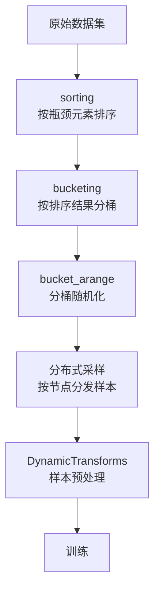

# 负载均衡

## 概述

### 背景与挑战

自动驾驶场景涉及到多种传感器数据，如点云、雷达、相机图像等，以及不同的道路交通环境，不同道路场景下的数据量差别较大，因此，自动驾驶模型在分布式训练中易出现计算负载不均衡的现象，造成性能瓶颈。

以轨迹预测模型`QCNet`为例：`QCNet`使用`Argoverse2`数据集，以学习轨迹特征，数据集中用`Agents`表示道路场景中的交通参与目标，而不同道路上的`Agents`数量差异较大，具有类似问题的模型还有目标检测模型`Deformable DETR`、点云模型`CenterPoint3D`等。

这类模型的共同特征是：单样本的计算量随场景内容变化剧烈，而分布式采样默认按样本均匀分配，导致各训练节点负载不均衡。由于分布式训练需要同步等待，为等待负载最大的节点，其他节点频繁进入通信等待阶段，产生额外的训练开销。

### 解决方案

Driving SDK的负载均衡特性通过三步缓解上述问题：

1. **排序（sorting）**：按引发负载不均衡的主要元素对数据集样本排序；
2. **分桶（bucketing）**：将排序后的样本分到多个桶中，使相邻样本计算量相近；
3. **随机化与分布式分发（bucket_arange）**：对分桶结果随机化后分发给各节点，保证训练随机性的同时让各节点负载相近。

通过动态负载均衡，分布式训练的各节点具有相近负载，避免过多通信等待开销，从而提升模型性能。

## 负载均衡机制

Driving SDK负载均衡特性由三类组件构成：`DynamicDataset`、`DynamicSampler`、`DynamicTransforms`。三者协作关系见[组件协作流程](#组件协作流程)。

### 组件一：DynamicDataset（排序与分桶）

`DynamicDataset`是负载均衡特性的数据侧入口，提供两个抽象方法：

| 抽象方法 | 作用 |
|----------|------|
| `sorting()` | 根据模型中造成负载不均衡瓶颈的主要元素，对数据集样本进行排序 |
| `bucketing()` | 根据`sorting()`结果，对数据集样本进行分桶 |

用户可继承该抽象类实现具体逻辑。Driving SDK提供两个已实现`bucketing()`的子类：

| 子类 | 关键参数 | 分桶方式 | 配套Sampler |
|------|----------|----------|--------------|
| `UniformBucketingDynamicDataset` | `num_bucket`（分桶总量） | 样本按`sorting()`结果均匀分布到所有桶内 | `DynamicDistributedSampler` |
| `CapacityBucketingDynamicDataset` | `bucket_capacity`（桶容量） | 每桶分配`bucket_capacity`个样本 | `ReplicasDistributedSampler` |

### 组件二：DynamicSampler（分桶随机化）

`DynamicSampler`负责对分桶结果进行随机化，提供抽象方法`bucket_arange()`。用户可继承实现，Driving SDK提供两个已实现子类：

| 子类 | 随机化流程 | 适用场景 |
|------|-----------|----------|
| `DynamicDistributedSampler` | 1. 对样本桶进行随机化；<br>2. 分别对每个桶内的数据随机化 | `UniformBucketingDynamicDataset`的分桶结果 |
| `ReplicasDistributedSampler` | 1. 对样本桶进行随机化；<br>2. 分别对每个桶内的数据随机化；<br>3. 按节点数将桶内数据均匀分布到各节点并再次随机化 | `CapacityBucketingDynamicDataset`的分桶结果 |

> [!NOTE]
>
> 两个Sampler的区别在于是否处理“节点间分布”，与`DynamicDistributedSampler`相比，`ReplicasDistributedSampler`还按节点数切分与再随机化，因此适合按容量分桶、桶大小可控的场景。

### 组件三：DynamicTransforms（预处理）

`DynamicTransforms`提供负载均衡相关的样本预处理函数，在训练循环中对样本进行动态变换（如基于瓶颈元素的计算）。其具体实现位于`mx_driving/dataset/utils/dynamic_transform.py`，使用方式请参见[负载均衡机制使用方法](#使用方法示例)。

### 组件协作流程

负载均衡特性在训练数据流中的完整协作流程如下：



| 环节 | 组件 | 输出 |
|------|------|------|
| 排序 | `DynamicDataset.sorting()` | 有序样本 |
| 分桶 | `DynamicDataset.bucketing()` | 样本桶集合 |
| 随机化 | `DynamicSampler.bucket_arange()` | 随机化后的桶 |
| 分发 | `DynamicSampler`（子类实现） | 各节点的样本集 |
| 预处理 | `DynamicTransforms` | 可训练样本 |

## 使用方法示例

本章以CenterPoint3D模型为例，演示负载均衡特性的使用方法。

### 为何选用CenterPoint3D

CenterPoint3D的负载不均衡成因具有代表性。模型基于点云数据训练，训练时将点云转换为`voxel`张量，模型对`voxel`张量尺寸敏感，即：`voxel`越大计算耗时越长，而不同点云样本产生的`voxel`数量差异明显。对`voxel`数量及尺寸实现负载均衡，是模型性能提升的重要手段，因此，本章选择采用此模型进行示例。

整体流程分为三步：定位瓶颈元素 → 实现排序与分桶 → 实现分桶随机化。

### 定位负载不均衡瓶颈

在使用负载均衡特性时，首先需要确认引发负载不均衡的主要元素。如[上节](#为何选用centerpoint3d)所示，对CenterPoint3D，该元素为点云转换获得的`voxel`张量尺寸。

### 实现排序与分桶

确定引发负载不均衡的主要元素后，即可根据元素数量或尺寸进行排序与分桶。

1. **生成带瓶颈元素信息的序列化文件**

    按`model_examples/CenterPoint/README.md`中“准备数据集”一节生成数据集所需的序列化文件。在生成代码中，以下代码用于获取数据集样本的`voxel`张量尺寸：

    ```python
    from mx_driving.dataset.utils import get_voxel_number_from_mean_vfe
    voxel_num = get_voxel_number_from_mean_vfe(data_path, ref_sd_rec['filename'], sweeps, max_sweeps)
    info["voxel_num"] = voxel_num
    ```

    `get_voxel_number_from_mean_vfe`函数位于`dataset/utils/dynamic_transform.py`中，用户无需对模型做过多侵入式修改即可获取`voxel`张量尺寸。

2. **使数据集继承`PointCloudDynamicDataset`**

    修改`pcdet/datasets/nuscenes/nuscenes_dataset.py`，使`NuScenesDataset`在继承原有父类的基础上同时继承`PointCloudDynamicDataset`，从而获得`sorting()`与`bucketing()`能力。

    原代码为：

    ```python
    class NuScenesDataset(DatasetTemplate):
        def __init__(self, dataset_cfg, class_names, training=True, root_path=None, logger=None):
            root_path = (root_path if root_path is not None else Path(dataset_cfg.DATA_PATH)) / dataset_cfg.VERSION
            super().__init__(
                dataset_cfg=dataset_cfg, class_names=class_names, training=training, root_path=root_path, logger=logger)
            ...
            if self.training and self.dataset_cfg.get('BALANCED_RESAMPLING', False):
                self.infos = self.balanced_infos_resampling(self.infos)
    ```

    修改后为：

    ```python
    from mx_driving.dataset import PointCloudDynamicDataset
    class NuScenesDataset(PointCloudDynamicDataset, DatasetTemplate):
        def __init__(self, dataset_cfg, class_names, training=True, root_path=None, logger=None):
            root_path = (root_path if root_path is not None else Path(dataset_cfg.DATA_PATH)) / dataset_cfg.VERSION
            DatasetTemplate.__init__(
                self, dataset_cfg=dataset_cfg, class_names=class_names, training=training, root_path=root_path, logger=logger
            )
            ...
            if self.training and self.dataset_cfg.get('BALANCED_RESAMPLING', False):
                self.infos = self.balanced_infos_resampling(self.infos)
            if training:
                self.sorting()
                self.buckets = self.bucketing(bucket_capacity=8)
            else:
                self.buckets = None
    ```

    关键点：

    - 训练阶段调用`self.sorting()`对样本按`voxel`数量排序，再以桶容量8调用`self.bucketing(bucket_capacity=8)`分桶；
    - 推理（非训练）阶段无需分桶，置`self.buckets = None`。

### 实现分桶随机化

分桶后，每个“桶”中具有计算量近似的数据，但是还需要对分桶结果进行随机化，以保证模型的训练精度。由于在[实现排序与分桶](#实现排序与分桶)时，模型使用了按容量分桶的`bucketing(bucket_capacity=8)`，因此，随机化须配套使用`ReplicasDistributedSampler`（见[组件二：DynamicSampler](#组件二dynamicsampler分桶随机化)），以完成节点间分布与桶内随机化。

- **修改`pcdet/datasets/__init__.py`**

    原代码为：

    ```python
    sampler = torch.utils.data.distributed.DistributedSampler(dataset)
    ```

    修改后为：

    ```python
    from mx_driving.dataset import ReplicasDistributedSampler
    sampler = ReplicasDistributedSampler(dataset)
    ```

完成上述修改后，模型即可正常训练。如需详细的训练步骤，请参见[CenterPoint3D模型](../../../model_examples/CenterPoint/README.md)。

## 效果验证与注意事项

- **预期效果**：基于负载均衡特性的训练性能较未使用负载均衡特性的同配置训练提升约18%。该数值以CenterPoint3D训练场景为基准，实际收益与具体数据分布及模型相关，建议以自身场景实测为准。
- **配套关系**：分桶方式与Sampler需按[组件一：DynamicDataset](#组件一dynamicdataset排序与分桶)与[组件二：DynamicSampler](#组件二dynamicsampler分桶随机化)的配套关系选用，混用可能导致负载均衡失效或数据分布异常。
- **精度影响**：负载均衡改变的是样本采样顺序与分配方式，不改变数据内容与模型结构；若训练收敛性异常，建议先核对Sampler与分桶参数的配套关系。

## 附录：相关源码路径

| 组件 | 源码位置 |
|------|----------|
| `DynamicDataset`及子类 | `mx_driving/dataset/` |
| `DynamicSampler`及子类 | `mx_driving/dataset/` |
| `DynamicTransforms` | `mx_driving/dataset/utils/dynamic_transform.py` |
| CenterPoint3D示例 | `model_examples/CenterPoint/` |
