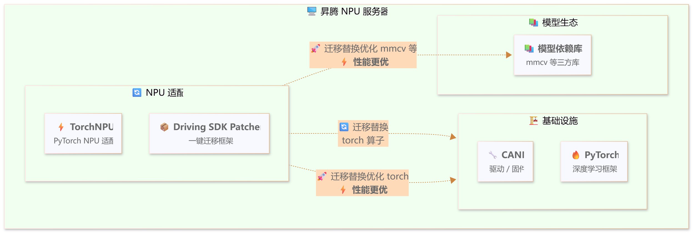
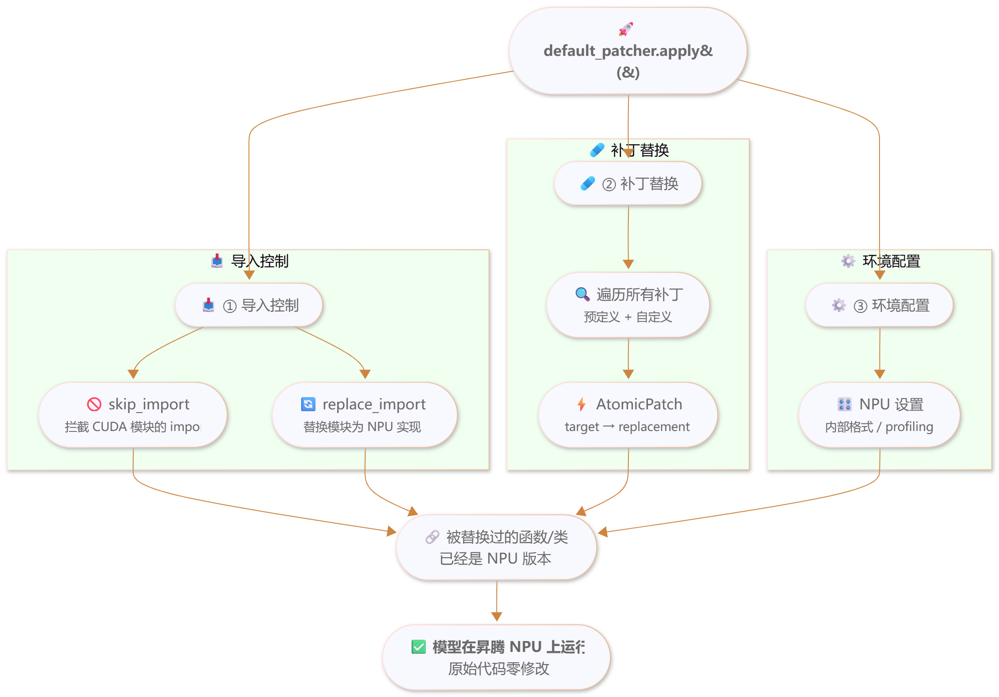

# 一键Patcher（快速上手）

本文档是一键Patcher的快速上手指南，主要介绍功能性使用：它是什么、为什么需要、如何最快跑通一个模型。底层逻辑、实现原理与接口细节请参见[一键Patcher（功能详解）](./patcher_features.md)。

## 与功能详解文档的关系

| 文档 | 定位 | 适用场景 |
|------|------|--------------|
| 本文档（快速上手） | 功能性使用：是什么、为什么、怎么最快跑通 | 首次使用、需要快速接入模型 |
| [一键Patcher（功能详解）](./patcher_features.md) | 各特性的底层逻辑、实现原理与接口的具体说明（参数、示例、注意事项） | 需要深入配置某个功能、排查不生效原因 |

> 本文档只保留最小可用示例；若需详细了解某个功能的原理与全部参数，请参见[一键Patcher（功能详解）](./patcher_features.md)对应章节。

## 概述

### 背景与挑战

开源自动驾驶模型通常基于**CUDA生态**开发。昇腾（Ascend）NPU的芯片架构与GPU存在本质差异——算子实现、内存管理、软件栈调用方式均不相同。将开源模型迁移到昇腾平台时，需要：

- 替换CUDA专属算子为NPU实现；
- 处理不兼容的第三方库（如`flash_attn`、`torch_scatter`）；
- 调整数据格式与精度策略；
- 修改分布式训练逻辑。

这些适配工作分散在大量文件中。传统做法是直接修改模型源代码，其代价如下：

| 问题 | 说明 |
|------|------|
| 代码管理混乱 | 原始代码与适配代码混杂，难以维护 |
| 升级困难 | 上游更新后需要重新适配 |
| 三方库改动成本高 | 修改mmcv等库的自定义算子后需要重新编译 |

因此，直接修改模型源码的迁移方式会导致模型迁移与维护的耗时增加，同时降低模型在昇腾平台上的易用性。为了提高迁移效率与模型易用性，Driving SDK提出了一键Patcher特性。

### 解决方案

**一键Patcher**是基于Monkey Patch（猴子补丁）机制的运行时替换框架，在程序运行时动态替换模块、类、函数或方法等属性，实现**CUDA → NPU的零侵入迁移**——不修改原始代码的一个字符。

具体而言，一键Patcher解决了以下问题：

| 问题 | 解决方式 |
|------|----------|
| 迁移工作量大、门槛高 | 封装常见适配为预定义补丁，一行代码即可应用 |
| 修改三方库源码需重新编译 | 运行时替换，无需修改和编译mmcv等库的源代码 |
| 适配代码与原始代码耦合 | 补丁独立于模型代码，源代码与迁移代码完全解耦 |
| 迁移经验难以复用 | 将已验证的适配方案沉淀为预定义补丁，新模型可直接复用 |
| 缺少昇腾环境的实用功能 | 内置性能采集（Profiling）、训练早停（Brake）等工具 |

## 开箱即用的default_patcher

### default_patcher是什么

`default_patcher`是框架预配置的Patcher实例，已包含常用的NPU优化补丁（针对mmcv、torch、numpy等库，请参见[预定义补丁列表](#预定义补丁列表)）。

> [!NOTICE]
>
> `default_patcher`不保证所有模型的迁移完备性。部分模型可能需要额外添加自定义补丁来处理特定的CUDA依赖或算子替换。

### 最小接入方式

```python
# train.py最顶部（所有其他import之前）
from mx_driving.patcher import default_patcher
default_patcher.apply()

from tools.train import main
main()
```

### 在default_patcher之上扩展

当模型有专有的CUDA算子需要额外处理时，可定义自定义补丁并加入`default_patcher`：

```python
from mx_driving.patcher import default_patcher, Patch, AtomicPatch
from mx_driving.patcher.patch import with_imports

class MyCustomPatch(Patch):
    """自定义补丁描述"""

    @classmethod
    def patches(cls, options=None):
        return [
            AtomicPatch(
                "target_module.target_function",
                cls._replacement,
            ),
        ]

    @staticmethod
    @with_imports("module")  # 声明函数依赖的外部模块
    def _replacement(...):
        """替换函数实现"""
        ...

default_patcher.add(MyCustomPatch)
default_patcher.apply()
```

> [!NOTE]
>
> - `Patch.name`为可选项。
> - 未显式定义时默认使用类名。
> - `disable()`既支持字符串名，也支持直接传`Patch`类或补丁实例。
> - 若需替换`default_patcher`中已启用的冲突补丁，推荐先`disable()`默认补丁，再`add()`新补丁。
> - 若需深入了解`precheck`、`runtime_check`、`with_imports`等参数的原理与完整用法，请参见[一键Patcher（功能详解）：补丁机制](./patcher_features.md#补丁机制)。

## 常用入口速览

### 常用功能速览

```python
from mx_driving.patcher import default_patcher, AtomicPatch

default_patcher.skip_import("<cuda_module>")                     # 跳过CUDA模块
default_patcher.replace_import("<old_module>", "<new_module>")   # 整模块替换
default_patcher.inject_import("<src>", "<name>", "<target>")     # 注入导入
default_patcher.add(AtomicPatch("<target>", replacement))        # 添加补丁
default_patcher.with_profiling("<output_dir>")                   # 性能采集
default_patcher.with_precision_debugger(dump_path="<dump_dir>")  # 精度采集
default_patcher.brake_at(<step>)                                 # 训练早停
default_patcher.allow_internal_format()                          # 允许NPU内部格式
default_patcher.apply()                                          # 应用所有
```

### 导入控制怎么选

三类导入控制解决的是三个不同问题：

| 场景 | 推荐API | 典型例子 |
|------|---------|----------|
| 模块在昇腾环境根本不存在，但后续路径并不会真正执行它 | `skip_import()` | `flash_attn`、`torch_scatter`只在顶部被import，真实执行路径会被NPU patch接管 |
| 问题就发生在模块import边界，需要把整个模块入口换掉 | `replace_import()` | DiffusionDrive把`projects.mmdet3d_plugin.ops.deformable_aggregation`的导出切到NPU实现 |
| 类/函数定义在子模块里，但父模块没有正确导出，导致`from pkg import Name`失败 | `inject_import()` | DiffusionDrive把`V1SparseDrive`、`V1SparseDriveHead`等类补回`projects.mmdet3d_plugin.models` |

一个真实的`configure_patcher()`片段通常会同时用到三者：

```python
patcher.skip_import("flash_attn", "torch_scatter")
patcher.replace_import(
    "projects.mmdet3d_plugin.ops.deformable_aggregation",
    DeformableAggregationFunction=_DeformableAggregationFunction,
)
patcher.inject_import(
    "projects.mmdet3d_plugin.models.sparsedrive_v1",
    "V1SparseDrive",
    "projects.mmdet3d_plugin.models",
)
```

> 若需详细了解三个API的完整用法、行为说明与实现原理，请参见[一键Patcher（功能详解）：导入控制](./patcher_features.md#导入控制)。

## 核心概念与执行流程

### 核心概念：AtomicPatch、Patch、Patcher

| 概念 | 说明 |
|------|------|
| **AtomicPatch** | 最小补丁单元，执行单个target → replacement替换 |
| **Patch** | 组合补丁，将多个相关的AtomicPatch组织在一起（如一个算子的forward + backward） |
| **Patcher** | 补丁管理器，收集、组织和应用所有补丁，并提供导入控制等辅助功能 |
| **default_patcher** | 预配置的Patcher实例，已包含常用预定义补丁，开箱即用 |

一个`AtomicPatch`的执行语义为：

target（原始属性路径，如"mmcv.ops.msda.forward"）→ replacement（NPU优化版本）

模型原始代码中调用`mmcv.ops.msda.forward()`的地方，在`apply()`之后实际执行的是NPU版本，而代码文本没有任何变化。

> 各补丁单元的完整接口说明与参数细节，请参见[一键Patcher（功能详解）：补丁单元](./patcher_features.md#补丁单元)。

### 补丁如何生效（执行流程）

一键Patcher在以下环境链中工作：



`apply()`背后发生的过程：



> [!NOTICE]
>
> `apply()`必须在所有其他`import`之前调用。因为Patcher通过替换模块属性实现补丁——如果目标模块已经被导入并且其属性已被其他模块引用，补丁将无法生效。
> 若需深入了解Patcher的底层实现机制，请参见[一键Patcher（功能详解）：补丁机制](./patcher_features.md#补丁机制)。

### 一个最小替换示例

下面演示如何将CUDA实现替换为NPU优化实现。假设目标模块`my_model.ops.gaussian`中有如下CUDA函数：

```python
# 文件：my_model/ops/gaussian.py（原始CUDA实现）
import math
import torch

def compute_gaussian_weights(distances, sigma):
    """计算高斯核权重（CUDA版本）"""
    variance = 2.0 * sigma * sigma
    weights = torch.exp(-distances * distances / variance)
    norm_factor = 1.0 / (sigma * math.sqrt(2 * math.pi))
    return weights * norm_factor
```

在NPU上，可用`torch_npu`提供的融合算子提升性能：

```python
# NPU优化版本
import math
import torch_npu

def compute_gaussian_weights(distances, sigma):
    """计算高斯核权重（NPU优化版本）"""
    variance = 2.0 * sigma * sigma
    weights = torch_npu.npu_exp(-distances * distances / variance)  # 使用NPU融合算子
    norm_factor = 1.0 / (sigma * math.sqrt(2 * math.pi))
    return weights * norm_factor
```

通过`Patch` + `AtomicPatch`完成替换：

```python
from mx_driving.patcher import default_patcher, Patch, AtomicPatch
from mx_driving.patcher.patch import with_imports
import torch

class GaussianWeightsPatch(Patch):
    """高斯核权重计算NPU优化"""
    name = "gaussian_weights"

    @classmethod
    def patches(cls, options=None):
        return [
            AtomicPatch(
                "my_model.ops.gaussian.compute_gaussian_weights",
                cls._compute_gaussian_weights_npu,
            ),
        ]

    @staticmethod
    @with_imports("math", "torch_npu")  # 声明函数依赖的外部模块
    def _compute_gaussian_weights_npu(distances, sigma):
        """NPU优化实现"""
        variance = 2.0 * sigma * sigma
        weights = torch_npu.npu_exp(-distances * distances / variance)  # noqa: F821
        norm_factor = 1.0 / (sigma * math.sqrt(2 * math.pi))  # noqa: F821
        return weights * norm_factor

default_patcher.add(GaussianWeightsPatch)
default_patcher.apply()
```

> 若需详细了解`with_imports`、`precheck`、`runtime_check`、`target_wrapper`等进阶能力，请参见[一键Patcher（功能详解）：补丁机制](./patcher_features.md#补丁机制)。

## 预定义补丁列表

框架内置了经过验证的NPU适配补丁，新模型可直接复用。

> [!NOTE]
>
> ✅ 表示已包含在`default_patcher`中，`apply()`即生效。
> ❌ 表示需通过`patcher.add()`手动添加。
>
> `NumpyCompat`属于默认补丁中的早期兼容补丁，用于恢复`np.bool` / `np.float` / `np.int`等已移除别名，避免第三方库在import-time就因NumPy兼容性问题提前失败。

| 模块 | 补丁名称 | 说明 | default_patcher |
|------|----------|------|:---------------:|
| **mmcv** | MultiScaleDeformableAttention | 多尺度可变形注意力 | ✅ |
| | DeformConv | 可变形卷积 | ✅ |
| | ModulatedDeformConv | 调制可变形卷积 | ✅ |
| | SparseConv3D | 3D稀疏卷积 | ✅ |
| | Stream | CUDA流管理 | ✅ |
| | DDP | 分布式数据并行 | ✅ |
| | Voxelization | 体素化 | ❌ |
| | OptimizerHooks | 优化器钩子（mmcv 1.x） | ❌ |
| **mmengine** | OptimizerWrapper | 优化器包装器 | ❌ |
| **mmdet** | PseudoSampler | 伪采样器 | ❌ |
| | ResNetAddRelu | ResNet加ReLU融合 | ✅ |
| | ResNetMaxPool | ResNet最大池化 | ✅ |
| | ResNetFP16 | ResNet FP16支持 | ❌ |
| **mmdet3d** | NuScenesDataset | NuScenes数据集 | ✅ |
| | NuScenesMetric | NuScenes评估指标 | ✅ |
| **numpy** | NumpyCompat | NumPy兼容性修复 | ✅ |
| **torch** | TensorIndex | 张量索引优化 | ✅ |
| | BatchMatmul | 批量矩阵乘法 | ✅ |
| **torch_scatter** | TorchScatter | scatter操作NPU实现 | ❌ |
| **transformers** | TransformersNPU | transformers NPU组合补丁（>=4.51.0） | ❌ |
| **diffusers** | DiffusersNPU | diffusers NPU组合补丁（==0.35.1） | ❌ |

## 迁移代码的文件组织

为保证“零侵入”真正落地，推荐将所有迁移相关代码集中在独立的`migrate_to_ascend/`文件夹中，实现源代码（模型原始代码）与迁移代码（NPU适配代码）的物理解耦：

```shell
my_model/                          ← 源代码（Source Code）
├── configs/                         不做任何修改
├── projects/
│   ├── models/
│   └── ops/
├── tools/
│   ├── train.py                     原始训练脚本
│   └── test.py
│
├── migrate_to_ascend/             ← 迁移代码（Migration Code）
│   ├── patch.py                     补丁定义和patcher配置
│   ├── train.py                     昇腾训练入口（基于原始train.py，顶部加入patcher代码）
│   ├── test.py                      昇腾测试入口（基于原始test.py，顶部加入patcher代码）
│   ├── train_8p.sh                  8卡分布式训练脚本
│   └── requirements.txt             昇腾环境依赖
│
├── README.md
└── setup.py
```

这种组织方式的优势：

| 优势 | 说明 |
|------|------|
| **零侵入** | `my_model/`下的所有文件不做任何修改 |
| **一键迁移** | 将`migrate_to_ascend/`文件夹拷入开源模型仓即可运行 |
| **双栈共存** | 同一个仓库、同一个分支可同时支持CUDA和昇腾两种环境 |
| **独立管理** | 迁移代码的版本控制与模型原始代码互不干扰 |

**训练入口示例**（`migrate_to_ascend/train.py`）：

```python
from mx_driving.patcher import default_patcher
from migrate_to_ascend.patch import configure_patcher

configure_patcher(default_patcher)
default_patcher.apply()

from tools.train import main
main()
```

实际项目参考：[DiffusionDrive](../../../model_examples/DiffusionDrive/README.md)和[PanoOcc](../../../model_examples/PanoOcc/README.md)的`migrate_to_ascend/`目录。

## 下一步：进阶功能入口

接入完成后，可按需启用以下配套能力。各功能的参数说明与实现原理见[一键Patcher（功能详解）](./patcher_features.md)：

| 功能 | 一句话说明 | 功能详解 |
|------|-----------|----------|
| 性能采集`with_profiling` | 在训练循环中采集NPU性能数据 | [with_profiling：性能采集](./patcher_features.md#with_profiling性能采集) |
| 精度采集`with_precision_debugger` | 接入msprobe采集API和Module精度数据 | [with_precision_debugger：精度采集](./patcher_features.md#with_precision_debugger精度采集) |
| 训练早停`brake_at` | 在指定步数停止训练，用于调试或性能测试 | [brake_at：训练早停](./patcher_features.md#brake_at训练早停) |
| NPU内部格式`allow_internal_format` | 允许NPU内部数据布局，可能提升性能但需验证精度 | [allow_internal_format：NPU内部格式控制](./patcher_features.md#allow_internal_formatnpu内部格式控制) |
| 日志配置 | 四层日志控制与分布式rank过滤 | [日志配置](./patcher_features.md#日志配置) |
| 补丁状态查看`print_info` | 查看补丁应用状态与代码差异 | [补丁状态查看](./patcher_features.md#补丁状态查看) |

## 常见问题排查

| 问题 | 排查要点 |
|------|----------|
| 补丁不生效 | 检查`apply()`是否在目标模块import之前调用（见[补丁如何生效（执行流程）](#补丁如何生效执行流程)时序要求） |
| `replace_import`不生效 | 目标模块可能已进入`sys.modules`；该API对已导入模块会跳过并给出warning |
| 自定义补丁未应用 | 确认`Patch.name`唯一、未被`disable()`；检查`precheck`是否返回`False` |
| 精度异常 | 确认`allow_internal_format`仅在功能验证通过后启用；替换算子后重新校验精度 |

> 若需进一步排查，请参见[一键Patcher（功能详解）：使用注意事项](./patcher_features.md#使用注意事项)。
