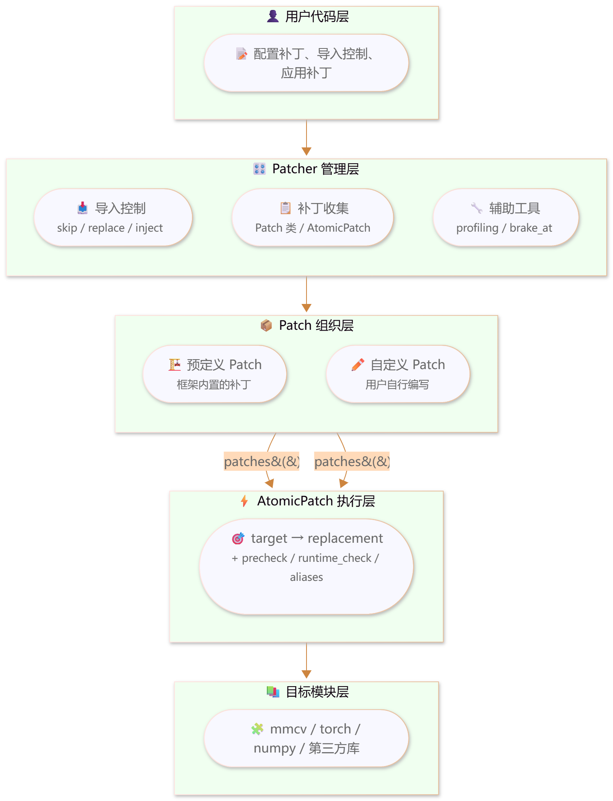
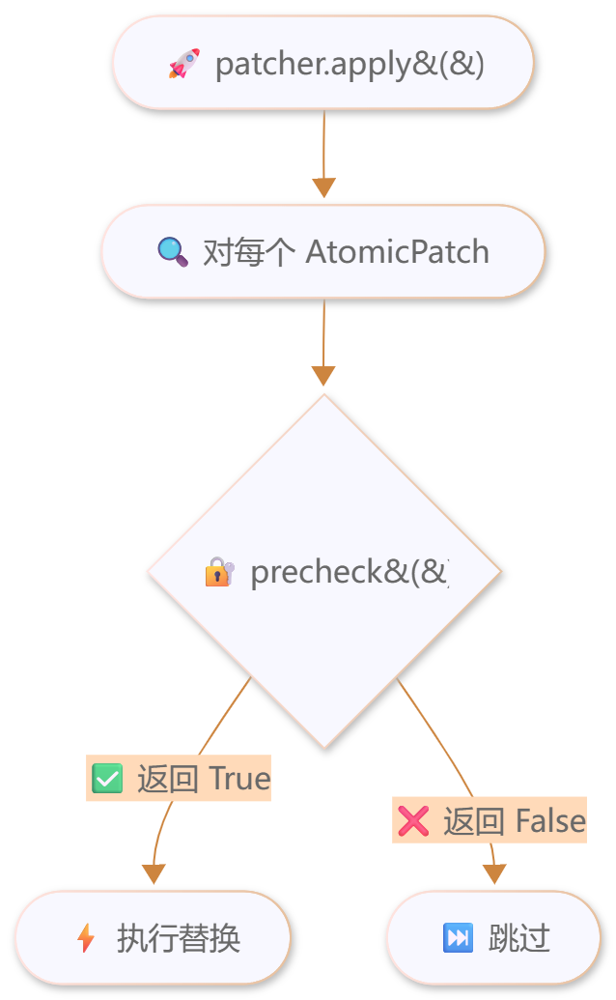
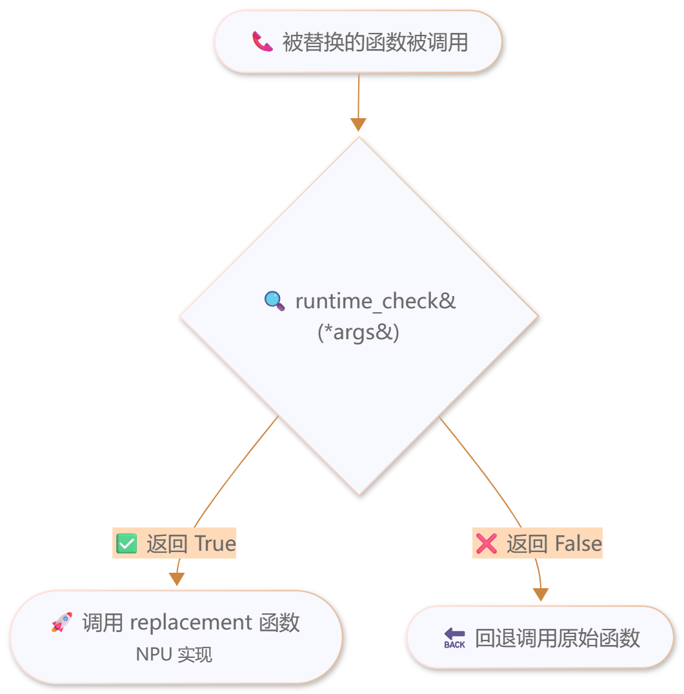

# 一键Patcher（功能详解）

本文档详细说明一键Patcher各项特性的底层逻辑、实现原理与接口的具体说明，包括功能分类、参数说明、代码示例与使用注意事项。

> 本文档聚焦于每个功能的详细配置，基础概念与快速上手请参阅[一键Patcher（快速上手）](./patcher.md)。本文档假定读者已了解`default_patcher`的基本用法。

## 与快速上手文档的关系

| 文档 | 定位 | 内容范围 | 适用读者 |
|------|------|----------|----------|
| [一键Patcher（快速上手）](./patcher.md) | 快速上手 | 什么是Patcher、为什么用、`default_patcher`基本用法、核心概念（AtomicPatch / Patch / Patcher）、预定义补丁列表、迁移代码组织 | 首次接触、需要快速跑通 |
| 本文档（功能详解） | 功能参考 | 各特性的底层逻辑、实现原理与接口的具体说明，包括参数、示例、注意事项及使用指导 | 需要深入配置或排查问题 |

> 两者为互补关系：`patcher.md`解决“怎么用起来”，本文档解决“每个功能怎么配置、为什么这样实现”。引用功能细节时，建议优先指向本文档对应章节。

## 功能总览

### 功能域划分

Patcher的功能按职责分为三大域：

| 功能域 | 功能 | 解决的问题 |
|--------|------|-----------|
| 导入控制 | `skip_import`、`replace_import`、`inject_import` | 模型在import阶段的CUDA依赖、模块缺失、导出缺失 |
| 补丁机制 | `AtomicPatch`、`Patch`、`RegistryPatch`及补丁参数 | 运行时的函数/类替换 |
| 辅助工具 | 版本检测、性能采集、精度采集、训练早停、日志、状态查看等 | 迁移与调优过程中的配套能力 |

架构分层如下：



### 阅读指引

| 应用场景 | 推荐章节 |
|----------|----------|
| 快速接入一个模型 | [导入控制](#导入控制) → [快速接入一个模型](#快速接入一个模型) |
| 排查补丁不生效问题 | [补丁参数](#补丁参数aliasesprecheckruntime_check) → [使用注意事项](#使用注意事项) |
| 深度定制补丁 | [补丁单元](#补丁单元)、[延迟导入与函数包装](#延迟导入与函数包装with_importstarget_wrapperreplacement_wrapper) → [进阶用法](#进阶用法) |
| 迁移调优配套能力 | [辅助工具](#辅助工具) |

## 导入控制

导入控制解决模型在**import阶段**的三类常见问题，每类问题对应1个API，如下表所示：

|import阶段常见问题| 对应API |
|-----|-----------|
| CUDA专属模块在当前环境不存在 | [skip_import()](#skip_import跳过不可用模块) |
| 原模块本身应被另一个模块整体接管 | [replace_import()](#replace_import替换模块导入) |
| 父模块少导出了某个类/函数，导致`from pkg import Name`失败 | [inject_import()](#inject_import注入缺失导入) |

### skip_import：跳过不可用模块

**用途**：当运行开源模型时，遇到`ModuleNotFoundError`，报错模块属于CUDA生态专属（如`flash_attn`、`torch_scatter`），在昇腾环境不存在且无需安装时，可使用`skip_import`跳过这些不可用模块。不可用的模块import可能分散在模型代码的多个文件中，若逐个删除import，会修改原始代码。`skip_import`可在不改动源代码的前提下，拦截这些import请求并返回无害的Stub对象，减少对原始代码的侵入式修改。

**语法**：`patcher.skip_import("source")`，其中`source`为不可用模块。

**行为说明**：被skip的模块及其所有子模块的import都会成功，但返回的是Stub对象——属性访问返回Stub，函数调用返回`None`。

**示例**：

```python
patcher.skip_import("flash_attn", "torch_scatter")

# 之后以下import都不会报错：
from flash_attn.flash_attn_interface import flash_attn_func  # → Stub
from flash_attn.any.deep.path import anything                # → Stub
import torch_scatter                                          # → Stub
```

若需更详细的使用示例，可参考[DiffusionDrive模型](../../../model_examples/DiffusionDrive/README.md)和[PanoOcc模型](../../../model_examples/PanoOcc/README.md)。

**注意事项**：

- 此API仅适用于“会被import但运行时不会走到原始实现”的模块。
- 若下游逻辑依赖该模块的计算能力，`skip_import()`只会让import通过，不会补齐功能；此时应改用`replace_import()`。

### replace_import：替换模块导入

**用途**：此API将CUDA算子模块替换为NPU实现。与`skip_import`不同，由`replace_import`替换后的模块提供实际可用的功能实现。

**语法**：`replace_import(source, target)`，其中`target`是`source`的替换模块。支持三种使用方式：

| 方式 | 语法 | 适用场景 |
|------|------|----------|
| 整模块替换 | `replace_import("old.module", "new.module")` | 默认推荐，最直观 |
| 仅提供导出表 | `replace_import("old.module", replace_with.module(...))` | 只替换部分导出（进阶用法） |
| 以某模块为模板并覆写导出 | `replace_import("old.module", replace_with.module("new.module", ...))` | 继承模板并覆盖特定导出（进阶用法） |

**行为说明**：

- `replace_import()`会优先保留真实父包和namespace package，不再用空stub污染父包；`import pkg.mod`与`from pkg import mod`均为支持路径。
- 若目标模块已出现在`sys.modules`中，`replace_import()`会跳过并给出warning。这是最常见的“不生效”原因。
- 使用`base_module`或`replace_with.module("new.module")`时，替身模块是源模块导出的**快照拷贝**，再叠加`exports`覆写，不是对原模块的实时代理。

**示例**：

```python
# 方式1：用另一个模块完全替换（默认推荐）
patcher.replace_import("cuda_ops.special_op", "mx_driving.npu_ops")

# 方式2：替换模块中的特定导出
# 当代码from projects.ops.cuda_op import MyFunction时，得到NPUImpl
from mx_driving.patcher import replace_with

patcher.replace_import(
    "projects.ops.cuda_op",
    replace_with.module(
        MyFunction=NPUImpl,
        AnotherFunc=NPUAnotherImpl,
    ),
)

# 方式3：以另一个模块为模板，并覆盖特定导出
patcher.replace_import(
    "old.module",
    replace_with.module("new.module", SpecialFunc=custom_impl),
)
```

兼容写法（不推荐此写法，建议使用方式1、方式2或方式3）：

```python
patcher.replace_import("projects.ops.cuda_op", MyFunction=NPUImpl)
patcher.replace_import("old.module", base_module="new.module", exports={"SpecialFunc": custom_impl})
```

若需更详细的使用示例，可参考[DiffusionDrive模型](../../../model_examples/DiffusionDrive/README.md)。

**注意事项**

- 问题发生在“模块导入边界”，而不是某个函数已成功import之后；

```python
# 正确：先replace_import，再import目标模块
patcher.replace_import("pkg.cuda_op", "pkg.npu_op")
from pkg.cuda_op import run

# 反例：目标模块已进入sys.modules，replace_import不生效
from pkg.cuda_op import run
patcher.replace_import("pkg.cuda_op", "pkg.npu_op")
```

- 下游通过`from pkg.cuda_op import MyKernel`方式消费模块导出。

> [!NOTE]
>
> 若真正要做的是“模块已能正常import、只是其中某个函数/类需要换实现”，应优先使用`AtomicPatch()`（见[补丁单元](#补丁单元)），其语义更直接。

**替换部分导出的实现原理**：

```python
from mx_driving.patcher import replace_with

patcher.replace_import(
    "pkg.cuda_op",
    replace_with.module(MyKernel=MyNpuKernel),
)
```

该用法并非把`pkg.cuda_op.MyKernel`属性patch掉，而是：

1. 构造一个新的替身模块`pkg.cuda_op`；
2. 将`MyKernel=MyNpuKernel`等导出挂到替身模块上；
3. 后续代码`import pkg.cuda_op`或`from pkg.cuda_op import MyKernel`时，拿到的是替身模块中的导出。

从实现角度看，该用法等价于：

```python
# 用户代码
from pkg.cuda_op import MyKernel

# replace_import做的不是：
# pkg.cuda_op.MyKernel = MyNpuKernel
#
# 而更像是：
# fake_module = ModuleType("pkg.cuda_op")
# fake_module.MyKernel = MyNpuKernel
# sys.modules["pkg.cuda_op"] = fake_module
```

### inject_import：注入缺失导入

**用途**：开源模型自身遗漏了某些import（例如`__init__.py`中未导出某个类），导致运行时`ImportError`。`inject_import`可在不修改模型代码的前提下修复。

**语法**：`inject_import(source, name, target)`，含义为“将`source`模块中的`name`注入到`target`模块的导出中”。

**行为说明**：

- `inject_import()`在调用时立即执行，不需要等到`apply()`；
- 若目标模块已有同名属性，不会覆盖原值；
- 若目标模块定义了`__all__`，注入成功后会尽量把名称补进`__all__`。

**示例**：

```python
# 场景：a.b.c中定义了MyClass，但a.b的__init__.py忘记导出
# 导致from a.b import MyClass失败
patcher.inject_import("a.b.c", "MyClass", "a.b")
# 修复后：from a.b import MyClass可用

# 场景：NPU迁移需要在目标模块中补充额外的类
patcher.inject_import(
    "mx_driving.npu_ops",        # 源模块（类定义所在）
    "NPUSpecialOp",              # 要注入的名称
    "projects.ops",              # 目标模块（注入到此处）
)
```

若需更详细的使用示例，可参考[DiffusionDrive模型](../../../model_examples/DiffusionDrive/README.md)。

## 补丁机制

补丁机制包含补丁单元、补丁参数、延迟导入与函数包装三个子域。

### 补丁单元

补丁单元共有三种，粒度由小到大：

| 补丁单元 | 作用 | 典型场景 |
|----------|------|----------|
| `AtomicPatch` | 执行单个target → replacement替换，最小补丁单元 | 替换单个函数或类 |
| `Patch` | 将多个相关`AtomicPatch`组织在一起 | 深度学习算子通常有forward / backward两个方法需要替换 |
| `RegistryPatch` | 向mmcv/mmengine的Registry注册类 | 注册优化器钩子、算子等 |

**AtomicPatch**：

语法：

```python
# 最简形式：指定target路径和replacement函数
AtomicPatch("mmcv.ops.func", npu_func)

# 字符串形式的replacement（延迟解析，避免循环导入）
AtomicPatch("module.func", "mx_driving.ops.npu_func")
```

完整参数见[补丁参数速查表](#补丁参数速查表)：

```python
AtomicPatch(
    target="mmcv.ops.msda.forward",     # 被替换的原始属性路径
    replacement=npu_forward,             # 替换实现（与target_wrapper至少提供一个）
    aliases=["mmcv.ops.MSDA.forward"],   # 别名路径列表
    precheck=lambda: mmcv_version.is_v2x,  # 应用前检查
    runtime_check=check_dtype,           # 运行时条件分发
    target_wrapper=wrap_fn,              # 包装原函数
    replacement_wrapper=add_logging,     # 包装replacement
)
```

**Patch**：

语法：

```python
from mx_driving.patcher import Patch, AtomicPatch
from mx_driving.patcher.patch import with_imports

class MyOpPatch(Patch):
    @classmethod
    def patches(cls, options=None):
        return [
            AtomicPatch("module.Op.forward", cls._forward),
            AtomicPatch("module.Op.backward", cls._backward),
        ]

    @staticmethod
    @with_imports(("torch_npu", "npu_op"))
    def _forward(ctx, x):
        return npu_op(x)  # noqa: F821

    @staticmethod
    def _backward(ctx, grad):
        return grad
```

`Patch`相关补充说明：

- `Patch.name`为可选项；未显式定义时默认使用类名（上例默认名为`MyOpPatch`）。
- 需要稳定外部标识时，建议显式写`name`，例如补丁会被用户配置禁用、跨版本迁移，或需要与`legacy_name`对齐。
- `patcher.disable()`接受三类参数：字符串名、`Patch`类、补丁实例。推荐写法为：`patcher.disable(MyOpPatch)`。

**RegistryPatch**：

语法：

```python
from mx_driving.patcher import RegistryPatch

RegistryPatch(
    "mmcv.runner.HOOKS",      # Registry路径
    MyOptimizerHook,          # 要注册的类
    name="OptimizerHook",     # 注册名称
    force=True,               # 强制覆盖已有注册
)
```

### 补丁参数：aliases、precheck、runtime_check

三个参数分别控制“替换哪些路径”“是否应用补丁”“是否走替换实现”。

**aliases：处理模块重导出**

**用途**：为某个target编写了`AtomicPatch`，但补丁未生效。原因通常是开源模型通过`from ... import ...`、`import ... as ...`或`__init__.py`重导出等方式导入target，使其存在于多个路径下。若模型代码使用别名路径而非原始定义路径，仅替换原始路径不够，需用`aliases`指定target的所有别名路径。

**示例**：

```python
# 示例：mmcv.ops.__init__.py中有
# from .multi_scale_deform_attn import MultiScaleDeformableAttnFunction
# 导致同一个类有两个访问路径

AtomicPatch(
    # target的原始定义路径
    "mmcv.ops.multi_scale_deform_attn.MultiScaleDeformableAttnFunction.forward",
    npu_forward,
    aliases=[
        # target通过__init__.py重导出后的别名路径
        "mmcv.ops.MultiScaleDeformableAttnFunction.forward",
    ],
)
```

**precheck：应用前条件检查**

**用途**：在`patcher.apply()`时调用，返回`False`则跳过该补丁，不执行替换。常用于版本约束。



**示例**：

```python
from mx_driving.patcher import mmcv_version

AtomicPatch(
    "mmcv.ops.msda.forward",
    npu_forward,
    precheck=lambda: mmcv_version.is_v2x,  # 仅mmcv 2.x时应用
)
```

**runtime_check：运行时条件分发**

**用途**：在每次被补丁替换后的函数被调用时执行检查，动态选择调用replacement函数（NPU实现）还是原始函数。参数必须与target函数一致。



**示例**：

```python
def check_fp32(input_tensor, weight, bias=None):
    """仅对FP32张量使用NPU优化"""
    return input_tensor.dtype == torch.float32

AtomicPatch(
    "module.conv",
    npu_conv,
    runtime_check=check_fp32,
)
```

### 延迟导入与函数包装：with_imports、target_wrapper、replacement_wrapper

**with_imports：延迟导入装饰器**

**用途**：编写replacement函数时通常需要导入NPU相关模块（如`torch_npu`）。直接在函数体内写import会带来三类问题：

- **循环导入**：replacement函数所在模块在导入时又去导入target模块，可能触发`ImportError`；
- **延迟导入**：某些模块需在特定时机（如`apply()`之后）才能导入，模块顶部import会失败；
- **代码风格不一致**：import写在函数体内，与原始函数风格差异明显，降低可读性。

`with_imports`通过装饰器声明依赖，在函数首次调用时执行导入并注入函数全局命名空间，使replacement函数的写法与原始函数保持一致。

**语法格式**：

```python
from mx_driving.patcher.patch import with_imports

@with_imports(
    "module_name",                    # 导入整个模块: import module_name
    ("module", "attr"),               # 从模块导入: from module import attr
    ("module", "attr", "alias"),      # 带别名: from module import attr as alias
)
def my_function():
    pass
```

**使用示例**：

```python
# 字符串形式：导入整个模块
@with_imports("torch_npu", "math")
def forward(x, sigma):
    return torch_npu.npu_exp(x) * math.sqrt(sigma)  # noqa: F821

# 元组形式：从模块中导入特定名称
@with_imports(("torch_npu", "npu_fusion_attention"))
def attention(q, k, v):
    return npu_fusion_attention(q, k, v, head_num=8)  # noqa: F821

# 带别名的导入
@with_imports(("torch_npu.npu_ops", "npu_matmul", "matmul"))
def compute(a, b):
    return matmul(a, b)  # noqa: F821

# 混合形式
@with_imports(
    "math",
    ("torch_npu", "npu_fusion_attention"),
    ("module.constants", "SCALE_FACTOR"),
)
def _forward(self, q, k, v):
    return npu_fusion_attention(q, k, v) * SCALE_FACTOR  # noqa: F821

# 使用@表达式给replacement延迟套装饰器
@with_imports(
    ("torch", "no_grad"),
    "@no_grad()",
)
def inference(x):
    return x
```

> `# noqa: F821`注释用于抑制IDE/Lint对“未定义变量”的告警，因为这些变量是运行时注入的。

**注意事项**：

- `@with_imports`要写在`@staticmethod` / `@classmethod`的下面，即更靠近函数定义的位置；
- 不要在同一个函数上叠多层`@with_imports`；当前实现会给出warning，推荐合并为一个装饰器调用；
- `apply_decorators`参数仍兼容，但新代码更推荐`@decorator_expr`写法，更接近普通Python装饰器。

**target_wrapper：包装原函数**

**用途**：在原函数基础上添加逻辑（如同步、日志），而非完全替换。使用时**不提供replacement**。

```python
def add_stream_sync(original):
    def wrapper(self, *args, **kwargs):
        import torch_npu
        torch_npu.npu.synchronize()
        result = original(self, *args, **kwargs)
        torch_npu.npu.synchronize()
        return result
    return wrapper

AtomicPatch("model.Module.forward", target_wrapper=add_stream_sync)
```

> [!NOTE]
>
> 若同时提供`replacement`和`target_wrapper`，以`replacement`为准，`target_wrapper`不生效。

**replacement_wrapper：包装替换函数**

**用途**：对replacement函数进行额外包装（如添加日志、计时）。与`target_wrapper`的对比：

| 对比 | target_wrapper | replacement_wrapper |
| ---- | -------------- | ------------------- |
| 包装对象 | 原函数 | replacement函数 |
| 能否访问原函数 | 能（作为参数传入） | 不能 |

```python
def add_logging(func):
    def wrapper(*args, **kwargs):
        print("calling npu_func")
        return func(*args, **kwargs)
    return wrapper

AtomicPatch("module.func", npu_func, replacement_wrapper=add_logging)
```

### 补丁参数速查表

| 参数 | 作用 | 何时使用 |
|------|------|----------|
| `target` | 被替换的原始属性路径 | 必填 |
| `replacement` | 替换实现（函数或字符串路径） | 与`target_wrapper`至少提供一个 |
| `aliases` | target的别名路径列表 | 目标通过`__init__.py`等重导出时 |
| `precheck` | 应用前条件检查，返回False跳过补丁 | 版本约束等需要条件应用时 |
| `runtime_check` | 运行时条件分发，动态选择replacement或原函数 | 需按输入条件选择实现时 |
| `target_wrapper` | 包装原函数 | 在原函数基础上添加逻辑 |
| `replacement_wrapper` | 包装replacement函数 | 为替换实现添加日志、计时等 |

## 辅助工具

### 版本检测

编写`precheck`时常需要检测依赖库版本。框架提供便捷的版本检测工具：

```python
from mx_driving.patcher import mmcv_version
from mx_driving.patcher.version import get_version, check_version

# mmcv版本检测
if mmcv_version.is_v1x:
    print("mmcv 1.x detected")
if mmcv_version.is_v2x:
    print("mmcv 2.x detected")
if mmcv_version.has_mmcv:
    print(f"mmcv version: {mmcv_version.version}")

# 通用版本检测
torch_version = get_version("torch")  # 返回版本字符串，如"2.1.0"
is_torch_2x = check_version("torch", major=2)  # 检查主版本号
is_torch_2_1 = check_version("torch", major=2, minor=1)  # 检查主次版本号
```

常见用法（根据mmcv版本应用不同补丁）：

```python
AtomicPatch(
    "mmcv.ops.msda.forward",
    npu_forward_v2,
    precheck=lambda: mmcv_version.is_v2x,
)

AtomicPatch(
    "mmcv.ops.msda.forward",
    npu_forward_v1,
    precheck=lambda: mmcv_version.is_v1x,
)
```

### with_profiling：性能采集

在训练循环中采集NPU性能数据，生成profiling报告。

```python
patcher.with_profiling(
    "/output/prof",    # 输出目录
    level=1,           # 0=最小, 1=NPU+CPU, 2=含调用栈
    skip_first=100,    # 跳过前N次迭代
    wait=1,            # 开始记录前等待的迭代次数
    warmup=5,          # 预热阶段迭代次数
    active=10,         # 实际记录数据的迭代次数
    repeat=2,          # 整个过程重复次数
)
```

**总迭代次数** = skip_first + (wait + warmup + active) × (repeat + 1)

### with_precision_debugger：精度采集

通过轻量step adapter接入msprobe PrecisionDebugger，用于采集精度对比数据，不替换框架的training loop。自动注入范围与`with_profiling()`一致：当前支持已适配的mmcv 1.x Runner和MMEngine TrainLoop；纯PyTorch自定义`for`循环不会被Patcher自动包装。

先安装与当前CANN、PyTorch、torch_npu版本匹配的可选依赖：

```bash
python -m pip install mindstudio-probe
```

```python
patcher.with_precision_debugger(
    dump_path="./msprobe_dump",
    task="statistics",
    level="L1",
    step=[0],
    rank=[],
    seed=1234,
    seed_mode=True,
)
```

参数：

- `config_path`：可选的msprobe `config.json`路径；不传时使用直接参数模式。
- `dump_path`：直接参数模式必填，指定采集结果输出目录。
- `task`：默认`statistics`；当前实现接受`statistics`、`tensor`、`acc_check`、`nan_check`、`structure`、`diff_check`、`exception_dump`。
- `level`：默认`L1`，常用`L1`或`mix`；`L0` / `mix`需要model，Patcher会在支持的mmcv / mmengine训练循环中自动传入。
- `step`：默认`[]`，建议先限制为`[0]`或少量step。
- `rank`：默认`[]`；多卡可配置`[0, "1-3"]`。
- `async_dump`、`dump_enable`、`extra_info`、`precision`、`risk_level`、`custom_op_namespaces`：按msprobe config字段透传。
- `scope`、`api_list`、`data_mode`、`summary_mode`、`tensor_list`：写入当前`task`对应的小节；`api_list`对应config中的`list`字段。
- `seed`：传入后会在`apply()`开始处调用`msprobe.pytorch.seed_all`，早于所有补丁、模型权重初始化和dataloader构建。
- `seed_mode`：传给`seed_all`的mode参数，默认`True`。

PrecisionDebugger固定在`apply()`末尾、所有补丁生效之后实例化。msprobe在实例化时包装其支持的torch API，因此`apply()`应早于项目代码绑定`from torch import matmul`这类直接引用。

典型训练入口：

```python
from mx_driving.patcher import default_patcher
from migrate_to_ascend.patch import configure_patcher

configure_patcher(default_patcher)
default_patcher.with_precision_debugger(
    dump_path="./msprobe_dump",
    task="statistics",
    level="mix",
    step=[0],
    rank=[],
    seed=1234,
).apply()

from tools.train import main
main()
```

如果项目模块会在import或构建时缓存Patcher将替换的类或函数，应先让Patcher生效，再导入项目模块和构建模型。BEVFusion中通过`from mmcv.ops import SparseConvTensor`缓存类型的场景已经完成验证；是否使用registry本身不是判断依据。使用builder context时，应把相关项目import、模型构建和训练放进context：

```python
builder = PatcherBuilder().with_precision_debugger(
    dump_path="./msprobe_dump",
    step=[0],
    rank=[],
)

with builder.build():
    import projects.my_model
    model = build_model()
    train(model)
```

如果已经有msprobe配置文件，也可以使用`config_path`模式：

```python
default_patcher.with_precision_debugger("./config.json", seed=1234).apply()
```

> [!NOTE]
> `config_path`模式和直接参数模式不要混用。传了`config_path`后，其他msprobe配置字段应写在config文件中。

最小`statistics`配置文件示例：

```json
{
  "task": "statistics",
  "dump_path": "./msprobe_dump",
  "rank": [],
  "step": [0],
  "level": "L1",
  "async_dump": false,
  "extra_info": true,
  "statistics": {
    "scope": [],
    "list": [],
    "tensor_list": [],
    "data_mode": ["all"],
    "summary_mode": "statistics"
  }
}
```

说明：

- `dump_path`为配置文件必选字段，用于指定采集结果输出目录。
- 单卡训练时`rank`建议配置为`[]`。
- `step`可为空列表，也可配置单个step或范围字符串，例如`[0, 1, "4-6"]`。
- 多卡训练可通过`rank`指定采集范围，例如`[0, "1-3"]`。
- Patcher只做基础config校验，完整语义由msprobe处理。
- 开启后会在训练迭代前后调用`start(model)`、`stop()`、`step()`；model由支持的mmcv / mmengine训练循环自动传入，如果训练框架未暴露model对象，则回退为`start()`。
- 纯PyTorch自定义loop没有runner/model约定；可在`apply()`后通过`patcher.precision_debugger`取得同一个controller，自行调用`start(model)` / `stop()` / `step()`。
- 默认不开启时不会导入msprobe，不影响原训练流程；开启后msprobe的导入与实例化都在`apply()`内完成，依赖缺失或配置非法会在`apply()`处直接报错。

采集模型每层数据时，`level`的含义如下：

- `L0`：采集`torch.nn.Module`模块级数据，需要传入model，Patcher会自动处理。
- `L1`：采集API级数据，不包含模型层级结构。
- `mix`：同时采集模块级和API级数据，适合逐层定位。

建议先用`statistics + mix`跑1个step，获取模块名：

```python
patcher.with_precision_debugger(
    dump_path="./msprobe_dump",
    task="statistics",
    level="mix",
    step=[0],
    rank=[],
    data_mode=["all"],
    summary_mode="statistics",
)
```

如果只采集某几层，将`dump.json`或`construct.json`里的模块名填入`api_list`：

```python
patcher.with_precision_debugger(
    dump_path="./msprobe_dump",
    task="statistics",
    level="mix",
    step=[0],
    rank=[],
    api_list=["Module.module.backbone.layer1.0.Conv2d.forward.0"],
    data_mode=["all"],
    summary_mode="statistics",
)
```

其中`Module.module...`里的第二个`module`通常来自DDP / DataParallel包装；实际名称以首次采集生成的文件为准。真实tensor数据可使用`task="tensor"`，但建议限制`step`、`rank`、`scope`或`api_list`，避免落盘数据过大。

采集结果验证：

```text
msprobe_dump/
└── step0/
    └── proc<pid>/ 或 rank<id>/
        ├── dump.json
        ├── stack.json
        └── construct.json
```

- `dump.json`存在表示当前step已生成可用于后续compare的采集结果。
- `stack.json`、`construct.json`是否生成取决于`extra_info`、`level`和msprobe版本。
- 首次验证建议只采集少量step和rank，避免落盘数据过大。

当前真实NPU端到端验证范围是单卡`statistics + L1 + step=[0]`。`tensor`、`mix`、多卡rank过滤以及与profiling / brake的组合尚未完成真实NPU端到端验证；下面的链式配置接口已经实现，但正式使用前应在目标环境分别验证：

```python
(
    patcher
    .with_profiling("./prof", level=1)
    .with_precision_debugger(dump_path="./msprobe_dump", step=[0])
    .brake_at(2)
)
```

### brake_at：训练早停

在指定步数停止训练，用于调试或性能测试。

```python
patcher.brake_at(1000)  # 在第1000步停止
```

### allow_internal_format：NPU内部格式控制

NPU内部格式（Internal Format）是昇腾NPU的一种数据布局优化，可能提升某些算子的性能，但在某些场景下可能导致精度问题。

- **默认行为**：禁用内部格式，以确保最大兼容性。

```python
patcher.allow_internal_format()       # 启用（可能提升性能，需验证精度）
patcher.disallow_internal_format()    # 禁用（默认）
```

- **建议**：首次迁移保持默认，功能验证通过后再尝试启用。

### 日志配置

当前logging有四层控制，建议分开理解：

| 层次 | 接口 | 作用 |
|------|------|------|
| Logger级别 | `set_patcher_log_level()` / `patcher_logger.set_level()` | 决定最低输出到哪一级 |
| 事件动作 | `configure_patcher_logging(on_apply=..., ...)` | 决定每类事件发生时是记录、静默、抛异常还是退出 |
| Summary配置 | `patcher_logger.configure_summary(...)` | 控制`apply()`结束后的summary输出级别与显示section |
| rank过滤 | `patcher_logger.set_rank_from_env()` | 分布式下默认仅rank 0输出日志和summary；`exception` / `exit`仍会在所有rank上执行 |

示例：

```python
from mx_driving.patcher import configure_patcher_logging, set_patcher_log_level, patcher_logger
import logging

# 严格模式：失败即抛异常
configure_patcher_logging(
    on_apply="info",        # 补丁成功应用
    on_skip="warning",      # 补丁被跳过
    on_fail="exception",    # 补丁应用失败 → 抛出PatchError
    on_error="exception",   # 意外错误 → 抛出PatchError
)

# 安静模式
configure_patcher_logging(
    on_apply="debug",
    on_skip="silent",       # 不记录
    on_fail="warning",
    on_error="error",
)

# Summary独立配置
patcher_logger.configure_summary(
    level=logging.INFO,
    show_applied=True,
    show_skipped=False,
    show_failed=True,
)

# Logger级别会同时影响即时日志和summary
set_patcher_log_level(logging.INFO)
```

`configure_patcher_logging()`的可选值本质上是**事件动作**而非日志级别：

- `"debug"` / `"info"` / `"warning"` / `"error"`：按对应级别记录日志；
- `"exception"`：抛出`PatchError`；
- `"exit"`：记录错误并终止程序；
- `"silent"`：完全静默，同时默认也会隐藏summary里对应section。

分布式训练下，日志自动限制为仅rank 0输出：

```python
from mx_driving.patcher import patcher_logger
patcher_logger.set_rank_from_env()  # 自动从环境变量检测
```

说明：

- `apply()`默认不是逐条直接`print()`，而是先缓冲，再通过logger发出层级化summary；
- 因summary也走logger，`set_patcher_log_level(logging.WARNING)`会同时影响summary是否可见。

### 补丁状态查看

```python
patcher.print_info()            # 查看补丁应用状态
patcher.print_info(diff=True)   # 包含代码差异（输出量较大，调试时使用）
```

输出示例：

```text
======================================================================
  MX-DRIVING PATCHER SUMMARY
======================================================================
  Applied Patches:
    [mmcv] (2.1.0)
      multi_scale_deformable_attention:
        + mmcv.ops.msda.forward
        + mmcv.ops.msda.backward
  Skipped Patches:
    [mmcv] (2.1.0)
      deform_conv:
        ~ mmcv.ops.dc.forward (precheck failed)
======================================================================
```

## 使用指导

### 快速接入一个模型

在`train.py`最顶部接入默认补丁并补充自定义配置：

```python
# train.py最顶部
from mx_driving.patcher import default_patcher, Patch, AtomicPatch, replace_with
from mx_driving.patcher.patch import with_imports

# 跳过不存在的模块
default_patcher.skip_import("cuda_extension")

# 替换整个CUDA模块入口
default_patcher.replace_import("my_model.ops.cuda_impl", "my_model.ops.npu_impl")

# 或仅替换原模块里的特定导出
default_patcher.replace_import(
    "my_model.ops.special",
    replace_with.module(SpecialKernel=my_npu_kernel),
)

# 使用with_imports延迟导入依赖
class CustomOpPatch(Patch):
    name = "custom_op"

    @classmethod
    def patches(cls, options=None):
        return [
            AtomicPatch("my_model.ops.custom_op", cls._npu_op),
        ]

    @staticmethod
    @with_imports(("torch_npu", "npu_add"))  # 延迟导入，避免循环依赖
    def _npu_op(x, y):
        return npu_add(x, y)  # noqa: F821

default_patcher.add(CustomOpPatch)
default_patcher.apply()

# 后续正常导入和训练
import torch
from my_model import Model

model = Model()
```

### 完整迁移配置示例

```python
# migrate_to_ascend/patch.py
"""DiffusionDrive模型NPU迁移配置"""
from mx_driving.patcher import Patcher, Patch, AtomicPatch, replace_with
from mx_driving.patcher.patch import with_imports

# 需要跳过的CUDA专属模块
SKIP_MODULES = ["flash_attn", "torch_scatter"]

# 需要注入的缺失导入
INJECT_IMPORTS = [
    ("projects.mmdet3d_plugin.models.sparsedrive_v1", "V1SparseDrive", "projects.mmdet3d_plugin.models"),
]

class FlashAttentionPatch(Patch):
    """Flash Attention NPU实现"""
    name = "flash_attention_npu"

    @classmethod
    def patches(cls, options=None):
        return [
            AtomicPatch(
                "projects.mmdet3d_plugin.models.attention.FlashAttention.forward",
                cls._forward,
            ),
        ]

    @staticmethod
    @with_imports(("torch_npu", "npu_fusion_attention"))
    def _forward(self, q, k, v, causal=False, key_padding_mask=None):
        scale = self.softmax_scale or (q.shape[-1]) ** (-0.5)
        output = npu_fusion_attention(  # noqa: F821
            q, k, v, q.shape[-2],
            input_layout="BSND",
            scale=scale,
        )[0]
        return output, None


class DeformableAggregationWrapper:
    """将CUDA实现重定向到mx_driving的NPU实现"""
    @staticmethod
    def apply(*args, **kwargs):
        import mx_driving
        return mx_driving.deformable_aggregation(*args, **kwargs)


def configure_patcher(patcher: Patcher, performance: bool = False) -> Patcher:
    """配置Patcher用于DiffusionDrive模型"""
    patcher.skip_import(*SKIP_MODULES)

    patcher.replace_import(
        "projects.mmdet3d_plugin.ops.deformable_aggregation",
        replace_with.module(DeformableAggregationFunction=DeformableAggregationWrapper),
    )

    for source, name, target in INJECT_IMPORTS:
        patcher.inject_import(source, name, target)

    patcher.add(FlashAttentionPatch)

    if performance:
        patcher.brake_at(1000)

    return patcher
```

入口写法：

```python
from mx_driving.patcher import default_patcher
from migrate_to_ascend.patch import configure_patcher

configure_patcher(default_patcher)
default_patcher.apply()

from tools.train import main
main()
```

链式调用：

```python
(default_patcher
    .skip_import("flash_attn", "torch_scatter")
    .add(MyPatch)
    .with_profiling("/prof", level=1)
    .brake_at(500)
    .apply())
```

### 进阶用法

**自定义Patcher（不使用default_patcher）**

需要完全控制补丁列表时，可创建独立的Patcher：

```python
from mx_driving.patcher import Patcher, MultiScaleDeformableAttention

patcher = Patcher()
patcher.add(MultiScaleDeformableAttention)  # 只添加需要的补丁
patcher.add(MyCustomPatch)
patcher.apply()
```

## 使用注意事项

### 调用顺序

导入控制与补丁配置必须在`apply()`之前，且导入控制必须在目标import之前：

```python
# 正确顺序
patcher.skip_import("flash_attn")      # 1. 先配置导入控制
patcher.replace_import(...)            # 2. 替换模块
patcher.inject_import(...)              # 3. 注入导入
patcher.add(MyPatch)                    # 4. 添加补丁
patcher.apply()                         # 5. 最后应用

# 反例：在skip_import之前已经导入了目标模块
import flash_attn                       # 已经导入！
patcher.skip_import("flash_attn")       # 无效
```

同理，`replace_import()`与依赖父模块导出的`inject_import()`若放在目标import之后，也会因时序过晚而失效或来不及影响消费方。

### apply()必须在最顶部

```python
# 正确
from mx_driving.patcher import default_patcher
default_patcher.apply()
import torch   # 在apply()之后

# 反例
import torch   # 太早了
from mx_driving.patcher import default_patcher
default_patcher.apply()  # torch已导入，相关补丁可能不生效
```

### replacement与target_wrapper

两者至少提供一个。同时提供时以`replacement`为准，`target_wrapper`不生效。

### runtime_check参数签名

`runtime_check`的参数必须与target函数的参数一致：

```python
# target函数: torch.matmul(a, b)
# runtime_check的参数也必须是(a, b)
def check(a, b):
    return a.dim() >= 4

AtomicPatch("torch.matmul", npu_matmul, runtime_check=check)
```
