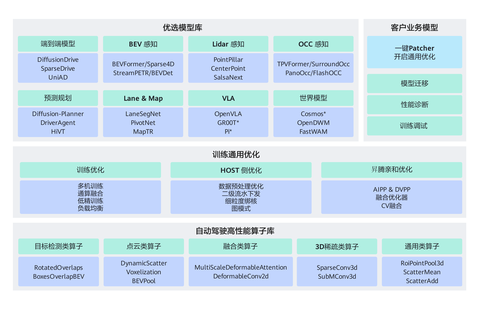

# Driving SDK介绍

## 概述

Driving SDK是基于昇腾AI集群系统开发的面向自动驾驶及具身智能领域的昇腾训练加速套件，提供高性能算子库、优选模型库，以及一键Patcher快速迁移工具。Driving SDK旨在为自动驾驶及具身智能行业客户和开发者提供基于昇腾算力的系统开发的底座能力。

## Driving SDK架构

Driving SDK架构关系如[图1](#架构图)所示，包含三大核心组件及训练通用优化能力：

- **优选模型库**

    将业界主流模型适配到昇腾NPU平台，覆盖自动驾驶与具身智能两大方向：
    - **自动驾驶**：覆盖端到端模型、BEV感知、预测规划、OCC感知、Lidar感知、Lane&Map、世界模型等领域，提供UniAD、SparseDrive、BEVFormer、MapTR、Cosmos等业界主流模型，支撑车辆在真实道路环境中的感知、预测与规划控制。
    - **具身智能**：覆盖VLA（Vision-Language-Action，视觉-语言-动作）与世界模型等方向，提供GR00T-N1.5/N1.6/N1.7、Pi-0.5、OpenVLA、StarVLA、Lingbot-vla、FastWAM等业界主流模型，支撑机器人在真实环境中的感知、推理与动作生成。

    部分模型经过深度优化后性能达到业界领先水平，支持在昇腾平台上快速复现和训练。详细模型清单及性能数据请参见[模型清单](../models/support_list.md)。

- **一键Patcher**

    针对客户自有模型，提供基于Monkey Patch机制的一键迁移框架，实现CUDA→NPU的零侵入迁移——无需修改原始源代码，通过运行时动态替换即可完成适配。围绕模型迁移与调优全流程，提供以下能力：
    - **模型迁移**：通过导入控制（skip_import/replace_import/inject_import）和预定义补丁，快速完成CUDA算子替换与第三方库适配，已内置mmcv、torch、numpy等常用库的NPU适配补丁，并支持自定义补丁扩展。
    - **性能诊断**：内置Profiling性能采集工具，支持多层级采集（NPU/NPU+CPU/NPU+CPU+调用栈），可精确控制采集的迭代区间。
    - **训练调试**：提供训练早停（Brake）等调试辅助功能，支持与Profiling组合使用，实现“采集完自动停止”。
    - **开启通用优化**：将通算融合、低精训练等训练通用优化手段应用到客户模型，充分释放昇腾硬件性能。

    详细使用方法和示例请参见[一键Patcher](../features/patcher.md)。

- **自动驾驶高性能算子库**

    提供覆盖通用、采样、体素化、检测、稀疏、融合等方向的高性能算子，包括BEVPool、SparseConv3d、DynamicScatter、MultiScaleDeformableAttention、ScatterMean等典型智驾算子，支撑模型在昇腾硬件上的高性能运行。算子支持<term>Atlas A2训练系列产品</term>、<term>Atlas A3训练系列产品</term>及 <term>Ascend 950PR&950DT系列产品</term>，详细算子清单请参见[API清单](../api/README.md)。

- **训练通用优化**

    模型迁移与调优过程中常用的优化策略集合，从训练策略、Host侧执行到昇腾亲和优化三个维度，提供多机训练、通算融合、低精训练、负载均衡、二级流水下发、细粒度绑核、图模式、数据预处理优化、融合优化器、CV融合、AIPP&DVPP等优化能力。这些优化手段已广泛应用于优选模型库的模型适配中，并可通过一键Patcher应用到客户自有模型。

**图1** Driving SDK架构图

