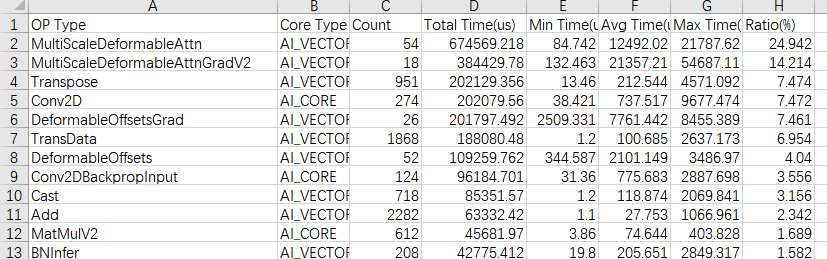

# 模型优化

本文档指导开发者对已迁移到昇腾NPU的自动驾驶模型进行性能优化。内容包括优化方法指导与一个端到端优化示例。

## 模型优化的三层路径

### 模型优化的意义

自动驾驶模型在迁移到昇腾NPU后，即便功能正确，性能仍可能明显低于预期。性能损耗通常来自三个层面：框架调度开销、单算子实现非最优、Host侧逻辑过重。模型优化就是逐层消除这些瓶颈、逼近硬件峰值性能的过程。

### 优化路径总览

模型优化按优化粒度由粗到细分为三层，建议按以下顺序实施，优先做成本低、收益大的改动：

| 层级 | 优化手段 | 针对瓶颈 | 实施成本 |
|------|----------|----------|----------|
| 框架级 | 环境变量优化、编译优化、高性能内存库替换 | Host调度开销高、编译/链接耗时久、内存分配性能不佳 | 低（配置即生效） |
| 算子级 | 融合优化器替换、融合算子替换 | 小算子下发过多、单算子耗时占比高 | 中（改代码，需验证精度） |
| 脚本级 | 计算向量化、NPU算子拼接、同步减少 | Host Bound | 中高（改脚本逻辑） |

[框架级优化](#基于torchnpu的框架级优化)、[算子级优化](#基于高性能算子的算子级优化)、[脚本级优化](#host-bound问题脚本级优化)分别介绍三层优化的具体方法，以BEVDet模型为例演示[模型端到端优化流程](#bevdet模型优化示例)。

## 基于TorchNPU的框架级优化

TorchNPU框架支持多种可提升性能的特性，包括环境变量配置、框架编译优化以及高性能内存库替换。这些手段多为配置级改动，成本最低，建议优先实施。

### 环境变量优化

以下环境变量用于消除Host侧的调度与分配开销。各变量的含义、解决瓶颈与使用建议如下：

| 环境变量配置 | 环境变量含义 | 解决瓶颈问题 | 取值 | 使用建议 |
|--------------|-----------|-----------|------|----------|
| `export TASK_QUEUE_ENABLE=2` | 将算子任务合并下发，减少Host调度次数 | Host调度开销高 | 0-关闭 / 1-Level 1优化 / 2-Level 2优化 | 训练场景建议从Level 2开始验证 |
| `export CPU_AFFINITY_CONF=1` | 将任务绑定到固定CPU核，减少CPU上下文切换与调度开销 | Host调度开销高 | 0-关闭 / 1-粗粒度绑核 / 2-细粒度绑核 | 多卡训练场景建议开启 |
| `export PYTORCH_NPU_ALLOC_CONF="expandable_segments:True"` | 启用内存池扩展段，按需创建内存块 | Host调度开销高 | `True` / `False` | 大模型训练场景建议开启 |
| `export COMBINED_ENABLE=1` | 将非连续的两个算子组合合并下发 | Host调度开销高 | 0-关闭 / 1-开启 | 存在相邻非连续算子组合时开启 |

### 编译优化

框架支持Python、PyTorch、TorchNPU的编译优化，可缩短编译链接耗时并降低内存占用。适合模型稳定、需频繁迭代运行的场景。

| 编译优化方式 | 参考链接 |
|--------------|---------|
| Python | [Python编译优化](https://www.hiascend.com/document/detail/zh/Pytorch/2610/devguide/fwfeatures/docs/zh/framework_feature_guide_pytorch/comp_opt_py.md) |
| PyTorch | [PyTorch编译优化](https://www.hiascend.com/document/detail/zh/Pytorch/2610/devguide/fwfeatures/docs/zh/framework_feature_guide_pytorch/pytorch_comp_opt.md) |
| TorchNPU | [TorchNPU编译优化](https://www.hiascend.com/document/detail/zh/Pytorch/2610/devguide/fwfeatures/docs/zh/framework_feature_guide_pytorch/torch_npu_comp_opt.md) |

### 高性能内存库替换

Python默认内存分配器在高并发、频繁小对象分配场景下性能不佳。tcmalloc（Thread-Caching Malloc）通过引入多层次缓存结构、减少互斥锁竞争、优化大对象处理流程，在保证低延迟的同时提升整体内存性能，适合需要频繁内存操作的训练场景。使用方式参考[高性能内存库替换](https://gitcode.com/Ascend/ModelZoo-PyTorch/blob/master/PyTorch/docs/zh/performance_tuning/performance_tuning_methods/scheduling_opt.md#高性能内存库替换)。

## 基于高性能算子的算子级优化

通过融合算子替换，可减少小算子下发次数、提升单算子执行效率。本章按“先优化器、再算子、后基于profiling定位”的顺序介绍。

### 替换融合优化器

模型训练每步都要多次更新参数。普通优化器每次参数更新下发一个算子，融合优化器将多次更新合并下发，显著减少小算子数量，从而提升训练性能。融合优化器详见[融合优化器](https://gitcode.com/Ascend/ModelZoo-PyTorch/blob/master/PyTorch/docs/zh/performance_tuning/performance_tuning_methods/npu_affinity_opt/fusion_optimizer.md)。

自驾模型通常使用AdamW优化器，替换方式如下：

| 优化器 | 样例源码 | 修改后代码 |
|--------------|-------|----------|
| AdamW | `optimizer = torch.optim.AdamW(model.parameters(), lr=args.lr)` | `optimizer = torch_npu.optim.NpuFusedAdamW(model.parameters(), lr=args.lr)` |

### 替换融合算子

Driving SDK仓提供了多种高性能融合算子，完整算子清单见[算子清单](../api/README.md)。自驾模型常用的融合算子及典型替换场景如下：

| 算子名 | 使用方式 | 典型替换场景 |
| ------| ---------| ------------|
| deform_conv2d | `from mx_driving import deform_conv2d, DeformConv2dFunction` | 可变形卷积计算 |
| npu_add_relu | `from mx_driving import npu_add_relu` | ResNet等backbone中`out += identity`与`out = self.relu(out)`的融合 |
| npu_max_pool2d | `from mx_driving import npu_max_pool2d` | 替换`nn.MaxPool2d`操作 |
| multi_scale_deformable_attn | `from mx_driving import multi_scale_deformable_attn` | 多尺度可变形注意力 |
| bev_pool_v3 | `from mx_driving import bev_pool_v3` | BEV Pooling |
| SparseConv3d | `from mx_driving import SparseConv3d` | 3D稀疏卷积 |
| SubMConv3d | `from mx_driving import SubMConv3d` | 子流形3D卷积 |

### 实战：基于profiling的算子替换

算子替换的前提是定位到真正耗时的算子，正确流程是：**先采集profiling，再分析耗时占比，最后针对性替换**。本节以BEVFormer模型为例演示。

1. **采集并分析算子耗时**

    运行profiling后查看算子耗时统计，找出正反向耗时占比高的算子。本例中`multi_scale_deformable_attn`算子正反向在模型中占比很高，因此需要替换为`mx_driving`的亲和算子以提升性能。

    

    > [!NOTE]
    >
    > - 算子使用位置为`projects/mmdet3d_plugin/bevformer/modules/decoder.py`
    > - 算子详细参数请参考[算子清单](../api/README.md)

2. **引入mx_driving**

    ```python
    import mx_driving
    ```

3. **将原始算子替换为mx_driving的亲和算子**

    找到`multi_scale_deformable_attn`算子使用的位置（325行），原始代码为：

    ```python
    if torch.cuda.is_available() and value.is_cuda:

        # using fp16 deformable attention is unstable because it performs many sum operations
        if value.dtype == torch.float16:
            MultiScaleDeformableAttnFunction = MultiScaleDeformableAttnFunction_fp32
        else:
            MultiScaleDeformableAttnFunction = MultiScaleDeformableAttnFunction_fp32
        output = MultiScaleDeformableAttnFunction.apply(
            value, spatial_shapes, level_start_index, sampling_locations,
            attention_weights, self.im2col_step)
    else:
        output = multi_scale_deformable_attn_pytorch(
            value, spatial_shapes, sampling_locations, attention_weights)
    ```

    替换为`mx_driving`仓中算子：

    ```python
        output = mx_driving.multi_scale_deformable_attn(value, spatial_shapes, level_start_index, sampling_locations, attention_weights)
    ```

    > [!NOTE]
    >
    > 替换融合算子后，需重新验证精度与性能。若精度不达标，可结合`/ascendc-precision-debug`定位。

## Host Bound问题脚本级优化

### Host Bound简介

**Host Bound**指算子执行时间远小于CPU侧下发与调度耗时，模型性能瓶颈位于Host侧。此时NPU大部分时间处于等待状态，性能不会因提升单算子效率而改善。

自驾模型尤其容易出现Host Bound，原因包括：

- **小算子下发多**：自动驾驶算法有大量slice、gather、sort等小算子；
- **CPU计算逻辑重**：检测算法的target assign、规控算法lovasz loss、groundtruth处理等涉及大量逻辑处理；
- **算子无NPU高性能替换**：部分计算只能在CPU上执行。

以下各节针对三类成因给出优化手段。

### 减少算子下发次数

小算子下发会占用大量Host时间。减少下发次数的主要方式是用等价的高粒度API替换循环逻辑。开源模型代码通常未经优化，规控模型决策模块及感知模型数据处理模块中常见大量for循环切片操作，可通过mask类API替换。

**典型场景：循环单点插值**

在车道线检测、多边形实例分割等任务中，目标由连续点序列构成，通过插值监督学习连续几何结构。例如Pivotnet的`interpolate`函数使用循环逐点计算插值，单Step调用90次，引入大量小算子及Free time。

原代码（循环单点计算）：

```python
@staticmethod
def interpolate(start_pt, end_pt, inter_num):
    res = torch.zeros((inter_num, 2), dtype=start_pt.dtype, device=start_pt.device)
    num_len = inter_num + 1 # segment num.
    for i in range(1, num_len):
        ratio = i / num_len
        res[i-1] = (1 - ratio) * start_pt + ratio * end_pt
    return res
```

向量化后（增大数据处理粒度，一次下发完成所有插值点计算）：

```python
@staticmethod
def interpolate(start_pt, end_pt, inter_num):
    ratios = torch.arange(1, inter_num + 1, dtype=start_pt.dtype, device=start_pt.device) / (inter_num + 1)
    ratios = ratios.view(-1, 1)
    return (1 - ratios) * start_pt + ratios * end_pt
```

### CPU计算转为NPU算子

规控模型规模小、整体端到端耗时短，因此若模型中存在CPU计算，会成为严重的性能瓶颈。当某个接口在昇腾上没有对应NPU算子时，会回退到原生torch的CPU实现，引入较长CPU计算时间，此时可通过同等小算子拼接替换。

**典型场景：logdet替换**

MultiPath++模型中调用了`torch.linalg.slogdet`评估预测轨迹与真实轨迹的差异，但`torch.nn.linalg`线性代数库在昇腾上没有对应的NPU算子，因此走了CPU计算。可替换为基于`torch.svd`的NPU小算子拼接：

原代码：

```python
def nll_with_covariances(gt, predictions, confidences, avails, covariance_matrices):
    precision_matrices = torch.inverse(covariance_matrices)
    gt = torch.unsqueeze(gt, 1)
    avails = avails[:, None, :, None]
    coordinates_delta = (gt - predictions).unsqueeze(-1)
    errors = coordinates_delta.permute(0, 1, 2, 4, 3) @ precision_matrices @ coordinates_delta
    errors = avails * (-0.5 * errors.squeeze(-1) - 0.5 * torch.logdet(covariance_matrices).unsqueeze(-1))
```

替换为：

```python
def custom_logdet(covariance_matrices):
    U, S, V = torch.svd(covariance_matrices)
    abs_det = torch.prod(S)
    return torch.log(abs_det)

def nll_with_covariances(gt, predictions, confidences, avails, covariance_matrices):
    precision_matrices = torch.inverse(covariance_matrices)
    gt = torch.unsqueeze(gt, 1)
    avails = avails[:, None, :, None]
    coordinates_delta = (gt - predictions).unsqueeze(-1)
    errors = coordinates_delta.permute(0, 1, 2, 4, 3) @ precision_matrices @ coordinates_delta
    errors = avails * (-0.5 * errors.squeeze(-1) - 0.5 * custom_logdet(covariance_matrices).unsqueeze(-1))
```

> [!NOTE]
>
> 使用SVD分解求行列式时，`U, S, V = torch.svd(...)`中的`U`、`V`在Python中无需实际使用，可按需求简化变量。若协方差矩阵存在非正定情况，可结合场景选择等价数学变换，并验证数值稳定性。

### 减少同步引起的流水等待

匈牙利匹配算法在目标检测、实例分割模型中有广泛应用，用于匹配预测与真实对象。Pivotnet中匈牙利算法的forward方法引入了大量`aclrtSynchronizeStream`，会打断模型流水。常见原因是代码调用了`aten::item`、`.npu()`、`.cpu()`等会触发同步的操作。

**典型场景：获取标量触发隐式同步**

以下代码根据`valid_lens`（每个样本的有效长度）生成掩码`gt_pts_mask`，其中有效长度内的位置为1、其余为0。其中获取`ll`会隐式调用`.item()`，打断流水：

```python
for i, ll in enumerate(targets[0]["valid_len"][cid]):
    gt_pts_mask[i][:ll] = 1
```

通过向量化脚本规避同步：

```python
valid_lens = torch.tensor(targets[0]["valid_len"][cid], device=gt_pts.device, dtype=torch.long)
row_indices = torch.arange(n_pt, device=gt_pts.device).expand(len(valid_lens), -1)
gt_pts_mask = (row_indices < valid_lens.unsqueeze(1)).to(dtype=torch.float32)
```

## BEVDet模型优化示例

本章以BEVDet模型为例，演示迁移完成后模型优化的实施流程。BEVDet是基于俯视图的3D目标检测模型，在自动驾驶、智能交通等领域应用广泛。模型迁移与依赖安装部分见[模型迁移](model_migration.md)。

### 模型与优化目标

BEVDet使用卷积神经网络和残差网络，训练过程中使用大量3D边界框数据。结合[框架级优化](#基于torchnpu的框架级优化)、[算子级优化](#基于高性能算子的算子级优化)、[脚本级优化](#host-bound问题脚本级优化)的优化方法，本示例应用的优化手段及其针对的瓶颈如下：

| 优化手段 | 对应方法 | 针对瓶颈 | 修改文件 |
| -------  | -------- | --------| --------|
| `export TASK_QUEUE_ENABLE=2`开启L2流水优化 | [环境变量优化](#环境变量优化) | Host调度开销高 | 环境变量配置 |
| `export CPU_AFFINITY_CONF=1`开启粗粒度绑核 | [环境变量优化](#环境变量优化) | Host调度开销高 | 环境变量配置 |
| `export COMBINED_ENABLE=1`优化非连续两个算子组合 | [环境变量优化](#环境变量优化) | Host调度开销高 | 环境变量配置 |
| 替换NpuFusedAdamW融合优化器 | [替换融合优化器](#替换融合优化器) | 小算子下发过多 | `configs/bevdet/bevdet-r50.py` |
| 替换npu_gaussian融合算子 | [替换融合算子](#替换融合算子) | 小算子下发过多 | `mmdet3d/models/dense_heads/centerpoint_head.py` |
| 替换bev_pool_v3融合算子 | [替换融合算子](#替换融合算子) | 单算子耗时占比高 | `mmdet3d/models/necks/view_transformer.py` |

### 迁移与依赖准备（前置）

本示例假设BEVDet模型已完成迁移适配并通过传统手动方式在昇腾NPU上正常运行，所需依赖也已安装完成。迁移与依赖安装的完整步骤见[模型迁移](model_migration.md)的[传统迁移：手动代码替换](model_migration.md#传统迁移手动代码替换)章节。

> [!NOTE]
>
> 本章优化手段均在迁移完成后的代码基础上实施。若模型尚未迁移，请先完成[模型迁移](model_migration.md)。

### 性能优化

迁移适配完成后，按[算子级优化](#基于高性能算子的算子级优化)方法进行性能优化。本节共三步，分别对应融合优化器与融合算子替换。

1. **替换融合优化器**

    在`configs/bevdet/bevdet-r50.py`中，原始代码为：

    ```python
    optimizer = dict(type='AdamW', lr=2e-4, weight_decay=1e-07)
    ```

    改为：

    ```python
    optimizer = dict(type='NpuFusedAdamW', lr=2e-4, weight_decay=1e-07)
    ```

2. **替换bev_pool_v3融合算子**

    `bev_pool_v3`已在[模型迁移](model_migration.md)的[迁移适配](model_migration.md#迁移适配)中完成替换。该替换同时带来性能收益：相比CUDA版`bev_pool_v2`，NPU亲和的`bev_pool_v3`无需排序算法，且要求通道数可被8整除，减少了小算子下发。

3. **替换npu_gaussian融合算子**

    在`mmdet3d/models/dense_heads/centerpoint_head.py`中添加引用：

    ```python
    from mx_driving import npu_gaussian
    ```

    替换`get_targets_single`函数，减少很多小算子下发，提高计算效率：

    ```python
    def get_targets_single(self, gt_bboxes_3d, gt_labels_3d):
        """Generate training targets for a single sample.

        Args:
            gt_bboxes_3d (:obj:`LiDARInstance3DBoxes`): Ground truth gt boxes.
            gt_labels_3d (torch.Tensor): Labels of boxes.

        Returns:
            tuple[list[torch.Tensor]]: Tuple of target including
                the following results in order.

                - list[torch.Tensor]: Heatmap scores.
                - list[torch.Tensor]: Ground truth boxes.
                - list[torch.Tensor]: Indexes indicating the position
                    of the valid boxes.
                - list[torch.Tensor]: Masks indicating which boxes
                    are valid.
        """
        device = gt_labels_3d.device
        gt_bboxes_3d = torch.cat(
            (gt_bboxes_3d.gravity_center, gt_bboxes_3d.tensor[:, 3:]),
            dim=1).to(device)
        max_objs = self.train_cfg['max_objs'] * self.train_cfg['dense_reg']
        grid_size = torch.tensor(self.train_cfg['grid_size'])
        pc_range = torch.tensor(self.train_cfg['point_cloud_range'])
        voxel_size = torch.tensor(self.train_cfg['voxel_size'])

        feature_map_size = grid_size[:2] // self.train_cfg['out_size_factor']

        # reorganize the gt_dict by tasks
        task_masks = []
        flag = 0
        for class_name in self.class_names:
            task_masks.append([
                torch.where(gt_labels_3d == class_name.index(i) + flag)
                for i in class_name
            ])
            flag += len(class_name)

        task_boxes = []
        task_classes = []
        flag2 = 0
        for idx, mask in enumerate(task_masks):
            task_box = []
            task_class = []
            for m in mask:
                task_box.append(gt_bboxes_3d[m])
                # 0 is background for each task, so we need to add 1 here.
                task_class.append(gt_labels_3d[m] + 1 - flag2)
            task_boxes.append(torch.cat(task_box, axis=0).to(device))
            task_classes.append(torch.cat(task_class).long().to(device))
            flag2 += len(mask)
        draw_gaussian = draw_heatmap_gaussian
        heatmaps, anno_boxes, inds, masks = [], [], [], []

        for idx, task_head in enumerate(self.task_heads):
            heatmap = gt_bboxes_3d.new_zeros(
                (len(self.class_names[idx]), feature_map_size[1],
                feature_map_size[0]))

            if self.with_velocity:
                anno_box = gt_bboxes_3d.new_zeros((max_objs, 10),
                                                dtype=torch.float32)
            else:
                anno_box = gt_bboxes_3d.new_zeros((max_objs, 8),
                                                dtype=torch.float32)

            ind = gt_labels_3d.new_zeros((max_objs), dtype=torch.int64)
            mask = gt_bboxes_3d.new_zeros((max_objs), dtype=torch.uint8)

            num_objs = min(task_boxes[idx].shape[0], max_objs)

            temp_classes = task_classes[idx]
            temp_boxes = task_boxes[idx]
            center_int, radius, mask, ind, anno_box = npu_gaussian(temp_boxes,
                                                                self.train_cfg['out_size_factor'],
                                                                self.train_cfg['gaussian_overlap'],
                                                                self.train_cfg['min_radius'],
                                                                voxel_size[0],
                                                                voxel_size[1],
                                                                pc_range[0],
                                                                pc_range[1],
                                                                feature_map_size[0],
                                                                feature_map_size[1],
                                                                self.norm_bbox,
                                                                self.with_velocity)
            for k in range(num_objs):
                cls_id = temp_classes[k] - 1

                width = temp_boxes[k][3]
                length = temp_boxes[k][4]
                width = width / voxel_size[0] / self.train_cfg[
                    'out_size_factor']
                length = length / voxel_size[1] / self.train_cfg[
                    'out_size_factor']

                if width > 0 and length > 0:
                    draw_gaussian(heatmap[cls_id], center_int[k], radius[k].item())
            heatmaps.append(heatmap)
            anno_boxes.append(anno_box)
            masks.append(mask)
            inds.append(ind)

        return heatmaps, anno_boxes, inds, masks
    ```

## 优化效果与下一步

完成[性能优化](#性能优化)的三项算子级优化后，BEVDet模型的算子下发量显著减少，训练性能得到提升。

> [!NOTE]
>
> 实际优化效果与模型、数据规模相关。建议完成优化后：
>
> 1. 重新采集profiling，确认原瓶颈算子耗时是否下降，并排查是否出现新的热点；
> 2. 校验精度，确保融合算子替换未引入精度损失；
> 3. 若仍存在性能瓶颈，参考[脚本级优化](#host-bound问题脚本级优化)手段，重点排查Host Bound类问题。
