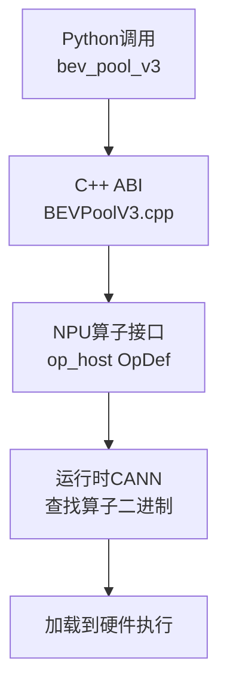

# 自动驾驶算子开发指导

本文档面向首次接触AscendC算子开发的开发者，以自动驾驶典型算子`bev_pool_v3`（BEV Pooling）为例，演示如何将一个Python参考实现逐步移植为可在昇腾NPU上运行的自定义算子。

## 概述

### 为何选用bev_pool_v3

在自动驾驶感知模型中，一个高频操作是将多视角相机的图像特征投射到鸟瞰图（Bird's Eye View，BEV）空间，这一过程称为**BEV Pooling**。`bev_pool_v3`即为此类算子，它是自动驾驶模型区别于通用视觉模型的一类典型算子。

与常规的矩阵/卷积类算子相比，`bev_pool_v3`具有三个显著特性，理解它们有助于把本文的方法复用到其他自驾算子：

| 特性 | 说明 | 对开发的影响 |
|------|------|--------------|
| **索引驱动** | 计算位置不按规整shape遍历，而是通过`ranks_depth`、`ranks_feat`、`ranks_bev`三个索引数组决定每次取数的来源与去向，属于gather/accumulate型访问 | 无法直接按张量维度切分，需要围绕索引做任务划分 |
| **非规整累加** | 多个索引可能指向同一个BEV位置，累加目标存在重叠 | 写回时必须使用原子加（`SetAtomicAdd`）保证正确性 |
| **对齐约束** | 索引数据与计算量需按SIMD指令宽度对齐，且算子前提是通道数可被8整除 | 涉及数据搬运与偏移计算时的对齐处理 |

> [!NOTE]
>
> 本文选择`bev_pool_v3`的另一原因是其实现链路完整覆盖自定义算子的全部环节，且计算逻辑足够简单，便于聚焦开发流程本身。

### 全链路视图：算子从Python到NPU

执行一个NPU算子时，调用链依次经过以下层次：



| 模块 | 代码位置 | 职责 |
|----|----------|------|
| Python API | `mx_driving/ops/bev_pool_v3.py` | 面向用户的算子入口，负责入参组织与输出shape变换 |
| C++ ABI | `mx_driving/csrc/BEVPoolV3.cpp`及pybind绑定 | 承接Python调用，桥接底层算子库 |
| 算子接口 | `kernels/bev_pool_v3/op_host/bev_pool_v3.cpp` | 向运行时声明算子的输入输出规格、格式与支持的平台 |
| Tiling | `kernels/bev_pool_v3/op_host/bev_pool_v3.cpp`<br>`kernels/bev_pool_v3/op_host/bev_pool_v3_Tiling.h` | 划分计算任务，决定启动核数与临时内存 |
| Kernel | `kernels/bev_pool_v3/op_kernel/bev_pool_v3.cpp` | 核内实际计算逻辑 |

### 开发路线图

本文的开发路线图分为四个阶段，按“由浅入深”的顺序进行，首先基于Torch参考实现说明算子逻辑，然后介绍如何适配调用接口，在理解算子逻辑、适配调用接口的基础上，逐步介绍如何开发AscendC核函数，最后将调用接口与核函数之间的链路打通，实现完整的算子开发流程。

| 阶段 | 章节 | 目标 |
|------|------|------|
| 理解算子逻辑 | [理解算子逻辑](#基于torch参考实现理解算子逻辑) | 用Torch实现参考算子，理解计算逻辑 |
| 适配调用接口 | [适配调用接口](#适配调用接口) | 搭建Python → C++调用链，先跑通全0占位实现 |
| 开发核函数 | [开发核函数](#开发核函数) | 定义算子接口、设计Tiling、实现核函数 |
| 打通适配与核函数链路 | [打通适配与核函数链路](#打通适配与核函数链路) | 编写胶水代码，打通Python到核函数 |

## 基于Torch参考实现理解算子逻辑

在编写AscendC代码之前，先用PyTorch实现参考版本，以精确理解计算逻辑，并为后续调试提供对照基准。

### 算子输入输出规格

`bev_pool_v3`的输入输出如下：

| 名称 | 类型 | Shape | 描述 |
| --- | --- | --- | --- |
| `depth` | `Tensor` | `[B, N, D, H, W]` | 输入，深度图 |
| `feat` | `Tensor` | `[B, N, H, W, C]` | 输入，特征图 |
| `ranks_depth` | `Tensor` | `[N_RANKS]` | 输入，深度图索引 |
| `ranks_feat` | `Tensor` | `[N_RANKS]` | 输入，特征图索引 |
| `ranks_bev` | `Tensor` | `[N_RANKS]` | 输入，BEV索引 |
| `bev_feat_shape` | `List[int]` | `5` | 输入，BEV特征图形状（B, D, H, W, C） |
| `out` | `Tensor` | `[B, C, D, H, W]` | 输出，BEV特征图 |

其中`N_RANKS`为投影点总数，即需要执行的累加次数。

### 参考实现与计算模式分析

`bev_pool_v3`的计算逻辑为：每次从深度图中取一个深度值，在特征图中找到对应特征，两者相乘后累加到BEV特征图的对应位置，共执行`N_RANKS`次。参考实现如下：

```python
import torch

B, N, D, H, W = 2, 3, 4, 5, 6
N_RANKS = 7
C = 8
depth = torch.rand([B, N, D, H, W])
feat = torch.rand([B, N, H, W, C])
ranks_depth = torch.randint(0, B * N * D * H * W, [N_RANKS])
ranks_feat = torch.randint(0, B * N * H * W, [N_RANKS])
ranks_bev = torch.randint(0, B, [N_RANKS])
bev_feat_shape = [B, D, H, W, C]

def bev_pool_v3(depth, feat, ranks_depth, ranks_feat, ranks_bev, bev_feat_shape):
    B, D, H, W, C = bev_feat_shape
    depth = depth.view([B * N * D * H * W])
    feat = feat.view([B * N * H * W, C])
    out = torch.zeros([B, D, H, W, C])
    for i in range(N_RANKS):
        d = depth[ranks_depth[i]]
        f = feat[ranks_feat[i]]
        b = ranks_bev[i]
        out[b] += d * f
```

### 特殊性：索引驱动与非规整累加

从参考实现可以看出，该算子的计算核心是一个for循环，每次迭代独立完成一次“取数 → 相乘 → 累加”。这与常规算子有两个本质差异：

1. **数据访问由索引驱动**：`ranks_depth[i]`、`ranks_feat[i]`、`ranks_bev[i]`决定了每次迭代访问的`depth`、`feat`元素以及累加目标位置，数据在内存中并非按顺序连续访问。
2. **累加目标存在重叠**：不同的`i`可能对应相同的`ranks_bev[i]`，即多个投影点累加到同一BEV位置，因此多核并行时写回操作必须保证原子性。

这两个特性将直接影响[计算任务划分](#计算任务划分tiling设计)与[核函数实现](#核函数实现kernel)的设计。

## 适配调用接口

本阶段完成算子从Python到C++的调用接口适配，包括算子的接口声明、Python调用接口实现和C++调用接口实现。

### C++ ABI声明

在设计Python的调用接口之前，首先需要完成三处声明，使Python侧能识别`npu_bev_pool_v3`。

1. 在`mx_driving/_C/__init__.pyi`中声明类型签名（可选但推荐），若需查看源代码，请参见[bev_pool_v3声明类型签名](../../../mx_driving/_C/__init__.pyi)：

    ```python
    def npu_bev_pool_v3(
        depth: torch.Tensor,
        feat: torch.Tensor,
        ranks_depth: torch.Tensor,
        ranks_feat: torch.Tensor,
        ranks_bev: torch.Tensor,
        B: int,
        D: int,
        H: int,
        W: int,
    ) -> torch.Tensor:...
    ```

    > [!NOTE]
    >
    > 此步骤可选。声明`.pyi`可为Python开发提供类型提示与代码补全，提升开发体验。

2. 在`include/csrc/functions.h`中声明函数原型，若需查看源代码，请参见[bev_pool_v3声明函数原型](../../../include/csrc/functions.h)：

    ```cpp
    at::Tensor npu_bev_pool_v3(const at::Tensor& depth, const at::Tensor& feat, const at::Tensor& ranks_depth,
        const at::Tensor& ranks_feat, const at::Tensor& ranks_bev, int64_t b, int64_t d, int64_t h, int64_t w);
    ```

3. 在`mx_driving/csrc/pybind.cpp`中完成Python绑定，若需查看源代码，请参见[bev_pool_v3绑定Python调用接口](../../../mx_driving/csrc/pybind.cpp)：

    ```cpp
    m.def("npu_bev_pool_v3", &npu_bev_pool_v3);
    ```

### Python API

新建`mx_driving/ops/bev_pool_v3.py`，定义面向用户的算子入口，具体代码请参见[bev_pool_v3算子入口](../../../mx_driving/ops/bev_pool_v3.py)。

> [!NOTE]
>
> `bev_pool_v3`的Python API中将转置逻辑（`permute`）放在`bev_pool_v3`函数而非`forward`中，这样在实现backward时无需再手动转置梯度，可降低实现复杂度。

`forward`调用`mx_driving._C.npu_bev_pool_v3`，该符号在[C++ ABI声明](#c-abi声明)中声明。

### C++ ABI实现（占位版）

新建`mx_driving/csrc/BEVPoolV3.cpp`，先实现一个返回全0的占位函数，以验证Python → C++调用链已经打通，具体代码请参见[bev_pool_v3算子C++接口](../../../mx_driving/csrc/BEVPool.cpp)。

执行`python setup.py develop`后，即可在Python中调用`bev_pool_v3`，但此时算子尚未实现任何计算。后续在[开发核函数](#开发核函数)阶段将逐步完善其功能。

> [!NOTICE]
>
> “先占位、后完善”是算子开发中常用的迭代方法：先用最小实现打通整条调用链，再逐层填充真实逻辑，便于隔离问题。

## 开发核函数

本阶段在NPU侧完成算子定义、计算任务划分与核函数实现。

### 定义NPU算子接口

`depth`、`feat`等输入最终需要在NPU上执行。为此，需要向运行时声明算子的输入输出规格，使运行时能够找到算子二进制、配置并下发计算任务。

新建`kernels/bev_pool_v3/op_host/bev_pool_v3.cpp`，定义算子接口，具体代码请参见[bev_pool_v3算子原型声明](../../../kernels/bev_pool_v3/op_host/bev_pool_v3.cpp)。代码声明了各输入输出的数据类型、格式、是否自动连续等规格，以及支持的硬件平台。

> [!NOTICE]
>
> 算子原型声明代码中，`AddConfig("ascendxxxx")`中的`ascendxxxx`为平台占位符。实际开发时需替换为真实平台名（例如`ascend910b`），否则算子无法在目标平台注册。可参考SDK内其他算子的写法确认合法取值。

### 计算任务划分（Tiling设计）

- 两种划分思维模式

    参考实现的计算核心是一个for循环。将其迁移到多核NPU时，需要把这段循环划分成多个计算任务，分发到多个核心并行执行。划分有两种思维模式：

    | 模式 | 划分思路 | 任务块形态 | 适用场景 |
    |------|----------|------------|----------|
    | **自顶而下** | 先将整个计算过程划分为多个大任务（每核1个），再把每个任务划分为多个子任务在核内顺序执行 | 可能出现3种大小的任务：ta（每核平均任务）、tb（每核尾块）、tc（尾核尾块） | 数据量很大、单核缓存无法容纳单个任务 |
    | **自底而上** | 先将整个计算过程划分为多个小任务（子任务），再将子任务分配到多个核心并行执行 | 可能出现2种大小的任务：ta（每核平均任务）、tb（尾核尾块） | 计算过程天然可拆分为独立小任务 |

    自顶而下的划分示意：

    ```shell
                            |                |                |
            +------+------+--|------+------+--|------+------+--+---+
            | ta   |      |tb|      |      |  |      |      |  | tc|
            +------+------+--|------+------+--|------+------+--+---+
                core0     |      core1     |      ...       |core39
    ```

    自底而上的划分示意：

    ```shell
                                |                    |                    |
            +------+------+------|------+------+------|------+------+------|--+
            |  ta  |      |      |      |      |      |      |      |      |tb|
            +------+------+------|------+------+------|------+------+------|--+
                    core0       |         core1      |         ...        |core39
    ```

- 选型依据

    `bev_pool_v3`采用**自底而上**的划分方式，原因有三：

    1. 计算过程是一个for循环，每次循环天然是一个独立子任务，无需二次拆分；
    2. 各子任务相互独立，可直接分发到多个核心并行执行；
    3. 只需对最后一个子任务（尾任务块）做特殊处理，任务划分逻辑简单。

- Tiling数据结构定义

    硬件如何感知任务划分？需要借助额外的数据结构`Tiling`将划分信息传递给硬件。在`kernels/bev_pool_v3/op_host/`下新建`bev_pool_v3_Tiling.h`，具体代码请参见[bev_pool_v3算子Tiling数据结构定义](../../../kernels/bev_pool_v3/op_host/bev_pool_v3_tiling.h)。

    代码中各字段的参考含义如下：

    | 字段 | 类型 | 含义 |
    |------|------|------|
    | `usedCoreNum` | `int32_t` | 参与计算的核心数量 |
    | `totalTaskNum` | `int32_t` | 任务块总数 |
    | `avgTaskNum` | `int32_t` | 每个核心的平均任务块数（ta的数量） |
    | `tailTaskNum` | `int32_t` | 尾核的任务块数 |
    | `avgRankNum` | `int32_t` | 每个任务块的平均rank数（ta的大小） |
    | `tailRankNum` | `int32_t` | 尾任务块的rank数（tb的大小） |
    | `channel` | `int32_t` | 特征通道数 |

- 尾块处理

    由于总任务数不一定能被核数整除，会出现尾块（tb）。处理原则是：**让前`tailTaskNum`个核心多处理一个任务块**，从而在保证负载均衡（各核计算量基本一致）的同时，使每个核处理的数据在内存中连续。该逻辑在[核函数实现](#核函数实现kernel)的`InitTask`中落地。

### Tiling函数实现

- Tiling函数的职责

    Tiling函数在host侧运行，承担三项职责：

    1. 将输入的shape信息、属性值或核函数运行所需的必要信息传入设备；
    2. 决定启动的设备核心数量；
    3. 分配核函数执行所需的临时内存。

    在`kernels/bev_pool_v3/op_host/bev_pool_v3.cpp`（即[定义NPU算子接口](#定义npu算子接口)中定义的算子所在文件）中增加`TilingForBEVPoolV3`函数，该函数的主要功能为：接收运行时上下文，根据输入和平台配置，完成三个任务：计算核心数量、计算任务块数与偏移、分配临时内存。具体代码请参见[bev_pool_v3算子Tiling函数](../../../kernels/bev_pool_v3/op_host/bev_pool_v3.cpp)。

### 核函数实现（Kernel）

1. 计算图与内存生命周期

    在编写核内代码前，先画出单个计算任务的计算图，明确数据流向：

    ```mermaid
    flowchart LR
        A[计算开始] --> B(搬入rankNum大小的ranksDepth, ranksFeat, ranksBev)
        B --> C[计算ranksFeat, ranksBev]
        C --> H{i >= rankNum}
        H --> |yes| D[计算结束]
        H --> |no| E(搬入depth, feat)
        E --> F(计算out = depth * feat)
        F --> G(开启原子加,搬出out)
        G --> D
    ```

    从计算图可得出涉及的内存及其生命周期：

    | 内存 | 角色 | 搬入内容 | 生命周期 |
    |------|------|----------|----------|
    | `ranksDepth`、`ranksFeat`、`ranksBev` | 输入 | 每个核心搬入`rankNum`大小的索引数据 | 整个计算过程 |
    | `depth`、`feat` | 输入 | 每个核心按需搬入 | for循环内：搬运开始 → 计算结束 |
    | `out` | 输出 | 每个核心计算得到 | for循环内：计算开始 → 搬运结束 |

    在AscendC中，使用`TQue`进行指令流水线的同步与内存分配。**生命周期一致的内存应放入同一个`TQue`**，以减少内存分配/释放次数与事件资源消耗。在分配内存之前，需要先获取Tiling信息。

2. 获取Tiling信息与Kernel类

    新建`kernels/bev_pool_v3/op_kernel/bev_pool_v3.cpp`，添加函数入口`bev_pool_v3`，具体代码请参见[bev_pool_v3核函数入口](../../../kernels/bev_pool_v3/op_kernel/bev_pool_v3.cpp)。

    > [!NOTE]
    >
    > 在[计算任务划分](#计算任务划分tiling设计)章节的“Tiling数据结构定义”步骤中，已经完成了Tiling结构体定义。编译器会根据Tiling结构体自动生成`GET_TILING_DATA`宏，用于在核内获取Tiling信息。`bevPoolTiling`即该节定义的`BEVPoolV3TilingData`实例。

    为便于维护，将计算逻辑封装为kernel类。该类接收Tiling信息，负责执行计算任务、读取输入、计算输出并写回。具体代码请参见[bev_pool_v3计算逻辑](../../../kernels/bev_pool_v3/op_kernel/bev_pool_v3.cpp)。

    代码中的成员含义如下表所示：

    | 成员 | 说明 |
    |------|------|
    | `pipe_` | 管理单个计算流所需资源的`TPipe` |
    | `blkIdx_` | 当前计算核的索引 |
    | `depthGm_`、`featGm_`、`outGm_`等 | `GlobalTensor`，管理全局内存中的输入输出 |
    | `ranksQue_`、`inQue_`、`outQue_` | `TQue`，管理输入输出队列 |
    | `taskStartIdx_`、`taskEndIdx_`等 | 计算任务划分相关变量 |

3. 初始化：任务、偏移、内存

    初始化过程包含两个步骤，分别完成任务范围与内存偏移量的计算。

    1. **初始化任务**，决定内存分配大小与计算起止位置，具体代码请参见[bev_pool_v3核函数](../../../kernels/bev_pool_v3/op_kernel/bev_pool_v3.cpp)的`InitTask`函数部分。

        > [!NOTE]
        >
        > 让`blkIdx_`小于`tailTaskNum`的核心多处理一个任务块，可保证各核计算量基本一致，且每个核处理的数据在内存中连续。

    2. **初始化偏移量**，用于在`LocalTensor`中定位各索引数据，避免在核内做大量标量运算（计算设备不擅长处理大量标量数据），具体代码请参见[bev_pool_v3核函数](../../../kernels/bev_pool_v3/op_kernel/bev_pool_v3.cpp)的`InitOffset`函数部分。

4. 偏移与SIMD对齐

    `B32_DATA_NUM_PER_BLOCK`表示每个block的数据量。NPU计算采用SIMD指令，因此数据量需对齐到该常量的倍数，以提高计算效率。上文对`rankSize_`以及后续计算量`rankNum`的对齐处理均基于此约束。

5. 初始化输入输出与缓冲区

    初始化部分的具体代码请参见[bev_pool_v3核函数](../../../kernels/bev_pool_v3/op_kernel/bev_pool_v3.cpp)的`InitGM`和`InitBuffer`函数部分。这里涉及两个概念：

    - **`GlobalTensor`**：管理全局内存（GM）中的输入输出。
    - **`LocalTensor`**：管理计算过程中的片上临时内存（UB）。

    `LocalTensor`在计算时由`TQue`分配，`InitBuffer`负责初始化各队列的内存大小：`ranksQue_`分配3个`rankSize_`大小的`int32_t`内存（存放三个索引数组），`inQue_`分配2个`(B32_DATA_NUM_PER_BLOCK + channel_)`大小的`int32_t`内存，`outQue_`分配2个`channel_`大小的`float`内存。各处大小均对齐到SIMD指令的倍数。

6. 单任务计算逻辑

    从计算图可以看出，单任务的计算分为两部分：for循环前与for循环内。

    **for循环前**：先搬运`ranksDepth`、`ranksFeat`、`ranksBev`三个索引数组，据此才能确定循环内输入输出的真实偏移量。若将该环节放入循环内、每点只搬一个索引，会导致三个问题：内存频繁读写、指令流水线阻塞、无法利用SIMD并行计算。

    用`ProcessSingle`函数实现单个任务的计算，接收任务id `taskIdx`与计算量`actualRankNum`。该段代码先用`AllocTensor`分配`LocalTensor`，将三个索引数组从`GlobalTensor`搬入，再`EnQue`入队；出队后用`Muls`（SIMD逐元素相乘指令）预计算`rankFeat`、`rankBev`乘以`channel_`，用于将一维索引换算为特征图内的字节偏移。

    > [!NOTICE]
    >
    > `Muls`的三个操作数`rankDepth`、`rankFeat`、`rankBev`在内存上的偏移量，以及计算量`rankNum`，都必须对齐到`B32_DATA_NUM_PER_BLOCK`的倍数。
    > `EnQue`/`DeQue`、`AllocTensor`/`FreeTensor`必须成对使用，否则会导致精度异常或卡死。

    **for循环内**：每次迭代取三个索引的标量值，完成一次取数、相乘、累加；循环内采用AscendC编程中常用的三段式（详见[核函数实现](#核函数实现kernel)的第7步）。`rd`、`rf`、`rb`为标量数据，可直接从`LocalTensor`读写，无需再次搬运。循环结束后释放`LocalTensor`。具体代码请参见[bev_pool_v3核函数](../../../kernels/bev_pool_v3/op_kernel/bev_pool_v3.cpp)的`ProcessSingle`函数部分。

7. 三段式流水

    三段式对应三级流水线的计算模式：

    | 阶段 | 流水 | 职责 |
    |------|------|------|
    | `CopyIn` | PIPE_MTE2 | 搬运数据 |
    | `Compute` | PIPE_V | 向量计算 |
    | `CopyOut` | PIPE_MTE3 | 写回数据 |

    各阶段（在无数据依赖时）相互独立、可并行执行。将三个阶段封装为独立函数，并通过队列进行通信与同步。具体代码请参见[bev_pool_v3核函数](../../../kernels/bev_pool_v3/op_kernel/bev_pool_v3.cpp)的`BEVPoolV3Kernel::CopyIn`、`BEVPoolV3Kernel::Compute`和`BEVPoolV3Kernel::CopyOut`函数部分。

    > [!NOTE]
    >
    > `CopyOut`中使用`SetAtomicAdd`/`SetAtomicNone`API，用于在写回时开启/关闭原子加。这是[特殊性：索引驱动与非规整累加](#特殊性索引驱动与非规整累加)中所述“非规整累加”特性在实现层面的体现：多个核可能累加到同一BEV位置，必须保证写回原子性。

8. 整体流程与尾块分发

    将整个计算过程封装到`Process`函数中。基于自底而上的划分方式，各任务块除尾块外计算量一致，因此只需对尾任务块做特殊处理，具体代码请参见[bev_pool_v3核函数](../../../kernels/bev_pool_v3/op_kernel/bev_pool_v3.cpp)的`BEVPoolV3Kernel::Process`函数部分。

    > [!NOTE]
    >
    > 尾块分支在运行中只会命中一次，使用`unlikely`提示编译器优化分支预测，可提升计算效率。

## 打通适配与核函数链路

核函数已实现，还需编写胶水代码将核函数与Python算子连接起来，完成输入输出转换并触发调用。这部分已被框架封装，在`mx_driving/point/ops/csrc/BEVPoolV3.cpp`中调用宏函数即可：

```cpp
EXEC_NPU_CMD(aclnnBEVPoolV3, depth, feat, ranks_depth, ranks_feat, ranks_bev, out);
```

其中：

- `aclnnBEVPoolV3`由[定义NPU算子接口](#定义npu算子接口)中`kernels/bev_pool_v3/op_host/bev_pool_v3.cpp`定义的`class BEVPoolV3 : public OpDef`自动生成，即以`aclnn`为前缀的算子名。
- `depth, feat, ranks_depth, ranks_feat, ranks_bev, out`需严格按照`BEVPoolV3`算子的输入输出顺序传入；若存在属性，则按“输入、属性、输出”的顺序传入。

至此，`bev_pool_v3`算子已完成从Python到核函数的全链路实现，可在Python中正常调用。

## 总结与自驾算子开发要点

本文以`bev_pool_v3`为例，完整演示了从Torch参考实现到AscendC算子的开发流程：理解算子逻辑 → 适配调用接口 → 定义算子接口 → 设计Tiling → 实现核函数 → 打通适配与核函数链路。

将方法复用到其他自驾算子时，可对照以下要点：

| 环节 | 自驾算子的典型考量 |
|------|--------------------|
| 计算逻辑分析 | 识别算子是规整张量运算，还是索引驱动（gather/scatter）型运算 |
| 任务划分 | 数据量是否超大（自顶而下）还是天然可分（自底而上） |
| 写回正确性 | 是否存在非规整累加，需要原子加 |
| 对齐处理 | 索引与计算量是否按SIMD宽度对齐，通道数是否满足约束 |
| 迭代验证 | 先占位跑通链路，再逐步填充真实逻辑，便于隔离问题 |

## 附录A：概念速查表

| 概念 | 说明 | 首次出现 |
|------|------|----------|
| Tiling | 描述计算任务划分信息的数据结构，在host侧计算并传递给核函数 | [计算任务划分](#计算任务划分tiling设计) |
| Tiling函数 | host侧函数，决定核数、任务划分与临时内存 | [Tiling函数实现](#tiling函数实现) |
| GlobalTensor | 管理全局内存（GM）中输入输出的张量句柄 | [核函数实现](#核函数实现kernel) |
| LocalTensor | 管理片上临时内存（UB）的张量句柄 | [核函数实现](#核函数实现kernel) |
| TQue | AscendC队列，负责指令流水线同步与片上内存分配 | [核函数实现](#核函数实现kernel) |
| 三段式 | CopyIn（MTE2）→ Compute（V）→ CopyOut（MTE3）的流水模式 | [核函数实现](#核函数实现kernel) |
| `SetAtomicAdd` | 开启写回原子加的接口，用于非规整累加场景 | [核函数实现](#核函数实现kernel) |

## 附录B：全链路文件清单

| 文件 | 归属层 | 作用 |
|------|--------|------|
| `mx_driving/ops/bev_pool_v3.py` | Python API | 算子用户入口 |
| `mx_driving/_C/__init__.pyi` | C++ ABI | 类型签名（可选） |
| `include/csrc/functions.h` | C++ ABI | 函数原型声明 |
| `mx_driving/csrc/pybind.cpp` | C++ ABI | Python绑定 |
| `mx_driving/csrc/BEVPoolV3.cpp` | C++ ABI | 算子实现+胶水代码 |
| `kernels/bev_pool_v3/op_host/bev_pool_v3.cpp` | 算子接口+ Tiling | OpDef定义+ Tiling函数 |
| `kernels/bev_pool_v3/op_host/bev_pool_v3.h` | Tiling | Tiling数据结构定义 |
| `kernels/bev_pool_v3/op_kernel/bev_pool_v3.cpp` | Kernel | 核函数实现 |
